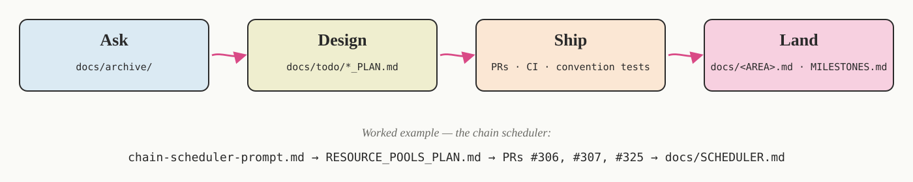

#  Cecelia Feijoa

[](https://github.com/schienstockd/cecelia/actions/workflows/ci.yml)
[](https://github.com/schienstockd/cecelia/actions/workflows/release.yml)
[](LICENSE)

A Julia package with a graphical interface for cellular image cytometry — import, segmentation,
tracking, gating, behavioural analysis, and clustering of multiplexed and live-cell microscopy
data. It is a ground-up reimplementation of the original R/Shiny
[cecelia](https://github.com/schienstockd/cecelia-legacy) in a Julia + Python + Vue stack.

> **This software was written almost entirely by AI.** Cecelia Feijoa's code was written by
> [Claude Code](https://claude.com/claude-code) under Dominik's direction, and validated on real
> intravital microscopy data. It has not yet been independently tested by other users. How the
> workflow works, per-subsystem validation, and sources:
> [How this software was built](#how-this-software-was-built).

- **New to Cecelia:** [`user-docs/`](user-docs/README.md) — what each part is for and what you need on day one
- **Developer setup:** [`docs/INSTALL.md`](docs/INSTALL.md) · **Architecture:** [`docs/ARCHITECTURE.md`](docs/ARCHITECTURE.md) · **FAQ (why it's built this way):** [`FAQ.md`](FAQ.md)

---

## What Cecelia does

<p align="center"></p>

One browser window, one Julia backend, one Pixi-managed Python env. Every stage of the pipeline —
import, correction, segmentation, tracking, gating, clustering, quantification, analysis — writes
artifacts the viewer displays; a **chain** runs the stages you pick, per image, in parallel. The
old two-app (napari + Shiny) arrangement is gone.

---

## Install & run

The installer sets up [Pixi](https://pixi.sh) + [Julia](https://julialang.org) if missing, fetches
the latest release, and provisions the environment (a few GB on first run; later launches are fast).
Bioformats2raw and the Cellpose checkpoints download on first launch. Installs **just for you** by
default — no admin rights needed.

**Install** — in a terminal:

```sh
# Linux / macOS
curl -LsSf https://raw.githubusercontent.com/schienstockd/cecelia/main/install.sh | sh
```

```powershell
# Windows (PowerShell)
irm https://raw.githubusercontent.com/schienstockd/cecelia/main/install.ps1 | iex
```

**Run** — launch **Cecelia** from your applications menu (Start Menu on Windows), or from a terminal:

```sh
# Linux / macOS
cd ~/.local/share/cecelia && pixi run app
```

```powershell
# Windows (PowerShell)
cd $env:LOCALAPPDATA\cecelia ; pixi run app
```

Running from a terminal streams stdout/stderr live — useful when diagnosing a launch failure. On
macOS the `.app` bundle redirects logs to `~/Library/Logs/Cecelia/launcher.log` instead.

**First launch.** Cecelia opens in your browser at <http://localhost:8080>. A one-screen wizard asks
where to store your projects — accept the default or pick a folder. The choice is saved to
`~/.cecelia/custom.toml` (`%USERPROFILE%\.cecelia\custom.toml` on Windows); to move the folder later,
edit that file or delete it and relaunch.

**Shared lab machine** — one install for every account, each with their own settings and projects:

```sh
# Linux / macOS — run as your admin account, WITHOUT sudo (it asks for your password when needed)
curl -LsSf https://raw.githubusercontent.com/schienstockd/cecelia/main/install.sh | CECELIA_INSTALL_SCOPE=system sh
```

```powershell
# Windows — in PowerShell opened with "Run as administrator"
$env:CECELIA_INSTALL_SCOPE='system'; irm https://raw.githubusercontent.com/schienstockd/cecelia/main/install.ps1 | iex
```

It installs to `/opt/cecelia`, `/Applications/cecelia` or `C:\Program Files\cecelia`, and adds a
**Cecelia** entry to every account's menu. Other accounts can run it but can't change it. On
Linux/macOS the install belongs to the admin account that ran the installer. On Windows it belongs to
the administrators.

**Advanced setup** — custom install location,
remote-server access — is in [`docs/INSTALL.md`](docs/INSTALL.md). To use your own
`bioformats2raw` instead of the bundled one, add `bioformats2raw = "/path/to/bioformats2raw"` under
`[dirs]` in `~/.cecelia/custom.toml`; every setting is listed in the bundled `app/config.toml`.

---

## Updating

Re-run the install command, run `pixi run update` from the install directory, or use the in-app
**Update** button. A shared install is updated by re-running its install command. On Linux/macOS that
means the admin account that installed it, and on Windows an administrator.

---

## Uninstalling

Run the uninstaller that sits in the install folder. It removes the app, its environment and the
menu entry. **Your settings and projects are kept** unless you say otherwise — it asks.

```sh
# Linux / macOS
sh ~/.local/share/cecelia/uninstall.sh          # shared install: sh /opt/cecelia/uninstall.sh
                                                # (macOS: sh /Applications/cecelia/uninstall.sh)
```

```powershell
# Windows (PowerShell; "Run as administrator" for a shared install)
powershell -ExecutionPolicy Bypass -File "$env:LOCALAPPDATA\cecelia\uninstall.ps1"
# shared install: powershell -ExecutionPolicy Bypass -File "$env:ProgramFiles\cecelia\uninstall.ps1"
```

To delete everything without being asked, add `--wipe-settings --wipe-projects --yes`
(`-WipeSettings -WipeProjects -Yes` on Windows). Projects are deleted one by one, so anything else
in your projects folder stays. Pixi, Julia and their caches stay installed, because other software
may use them. The uninstaller lists them so you can remove them yourself. Details:
[`docs/INSTALL.md`](docs/INSTALL.md) → *Uninstall*.

---

## Bleeding-edge builds (dev channel)

Set `CECELIA_CHANNEL=dev` to track `main` instead of the latest release; the frontend is built
locally. Node.js is fetched on demand via `pixi exec` (~40 MB, cached), so no host Node is required.
Re-run the same command to update.

```sh
# Linux / macOS
curl -LsSf https://raw.githubusercontent.com/schienstockd/cecelia/main/install.sh | CECELIA_CHANNEL=dev sh
```

```powershell
# Windows (PowerShell)
$env:CECELIA_CHANNEL='dev'; irm https://raw.githubusercontent.com/schienstockd/cecelia/main/install.ps1 | iex
```

---

## Monitoring tasks (terminal console)

Long jobs — segmentation, tracking, chain runs — go through a background scheduler. A read-only
terminal dashboard shows what's running, queued and finished, per-task elapsed, and per-pool
concurrency (cpu/gpu/io/hpc). Run alongside the app, from the install directory:

```sh
# Linux / macOS
cd ~/.local/share/cecelia && pixi run console
```

```powershell
# Windows (PowerShell)
cd $env:LOCALAPPDATA\cecelia ; pixi run console
```

Add `-- --stream` for an append-only log (`pixi run console -- --stream | tee run.log`). `Ctrl-C`
closes it — your tasks keep running.

---

## Adding your own analysis step

Cecelia is extensible without touching the package or rebuilding. Drop two files into your config
directory — a JSON describing the form, a Julia file saying what happens on Run — and your task
appears on the page you named. Package the same files as a **plugin** and you get a page of your
own; plugins install from a URL in **Settings → Plugins**.

Guide: [`docs/CUSTOM_MODULES.md`](docs/CUSTOM_MODULES.md). Two runnable examples ship in the repo
(loaded by CI on every commit): [`docs/examples/custom-modules/`](docs/examples/custom-modules/) and
[`docs/examples/plugins/`](docs/examples/plugins/).

> Neither is sandboxed — a custom module is arbitrary code with full access to your machine, exactly
> like an R package. Only run what you wrote or trust.

---

## Developing

Running from source with hot-reload (`pixi run dev`) is covered in [`docs/DEV.md`](docs/DEV.md).

### Terminal tools

| Command | What it does |
|---|---|
| `pixi run bootstrap-worktree <name>` | New git worktree, ready to run (own env, `.env`, `npm ci`) |
| `pixi run prune-worktrees` | Lists worktrees safe to remove; `--remove` removes them |
| `pixi run console` | Live view of the task scheduler: running, queued, finished, per-pool load (see [*Monitoring tasks*](#monitoring-tasks-terminal-console) above) |
| `pixi run agents` | One row per live Claude Code session: state, context fill, branch, PR + CI; → shows each session's recap and recital findings |
| `pixi run recital` | Runs the pre-commit reviewers on the current diff |
| `pixi run recital-console` | Live view of reviewer runs and findings, with the agents pane on top |
| `pixi run judge-review` | Walks you through the weekly judge's open bugs, one Claude session each |

Details: [`docs/DEV.md`](docs/DEV.md) → *Creating a new worktree*, *Removing worktrees* (also
`agents`), *Commits* (`recital`); [`docs/ai-assist/WEEKLY_JUDGE.md`](docs/ai-assist/WEEKLY_JUDGE.md)
→ *Working the record* (`judge-review`).

---

## How this software was built

<p align="center">.md · MILESTONES.md); worked example on the chain scheduler" width="100%"></p>

This software was developed almost entirely with [Claude Code](https://claude.com/claude-code)
(Anthropic), using the Claude Opus and Claude Sonnet models, under the Garvan Institute of Medical
Research enterprise license. The field hasn't settled on how to develop, disclose, credit, or
validate AI-assisted scientific software — this section is what we did. Longer version in
[`docs/PROVENANCE.md`](docs/PROVENANCE.md).

**Claude's role.** Claude wrote essentially all of the code — both the port of the original R/Shiny
`cecelia` and the newer subsystems that have no direct predecessor (the WebGPU browser viewer, the
offline renderer, the analysis board, the notebook playground, the chain executor). On engineering
decisions it was consulted like a colleague with opinions worth listening to; on scientific
decisions it was the implementer, not the judge.

**The human role — direction, and validation on real data.** Dominik set every goal and every
design decision, and provided the immunology and intravital-microscopy judgment the analysis has to
be correct for. The automated test suite checks *code correctness* — that a function does what it's
supposed to. It doesn't check *scientific correctness* — whether a segmentation captured the cells
that mattered. Early in the port, a segmentation model was being tuned by an accuracy metric
computed without ground truth; on those numbers temporal smoothing looked unhelpful, and the AI
proposed dropping it. On real intravital output, temporal smoothing was in fact what captured the
cells being analysed — the metric had been optimising something other than the biological signal.
The final choice was made on the images, not on the number. Per-subsystem validation record:
[`docs/PROVENANCE.md`](docs/PROVENANCE.md).

**Claude checks its own drift.** Dominik can't review every change, so the setup lets Claude catch
its own mistakes. Before each commit, `pixi run recital` has two fresh reviewer agents read the
diff: the *fan-out audit* looks for a fix that missed its sibling call sites, the *convention check*
for new code that duplicates an existing helper or breaks a convention. Mechanical checks flag
undocumented files and routes, and the structural rules in
[`docs/MAINTAINABILITY.md`](docs/MAINTAINABILITY.md). A git hook blocks the commit until each finding
is resolved in the message, and every outcome is logged (`pixi run recital-console`). Once a week an
unattended judge re-checks what wasn't fixed. This is recent and still being measured:
[`docs/ai-assist/`](docs/ai-assist/GOVERNANCE_INDEX.md).

<p align="center"></p>

Lines into the bug check are vermillion, lines into the rule count blue. *Not fixed* includes
*false positive*: that's the agent's own call, so the judge re-checks it. The bug check also takes
errors from unattended agent runs, and runs Dominik reviewed as bad.

The terms, in all three figures: *confirmed* and *plausible* are the fan-out reviewer's sure and
unsure calls; only a confirmed one has to be resolved before commit. *Gone*: the flagged code has
since changed and the problem isn't there. *Not a bug*: the judge or a verify agent read the code
and disagreed. *Parked*: real, but nothing in today's code reaches it. *Waiting*: not on `main` yet,
or not judged yet. Where the findings went so far:

<p align="center"></p>

<p align="center"></p>

Both charts are redrawn by the weekly judge. What they count and what they can't tell you:
[`docs/ai-assist/AGENT_RECORD.md`](docs/ai-assist/AGENT_RECORD.md).

**Attribution.** Claude wrote the code. Dominik directed it, reviewed as much as was practical, and
made every scientific and design decision. Neither is the sole author in the sense the word meant a
few years ago. Every public disclosure the field has landed on so far agrees on one thing: AI isn't
a listed author. On everything else — how loudly to say "AI wrote this", what to call the human's
role, where maintenance responsibility sits — there isn't a convention yet. This section doesn't
try to invent one.

### Sources

- The original **`cecelia`** R/Shiny package by Dominik and colleagues — the behavioural
  specification this project ports. Published in *Nature Communications* (2025),
  [doi:10.1038/s41467-025-57193-y](https://doi.org/10.1038/s41467-025-57193-y); source (R version):
  [github.com/schienstockd/cecelia-legacy](https://github.com/schienstockd/cecelia-legacy).
- The scientific tools this pipeline orchestrates, each retaining its own license and citation:
  **Cellpose** (segmentation), **btrack** (Bayesian cell tracking), **scanpy** / **anndata**
  (single-cell data + clustering), **scikit-image**, **PyTorch**.
- The **celltrackR** R package (Wortel & Textor) — its track-measurement algorithms are ported in
  `app/src/tasks/tracking/track_measures.jl`. Cited work, not just a dependency: Wortel et al.
  (2021), *Cell Reports Methods*, [doi:10.1016/j.crmeth.2021.100006](https://doi.org/10.1016/j.crmeth.2021.100006).
- The **Julia**, **Python**, and **Vue** (with Observable Plot) open-source ecosystems.

---

## Contributing & how to change this codebase

This project is being actively made maintainable by contributors beyond its original author. It
has been AI-assisted from the start — see [How this software was built](#how-this-software-was-built)
above — and the goal is a codebase a competent Julia / Python / TypeScript developer can change
safely within a day of onboarding, not one that requires holding an AI agent's context in prompt
history.

**Where to start:**

- **[`docs/MAP.md`](docs/MAP.md)** — task-first index of where things live ("I want to change how
  QC findings are reported", "I want to add a resource pool"). Organised by what you're trying to
  do, not by module name.
- **[`docs/MAINTAINABILITY.md`](docs/MAINTAINABILITY.md)** — the standard a change gets checked
  against: comment/docstring rules, cross-module contract rules, file-responsibility rules.
  Checklist at the bottom.
- **[`docs/DEV.md`](docs/DEV.md)** — running tests, branches and PRs, dev-loop conventions.
- **Root [`CLAUDE.md`](CLAUDE.md)** — cross-cutting rules everyone must follow (H5AD access,
  OME-ZARR access, `run_py` for Python subprocesses).

**Files flagged concurrency-critical** (do not casually trim comments — they document lock
ordering, cancellation races, silent-failure contracts): see [`docs/MAP.md`](docs/MAP.md) →
*Concurrency-critical files*. Currently: `app/src/tasks/scheduler.jl`.

**Files with monolith pressure** (new functionality should NOT be appended by default): see
[`docs/MAP.md`](docs/MAP.md) → *Structure register*.

**What is not yet in place** (a stranger reading this should know rather than infer):

- No `CONTRIBUTING.md`, issue templates, or a "good first issue" label yet.
- No single "who to ask" pointer for questions. File an issue.
- The test-running command is in [`docs/DEV.md`](docs/DEV.md); there is no per-category CI badge
  above yet.

---

## License

Cecelia Feijoa is licensed under **GPL-3.0-or-later** — see [`LICENSE`](LICENSE). This is
inherited from the original `cecelia` R package (`GPL (>= 3)`) that this project ports.

Third-party software it derives from, bundles, or depends on — including **celltrackR** (GPL-2.0),
whose track-measure algorithms are reimplemented in `app/src/tasks/tracking/track_measures.jl` — is
acknowledged in [`THIRD_PARTY.md`](THIRD_PARTY.md).
