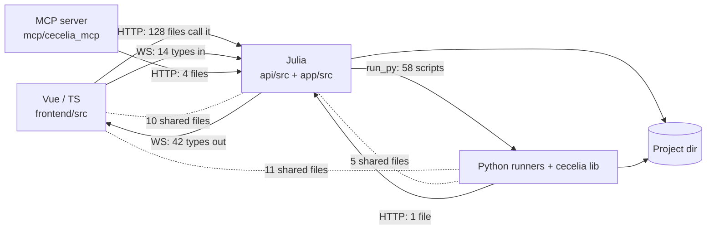

# Cross-language boundaries

> **Generated** by `scripts/architecture/boundaries_extract.py` — do not edit; run `pixi run arch-diagrams`.

Where one language hands off to another: which file holds each end, how the contract is kept, and
what does not line up. The processes and ports are in [`system.md`](system.md); the step-by-step
crossings are in [`flows/`](flows/). Every row of every touchpoint:
[`boundaries_reference.md`](boundaries_reference.md).

Solid: a call or a message. Dotted: a data file both sides read (a schema, a shader, a constants table).

## Where each boundary lives

| Boundary | Julia end | Other end | Contract kept by | Size | Gaps |
|---|---|---|---|---|---|
| Julia → Python | `app/src/py_runner.jl` `run_py` | `script_params()` in `python/cecelia/utils/script_utils.py` | params JSON keys; `[PROGRESS] n/total`; exit code | 58 scripts (52 task runners) | none |
| Vue → Julia, HTTP | route table in `api/src/server.jl`, handlers across `api/src` | `frontend/src/utils/api.ts` (the client), routes named in 128 files | `docs/API.md` → *Route index* | 337 routes in 57 areas | none |
| MCP → Julia, HTTP | same routes | `mcp/cecelia_mcp/autonomous.py`, `mcp/cecelia_mcp/client.py` +2 | `mcp/cecelia_mcp` tool specs | 4 files | — |
| Python → Julia, HTTP | same routes | `python/cecelia/cecelia_client.py` | — | 1 file | — |
| Vue ↔ Julia, WebSocket | `api/src/sockets.jl` `handle_message` (in), `api/src/server.jl` `broadcast_ws` (out) | `frontend/src/stores/ws.ts` | `WsMsgType` table (in); type strings (out) | 14 in, 42 out | none, none, none |
| Shared data files | — | — | a test that names the file | 18 files + 72 task specs | none |

## Shared data files

Data files named from two or more languages. The 72 task specs (`app/src/tasks/<category>/<name>.json`) are not listed: Julia reads them and serves them over `/api/tasks/definitions`, so the browser never names one. *Test* names a test file that names the file — the thing that fails if the two sides drift.

| File | Read by | Test |
|---|---|---|
| `constants.json` | Julia, Python, TS/Vue | `api/test/suite/movie_rail_translators.jl` +1 |
| `figureStyle.json` | Julia, Python, TS/Vue | `python/cecelia/tests/test_render_figure.py` |
| `golden.json` | Python, TS/Vue | `api/test/suite/overlay_3d_and_rail_3d.jl` +2 |
| `guides.json` | Python, TS/Vue | `app/test/suite/guides_and_flow.jl` +3 |
| `kiwiRef.schema.json` | Julia, TS/Vue | `frontend/src/utils/kiwiRef.test.ts` |
| `label_palette.json` | Julia, Python | `frontend/src/lib/webgpu/shaderSource.test.ts` |
| `lens.wgsl` | Julia, Python, TS/Vue | `api/test/suite/movie_rail_translators.jl` +2 |
| `maskPopTable.parity.json` | Julia, TS/Vue | `api/test/suite/overlay_author.jl` +1 |
| `mip.wgsl` | Python, TS/Vue | `python/cecelia/tests/test_wgsl_utils.py` |
| `mip_common.wgsl` | Julia, TS/Vue | `frontend/src/utils/axesGizmo.test.ts` +1 |
| `mip_points.wgsl` | Python, TS/Vue | `python/cecelia/tests/test_wgsl_utils.py` |
| `mip_segments.wgsl` | Python, TS/Vue | `frontend/src/lib/webgpu/shaderSource.test.ts` +1 |
| `overlay_quads.wgsl` | Julia, Python, TS/Vue | `api/test/suite/spatial_graph_lines.jl` +3 |
| `palettes.json` | Julia, TS/Vue | `api/test/suite/overlay_3d_and_rail_3d.jl` +5 |
| `popTypeRegistry.json` | Julia, TS/Vue | `app/test/suite/pop_type_registry.jl` +1 |
| `tools.json` | Python, TS/Vue | `api/test/suite/kiwi_turn.jl` +4 |
| `track_measures.json` | Julia, TS/Vue | `app/test/suite.jl` +3 |
| `uniforms.json` | Python, TS/Vue | `frontend/src/lib/webgpu/shaderSource.test.ts` |
