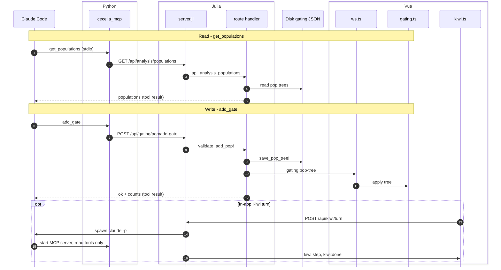

# Flow — Claude reads and writes a project through the cecelia-observer MCP

> **Hand-traced** — every step is pinned to a file and symbol below; `test_architecture_docs.py`
> fails when a pin stops matching the code.

Claude Code in the user's terminal calls a cecelia-observer tool. The Cecelia plugin launched the MCP
server as a Python child over stdio, and that server turns each tool call into one token-gated HTTP
request to the running Julia API. A read (`get_populations`) ends when the JSON reply returns to Claude.
A write (`add_gate`) also saves the gating sidecar and broadcasts `gating:pop-tree` over `/ws`, which
redraws the population tree in the open browser. In the `opt` block, the in-app Kiwi assistant
reaches the same server: Julia spawns `claude -p` with an MCP config that points back at this API.

## Steps

| # | What happens |
|---|---|
| 1 | tools/call get_populations over stdio |
| 2 | client.py _request allow-list then http_json GET /api/analysis/populations with Bearer token |
| 3 | token gate passes, route table calls api_analysis_populations |
| 4 | populations_summary reads each stored pop tree |
| 5 | 200 JSON images with populations, back via MCP as the tool result |
| 6 | tools/call add_gate with name, parent, gate spec |
| 7 | POST /api/gating/pop/add-gate with ids, parent, name, gate, colour, dryRun |
| 8 | api_gating_pop_add_gate validates, locks, add_pop! stamped by author_stamp |
| 9 | _persist_and_broadcast! calls save_pop_tree! |
| 10 | broadcast_ws type gating:pop-tree with tree, missingColumns, canUndo |
| 11 | dispatch to onPopTreePush, applyBroadcast sets the tree |
| 12 | 200 ok, dryRun, path, counts, back via MCP as the tool result |
| 13 | POST /api/kiwi/turn |
| 14 | kiwi_start_turn spawns claude -p with --mcp-config observer-mcp-headless.json, prompt on stdin |
| 15 | claude spawns python -m cecelia_mcp.server, then steps 1-5 with KIWI_READ_TOOLS only |
| 16 | broadcast_ws kiwi:step then kiwi:done via stores/ws.ts |

## What crosses each boundary

| Step | From → To | Mechanism | Payload / contract |
|---|---|---|---|
| 1 | Claude Code → Python MCP server | MCP JSON-RPC over stdio. The plugin starts `python -m cecelia_mcp.server` with `CECELIA_API_URL` and `CECELIA_API_TOKEN_FILE` | Tool name + args. `tools.json` sets each tool's kind (`read`/`add`), which becomes its MCP annotations |
| 2 | Python client.py → Julia server.jl | HTTP GET on loopback (`http_json`) | Query `projectUid`, `imageUid`?, `setUid`?. Headers `Authorization: Bearer <token>`, `X-Cecelia-Client: claude`, plus caller headers |
| 4 | Julia → Disk | File read | The gating sidecar per image × value name × pop type (`stored_pop_tree`) |
| 5 | Julia → Python → Claude | HTTP 200 JSON, then MCP tool result | `{projectUid, images: [{…header, populations, truncated}]}`. An `{error}` becomes `ApiError` → `ToolError` |
| 7 | Python gating_views.py → Julia | HTTP POST JSON. The route must be in `GATING_WRITE_ROUTES` | `{projectUid, imageUid, valueName, parent, name, gate (stored gate_spec shape), colour, dryRun}`. 404 missing parent, 409 name taken, 422 bad gate |
| 9 | Julia → Disk | Atomic JSON write (`save_pop_tree!`) | Pop tree with the new pop and `createdBy` from `author_stamp()` (`via: claude` from the header). A dry run skips steps 9–11 |
| 10 | Julia → every browser | WS frame on `/ws` (`broadcast_ws`, per-client queue) | `{type: "gating:pop-tree", projectUid, imageUid, valueName, popType, tree, missingColumns, canUndo, canRedo}` |
| 12 | Julia → Python → Claude | HTTP 200 JSON | `{ok, dryRun, path, valueName, regions, …}` |
| 13 | Vue → Julia | HTTP POST `/api/kiwi/turn` | Prompt + refs. Julia starts the turn in the background with `Threads.@spawn` |
| 14 | Julia → claude CLI | Subprocess `claude -p --output-format json --mcp-config <file> --allowedTools …`, prompt on stdin | The config file `{mcpServers: {cecelia-observer: {command: python, args: [-m, cecelia_mcp.server], env: {CECELIA_API_TOKEN_FILE, CECELIA_OBSERVER_NO_PAIR=1}}}}` |
| 15 | claude CLI → Python MCP server | Subprocess + stdio, the same server as step 1 | The same contract as steps 1–5. Only `KIWI_READ_TOOLS` are allowed, and the rest are denied by name |
| 16 | Julia → browser | WS frames | `kiwi:step` (progress) and `kiwi:done` (`{turnId, turn}`) |

## Pins

| # | File | Symbol |
|---|---|---|
| 1 | `mcp/claude-plugin/cecelia/.claude-plugin/plugin.json` | `"args": ["-m", "cecelia_mcp.server"]` |
| 1 | `mcp/cecelia_mcp/server.py` | `mcp.run(transport="stdio")` |
| 1 | `mcp/cecelia_mcp/server.py` | `def get_populations(` |
| 1 | `mcp/cecelia_mcp/tools.json` | `"get_populations": "read"` |
| 2 | `mcp/cecelia_mcp/client.py` | `if (method, path) not in ALLOWED_ROUTES:` |
| 2 | `mcp/cecelia_mcp/client.py` | `def http_json(` |
| 2 | `mcp/cecelia_mcp/client.py` | `return self._analysis_summary("/api/analysis/populations", project_uid, image_uid, set_uid)` |
| 2 | `mcp/cecelia_mcp/auth.py` | `{"Authorization": f"Bearer {tok}"}` |
| 2 | `mcp/cecelia_mcp/client.py` | `"X-Cecelia-Client": "claude"` |
| 3 | `api/src/server.jl` | `_request_authorized(req::HTTP.Request)::Bool =` |
| 3 | `api/src/server.jl` | `"/api/analysis/populations" => (req, body_bytes) -> (api_analysis_populations(req)),` |
| 3 | `api/src/routes/image.jl` | `api_analysis_populations(req::HTTP.Request) =` |
| 4 | `app/src/ai/populations.jl` | `populations_summary(proj::CciaProject; image_uid::AbstractString = "", set_uid::AbstractString = "") =` |
| 4 | `app/src/ai/observer_summary.jl` | `m = stored_pop_tree(img, v, pt)` |
| 5 | `mcp/cecelia_mcp/client.py` | `raise ApiError(e.code, detail) from e` |
| 6 | `mcp/cecelia_mcp/gating_views.py` | `def add_gate(project_uid: str, image_uid: str, value_name: str, name: str, gate: dict,` |
| 6 | `mcp/cecelia_mcp/tools.json` | `"add_gate": "add"` |
| 7 | `mcp/cecelia_mcp/gating_views.py` | `ADD_ROUTE = "/api/gating/pop/add-gate"` |
| 7 | `mcp/cecelia_mcp/gating_views.py` | `GATING_WRITE_ROUTES = frozenset(` |
| 7 | `api/src/server.jl` | `"/api/gating/pop/add-gate" => (req, body_bytes) -> (api_gating_pop_add_gate(body_bytes)),` |
| 8 | `api/src/gating_api.jl` | `function api_gating_pop_add_gate(body_bytes::Vector{UInt8})` |
| 8 | `api/src/gating_api.jl` | `created_by = author_stamp()` |
| 8 | `api/src/server.jl` | `_from_claude(req::HTTP.Request)::Bool = HTTP.header(req, "X-Cecelia-Client", "") == "claude"` |
| 9 | `api/src/gating_api.jl` | `function _persist_and_broadcast!(m::PopulationTree, img::CciaImage, body, vn, pop_type)` |
| 9 | `app/src/gating/popmanager/persistence.jl` | `function save_pop_tree!(m::PopulationTree, img::CciaImage)` |
| 10 | `api/src/gating_api.jl` | `"type" => "gating:pop-tree"` |
| 10 | `api/src/server.jl` | `function broadcast_ws(msg::Dict)` |
| 11 | `frontend/src/stores/ws.ts` | `function dispatch(data: Record<string, unknown>)` |
| 11 | `frontend/src/stores/gating.ts` | `ws.on('gating:pop-tree', onPopTreePush)` |
| 11 | `frontend/src/stores/gating.ts` | `function applyBroadcast(` |
| 11 | `frontend/src/components/canvas/PopulationManager.vue` | `const g = useGatingStore()` |
| 12 | `api/src/gating_api.jl` | `function _claude_gate_reply(` |
| 13 | `frontend/src/utils/kiwiTurn.ts` | `svcPost('/api/kiwi/turn', body, 15_000)` |
| 13 | `api/src/server.jl` | `"/api/kiwi/turn" => (req, body_bytes) -> (api_kiwi_turn(body_bytes)),` |
| 14 | `api/src/kiwi_api.jl` | `function kiwi_start_turn(` |
| 14 | `api/src/kiwi_turn.jl` | `turn(p, sid) = (r = Cecelia.run_agent_turn(agent, p, mcp_config_path; session_id = sid,` |
| 14 | `api/src/observer_api.jl` | `function _write_observer_mcp_config(; headless::Bool = false)::String` |
| 14 | `app/src/ai/agent_runner.jl` | `function _build_claude_cmd(a::ClaudeAgent, mcp_config_path::AbstractString;` |
| 14 | `app/src/ai/agent_runner.jl` | `"--mcp-config", String(mcp_config_path),` |
| 15 | `app/src/ai/agent_runner.jl` | `function observer_mcp_spec(` |
| 15 | `app/src/ai/agent_runner.jl` | `headless && (spec["env"]["CECELIA_OBSERVER_NO_PAIR"] = "1")` |
| 15 | `api/src/kiwi_turn.jl` | `const KIWI_READ_TOOLS = [` |
| 16 | `api/src/kiwi_api.jl` | `"type" => "kiwi:done"` |
| 16 | `frontend/src/stores/kiwi.ts` | `ws.on('kiwi:done'` |
