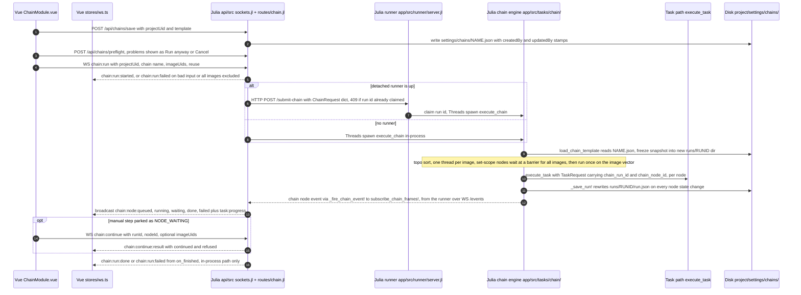

# Flow — Run a chain over several images

> **Hand-traced** — every step is pinned to a file and symbol below; `test_architecture_docs.py`
> fails when a pin stops matching the code.

The user presses Run in the chain whiteboard (`ChainModule.vue`). The browser never ships the chain to
the executor: it first saves the template to `settings/chains/<name>.json` over HTTP, then sends a
`chain:run` WebSocket frame that names the chain and the images. The executor (the detached task
runner if one is up, otherwise a thread in the API server) re-reads the template from disk, runs one
thread per image plus one barrier runner per set-scope node, dispatches every node through the normal
task path, and streams `chain:node:*` frames back while it rewrites `settings/chains/runs/<runId>/run.json`
after every node transition.

`T` is the shared single-task pathway (`run_task` / pools / Python subprocess) and is traced in its own
flow; a chain node is just a `TaskRequest` with the two chain correlation fields set. In the manual
branch, step 15 is resolved in order: `continue_chain_node!` in this process, the runner's
`/continue-chain`, then `continue_parked_on_disk!` against `run.json` followed by a resume (`chain:run`
with `runId`).

## What crosses each boundary

| Step | From → To | Mechanism | Payload / contract |
|---|---|---|---|
| 1 | Vue → Julia API | HTTP POST `/api/chains/save` | `{projectUid, template:{name,nodes,edges,startTargets}}`; server validates, repairs the name |
| 2 | Julia API → Disk | file write | `<proj>/settings/chains/<name>.json` (+ `createdBy`/`updatedBy`) |
| 3 | Vue → Julia API | HTTP POST `/api/chains/preflight` | `{projectUid, chain, imageUids}` → `{problems}` (advice only) |
| 4 | Vue → Julia API | WS frame `chain:run` | `{projectUid, chain, imageUids, reuse?}`; also `runId`/`startNode` (resume), `fromRun` (replay), `template` (inline "Queue after") |
| 5 | Julia API → Vue | WS frame `chain:run:started` / `chain:run:failed` | `{chain, runId, imageCount}` / `{error}` |
| 6 | Julia API → Julia runner | HTTP POST `/submit-chain` (localhost) | `chain_request_dict(ChainRequest)`; `ok:true` accepted, 409 = already running there, transport error = run in-process |
| 9 | Chain engine → Disk | file read + mkdir | template JSON in, `settings/chains/runs/<runId>/` created |
| 10 | Chain engine → task path | in-process call | `TaskRequest(fun_name, image_uid, pool_name, params, chain_run_id, chain_node_id)` — the Python hop happens inside |
| 11 | Chain engine → Disk | atomic file write | `run.json`: frozen template, `image_states[uid][node]` (status, task_id, params_hash, reason, reused), `node_params`, `excluded_images` |
| 12 | Runner → Julia API | WS `ws://127.0.0.1:<port>/events` | chain frames built by `subscribe_chain_frames!` in the runner, relayed verbatim by `_relay_runner_frame` (outcome banked for `/api/tasks/recent`) |
| 13 | Julia API → Vue | WS broadcast | `chain:node:*` `{runId, chainName, projectUid, imageUid, nodeId, fn, pool, by, taskId, params?, status?, error?}` |
| 14 | Vue → Julia API | WS frame `chain:continue` | `{projectUid, runId, nodeId, imageUids?}`; runner leg is HTTP POST `/continue-chain` |
| 15 | Julia API → Vue | WS frame `chain:continue:result` | `{runId, nodeId, continued, refused}` or `{error}` |
| 16 | Julia API → Vue | WS broadcast | `chain:run:done` / `chain:run:failed` `{chain, error}` |

## Pins

| # | File | Symbol |
|---|---|---|
| 1 | `frontend/src/modules/ChainModule.vue` | `async function saveChain()` |
| 1 | `api/src/server.jl` | `"/api/chains/save"` |
| 2 | `api/src/routes/chain.jl` | `function api_chains_save(` |
| 2 | `api/src/routes/chain.jl` | `out["updatedBy"] = author_stamp()` |
| 3 | `frontend/src/modules/ChainModule.vue` | `fetch('/api/chains/preflight'` |
| 3 | `api/src/routes/chain.jl` | `function api_chains_preflight(` |
| 4 | `frontend/src/modules/ChainModule.vue` | `function startRun(uid: string)` |
| 4 | `api/src/sockets.jl` | `WS_CHAIN_RUN    => "chain:run",` |
| 4 | `api/src/sockets.jl` | `function handle_chain_run(ws, data)` |
| 5 | `api/src/sockets.jl` | `type="chain:run:started",` |
| 6 | `api/src/runner_api.jl` | `function _submit_chain_to_runner(req)::Symbol` |
| 6 | `app/src/runner/client.jl` | `_runner_post(h, "/submit-chain", chain_request_dict(req))` |
| 7 | `app/src/runner/server.jl` | `route == "/submit-chain" && return _runner_submit_chain(body_bytes)` |
| 7 | `app/src/runner/server.jl` | `_claim_chain_run!(creq.run_id)` |
| 8 | `api/src/sockets.jl` | `Threads.@spawn execute_chain(creq;` |
| 8 | `app/src/runner/execute.jl` | `function execute_chain(req::ChainRequest;` |
| 9 | `app/src/tasks/chain/persistence.jl` | `function load_chain_template(proj::CciaProject, name::String)::ChainTemplate` |
| 9 | `app/src/tasks/chain/api.jl` | `run_dir = joinpath(_runs_dir(proj), new_id)` |
| 9 | `app/src/tasks/chain/api.jl` | `Threads.@spawn _execute_image_chain!(` |
| 9 | `app/src/tasks/chain/execute.jl` | `function _barrier_wait_all!(run::ChainRun, node_id::String)` |
| 10 | `app/src/tasks/chain/execute.jl` | `chain_run_id = run.id,` |
| 10 | `app/src/runner/execute.jl` | `function execute_task(req::TaskRequest;` |
| 11 | `app/src/tasks/chain/persistence.jl` | `function _save_run!(run::ChainRun)` |
| 11 | `app/src/tasks/chain/persistence.jl` | `write_atomic(joinpath(run._dir, "run.json")) do io` |
| 12 | `app/src/events.jl` | `function _fire_chain_event!(event_type::String, payload::NamedTuple)` |
| 12 | `app/src/runner/chain_frames.jl` | `function subscribe_chain_frames!(emit::Function)` |
| 12 | `app/src/runner/server.jl` | `subscribe_chain_frames!(runner_emit)` |
| 12 | `app/src/runner/client.jl` | `"ws://127.0.0.1:$(h.port)/events"` |
| 12 | `api/src/runner_api.jl` | `function _relay_runner_frame(f::Dict{String,Any})` |
| 13 | `api/src/server.jl` | `subscribe_chain_frames!(broadcast_ws)` |
| 13 | `frontend/src/stores/ws.ts` | `if (type === 'chain:node:queued') {` |
| 14 | `app/src/tasks/chain/execute.jl` | `_fire_chain_event!("node:waiting", (` |
| 14 | `frontend/src/utils/chainManual.ts` | `export function continueFrame(` |
| 14 | `api/src/sockets.jl` | `function handle_chain_continue(ws, data)` |
| 14 | `app/src/tasks/chain/manual.jl` | `function continue_chain_node!(` |
| 15 | `api/src/sockets.jl` | `"type" => "chain:continue:result"` |
| 15 | `frontend/src/stores/ws.ts` | `type === 'chain:continue:result'` |
| 16 | `api/src/sockets.jl` | `"type"  => ok ? "chain:run:done" : "chain:run:failed",` |
