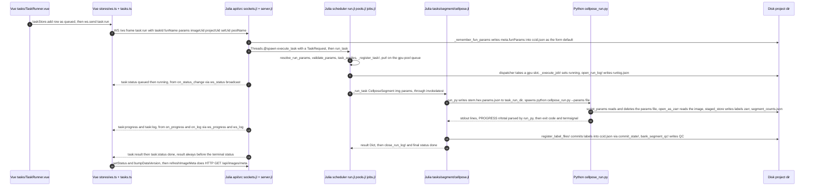

# Flow — Run one task on one image (cellpose segmentation)

> **Hand-traced** — every step is pinned to a file and symbol below; `test_architecture_docs.py`
> fails when a pin stops matching the code.

The user presses Run on the Segment page with one image selected and *Cellpose* picked. The request goes to
Julia as a **WebSocket** frame (`task:run`), not an HTTP call. Julia queues it on the `gpu` resource pool,
then spawns `cellpose_run.py` through `run_py` with a params JSON file. Progress comes back on stdout and
goes out to the browser as WS frames. The flow ends when the label stores are registered in `ccid.json`,
the browser gets `task:result` + `task:status done`, and the browser reloads the image's meta over HTTP.

**Dev-only detached runner (note).** When the runner is enabled, step 4 does not call `execute_task`
here. `handle_task_run` first tries `_submit_to_runner`: an HTTP POST `/submit` to the runner process on
:7657, carrying the same `TaskRequest` as JSON (`task_request_dict`). The runner then runs steps 5–15
with the same `execute_task`. Its frames come back over a WS (`/events`) and go into the same sinks
through `_relay_runner_frame`. If the runner refuses or is switched off, the task runs in-process. If it
is enabled but not answering, the server relaunches it and falls back to in-process if that fails. On
HPC (`target = hpc`), `run_py` hands off to `_run_py_hpc` at step 9 instead of spawning locally.

## What crosses each boundary

| Step | From → To | Mechanism | Payload / contract |
|---|---|---|---|
| 2 | Vue → Julia | WebSocket `/ws`, JSON text frame | `{type:"task:run", taskId, funName, params, imageUid, projectUid, setUid, poolName, …hpcFields}`. Parsed into the `WsMsgType` enum (`parse_ws_msg_type`). The frame's projectUid must look like a uid (`bad_uid_in_json`) |
| 3 | Julia → disk | `ccid.json` write | `meta.funParams` (and the per-name copy) on the image and its set. Written **before** the run, whatever the outcome |
| 6 | Julia → disk | `runlog.json` beside `ccid.json` | the run-log entry is opened *before* the work and closed at step 14 |
| 7, 12, 15 | Julia → every browser | WS broadcast (`broadcast_ws`, all clients, not just the sender) | `task:status {taskId, status, imageUid, imageUids, fun, pool, startedAt, finishedAt}` · `task:progress {taskId, progress 0–1}` · `task:log {taskId, line}` · `task:result {taskId, imageUid, meta}` |
| 9 | Julia → disk → Python | params JSON file + subprocess argv | `cellpose_run.<hex>.params.json` in `task_run_dir(img._dir)` holds the NamedTuple from `cellpose.jl` (`imPath, taskDir, outputValueName, qcOutPath, models, blockSize, …`). argv `--params <file>`. Env: `PYTHONPATH=python/`, contract version, compressor, `CECELIA_USAGE_OUT` |
| 10 | Python → disk | OME-ZARR + JSON | reads the input `.ome.zarr` (`zarr_utils.open_as_zarr`). Writes `labels/<value>*.zarr` through `staged_store`, plus `segment_counts.json` at `qcOutPath` (`write_json_atomic`) |
| 11 | Python → Julia | stdout/stderr pipe + exit status | `[PROGRESS] n/total` (regex in `run_py`, from `StdoutLogger.progress`). Every other line is a log line. Success = `exitcode == 0 && termsignal == 0` |
| 13 | Julia → disk | `ccid.json` read-modify-write in the image transaction | `labels[<outputValueName>] = [label files]` (`unversioned_set_field!`, `write_json_atomic`) |
| 16 | Vue → Julia | HTTP GET | `/api/images/meta?projectUid=…&imageUid=…`. The browser picks up the new `labels` entry here, not from `task:result` |

## Pins

| # | File | Symbol |
|---|---|---|
| 1 | `frontend/src/tasks/TaskRunner.vue` | `function dispatch(def: TaskDef` |
| 1 | `frontend/src/tasks/TaskRunner.vue` | `const t = taskStore.add({` |
| 2 | `frontend/src/stores/ws.ts` | `function send(msg: Record<string, unknown>)` |
| 2 | `api/src/server.jl` | `function handle_ws(ws)` |
| 2 | `api/src/sockets.jl` | `WS_TASK_RUN     => "task:run",` |
| 2 | `api/src/sockets.jl` | `function handle_task_run(ws, data)` |
| 3 | `api/src/sockets.jl` | `function _remember_fun_params(` |
| 3 | `app/src/model/image.jl` | `function write_module_fun_params!(` |
| 4 | `api/src/sockets.jl` | `run_in_process() = execute_task(req;` |
| 4 | `app/src/runner/execute.jl` | `function execute_task(req::TaskRequest;` |
| 4 | `app/src/runner/execute.jl` | `result = run_task(task_struct, img, req.params;` |
| 5 | `app/src/tasks/scheduler/run.jl` | `validate_params(task, params)` |
| 5 | `app/src/tasks/scheduler/run.jl` | `put!(pool.queue, job)` |
| 5 | `app/src/tasks/segment/cellpose.json` | `"resource_pool": "gpu"` |
| 6 | `app/src/tasks/scheduler/pools.jl` | `_acquire_slot!(pool)` |
| 6 | `app/src/tasks/scheduler/jobs.jl` | `function _execute_job!(job::TaskJob)` |
| 6 | `app/src/tasks/scheduler/jobs.jl` | `open_run_log!(tgt, fun_name, value_name, job.params;` |
| 7 | `api/src/sockets.jl` | `_broadcast_task((; type="task:status"` |
| 7 | `api/src/server.jl` | `function broadcast_ws(msg::Dict)` |
| 7 | `frontend/src/stores/ws.ts` | `if (type === 'task:status') {` |
| 8 | `app/src/tasks/scheduler/jobs.jl` | `Base.invokelatest(_run_task, job.task, job_target,` |
| 8 | `app/src/tasks/segment/cellpose.jl` | `function _run_task(task::CellposeSegment` |
| 9 | `app/src/tasks/segment/cellpose.jl` | `ok = run_py("tasks/segment/cellpose_run.py",` |
| 9 | `app/src/py_runner.jl` | `function run_py(` |
| 9 | `app/src/py_runner.jl` | `params_file = joinpath(task_dir, "$stem.$(string(rand(UInt32); base = 16)).params.json")` |
| 9 | `app/src/py_runner.jl` | `--params $params_file` |
| 10 | `app/src/tasks/segment/cellpose_run.py` | `params = script_utils.script_params()` |
| 10 | `python/cecelia/utils/script_utils.py` | `def script_params():` |
| 10 | `app/src/tasks/segment/cellpose_run.py` | `zarr_utils.open_as_zarr(im_path, as_dask=False)` |
| 10 | `python/cecelia/utils/segmentation_utils.py` | `zarr_utils.staged_store(_store_path(ma))` |
| 10 | `app/src/tasks/segment/cellpose_run.py` | `write_json_atomic(qc_out_path,` |
| 11 | `python/cecelia/utils/script_utils.py` | `print(f'[PROGRESS] {n}/{total}', flush=True)` |
| 11 | `app/src/py_runner.jl` | `m = match(r"^\[PROGRESS\] (\d+)/(\d+)$", line)` |
| 11 | `app/src/py_runner.jl` | `proc.exitcode == 0 && proc.termsignal == 0` |
| 12 | `api/src/sockets.jl` | `on_progress = (n, t) -> ws_progress(ws, task_id, n, t),` |
| 12 | `api/src/sockets.jl` | `type="task:progress"` |
| 12 | `frontend/src/stores/ws.ts` | `if (type === 'task:progress') {` |
| 13 | `app/src/tasks/segment/cellpose.jl` | `register_label_files!(img, p.outputValueName, label_files)` |
| 13 | `app/src/segmentation.jl` | `function register_label_files!(` |
| 13 | `app/src/model/project.jl` | `function commit_state!(f::Function, obj)` |
| 13 | `app/src/tasks/segment/cellpose.jl` | `bank_segment_qc!(img, "segment.cellpose"` |
| 14 | `app/src/tasks/scheduler/jobs.jl` | `close_run_log!(tgt, job.id, string(final);` |
| 15 | `app/src/runner/execute.jl` | `on_result(req.image_uid, result)` |
| 15 | `api/src/sockets.jl` | `type="task:result"` |
| 15 | `frontend/src/stores/ws.ts` | `if (type === 'task:result') {` |
| 16 | `frontend/src/stores/tasks.ts` | `function setStatus(id: string, status: TaskStatus,` |
| 16 | `frontend/src/stores/project.ts` | `async function refreshImageMeta(projectUid: string, imageUid: string)` |
| 16 | `api/src/server.jl` | `"/api/images/meta" =>` |
| 16 | `api/src/routes/image.jl` | `function api_images_meta(req::HTTP.Request)` |
| note | `api/src/runner_api.jl` | `function _submit_to_runner(req)::Symbol` |
| note | `app/src/runner/client.jl` | `_runner_post(h, "/submit", task_request_dict(req))` |
| note | `api/src/runner_api.jl` | `function _relay_runner_frame(f::Dict{String,Any})` |
| note | `app/src/py_runner.jl` | `return _run_py_hpc(script_rel, params, task_dir, d;` |
