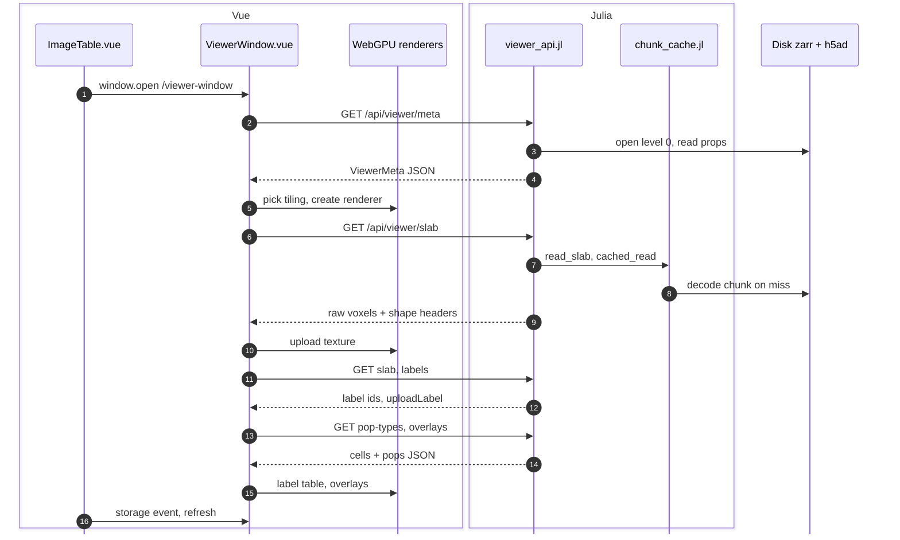

# Flow — Open an image in the viewer

> **Hand-traced** — every step is pinned to a file and symbol below; `test_architecture_docs.py`
> fails when a pin stops matching the code.

The user clicks the eye on an image row (image table, jump search, cell card). The main window opens
(or re-navigates) the named pop-out on `/viewer-window?project=…&image=…`; the pop-out is a fresh SPA
instance that asks Julia for the image's geometry, then pulls raw voxels through ONE binary route,
`/api/viewer/slab`, in one of three shapes — 2D tiles, whole-timepoint slabs (flat 3D) or bricks (brick
3D) — and writes them straight into WebGPU textures. Masks ride the same route (`labels=`); population
colours are a separate JSON fetch turned into a label-colour texture. It ends at a drawn frame; pan,
zoom, plane and time changes re-enter at step 6.

## Steps

| # | What happens |
|---|---|
| 1 | window.open /viewer-window ?project ?image ?valueName (named window) |
| 2 | GET /api/viewer/meta projectUid imageUid valueName |
| 3 | open_level0 + init_object + props file (dims, levels, channel names, contrast, set) |
| 4 | JSON ViewerMeta (nX nY nZ nC nT, bytesPerVoxel, levels, channels) |
| 5 | pick tile 2D, flat volume or bricks (shouldUseBricks) and a level, create renderer, setChannels |
| 6 | GET /api/viewer/slab t c(cTo) z(zTo) x xTo y yTo level enc (per tile, timepoint channel, or brick) |
| 7 | read_slab then read_native then cached_read (decoded chunks, single-flight) |
| 8 | zarr chunk decode on miss (blosc, pool thread) |
| 9 | raw little-endian voxels, X-Slab-Shape Bpv Level headers, optional zstd Content-Encoding |
| 10 | shape guard, then uploadTile, uploadFrame or brick payload writeTexture |
| 11 | GET /api/viewer/slab labels=segmentation (same box, mask ids) |
| 12 | label ids (u16 or u32), widened to u32 client side, then uploadLabel |
| 13 | GET /api/viewer/pop-types then /api/viewer/overlays popType valueName |
| 14 | JSON cells (t x y z track) from label_props h5ad + pops (labels, colour, show) from resolve_pops |
| 15 | maskPopTable into setLabelTable, points and tracks via setOverlayWindow |
| 16 | localStorage storage event - overlays tick, cache-clear rev or image-meta rev (gate edit, task done, rename) |

## What crosses each boundary

| Step | From → To | Mechanism | Payload / contract |
|---|---|---|---|
| 1 | Main window → pop-out | `window.open` on the named window, then `location.href` reassigned | Query is identity only: `project`, `image`, optional `valueName`. A different `image` on an open pop-out triggers a full `window.location.reload()` |
| 2, 4 | Pop-out → Julia | HTTP GET JSON | `ViewerMeta`: dims, `bytesPerVoxel`, per-level shapes, channel names / LUT / contrast, set uid, image name, `labelDims` |
| 3 | Julia → disk | Zarr.jl `zopen` (metadata), `ccid.json` via `init_object`, viewer props file | — |
| 6, 9 | Pop-out → Julia | HTTP GET binary, served by `try_serve_slab` BEFORE the JSON router (own pool-thread read + write) | Query: `t`, `c`[`cTo`], `z`[`zTo`], `x/xTo/y/yTo`, `level`, `enc=identity/zstd`, `_r` cache-buster. Body: raw voxels, little-endian, x fastest, channels last when `cTo`. Headers `X-Slab-Shape` (`nz,ny,nx` or `nc,nz,ny,nx`), `X-Slab-Bpv`, `X-Slab-Level`, `Cache-Control: private, max-age=3600` |
| 8 | Julia → disk | Zarr.jl chunk reads through the decoded-chunk LRU | Keyed by level array dir (path, inode, mtime) + chunk index; `.partial` live stores bypass it |
| 10, 12, 15 | JS → GPU | `device.queue.writeTexture` / `writeBuffer` + `copyBufferToTexture` | Tile atlas slot per channel, flat 3D texture per timepoint, brick atlas + page table; label ids as `r32uint`; pop colours as a 2D colour table |
| 11–12 | Pop-out → Julia | Same slab route with `labels=<vn>` (+ `preview=1`, `live=1`, `files=`) | 409 = "no mask to draw here", not an error |
| 13–14 | Pop-out → Julia | HTTP GET JSON | `/api/viewer/overlays`: whole-movie centroids sorted for per-t ranges; `part=pops` = populations only; 413 past 3M cells |
| 14 | Julia → disk | `label_props` (h5ad) with `select_cols`, gating map via `resolve_pops` | — |
| 16 | Main window → pop-out | `localStorage` key + `storage` event (plus a same-window CustomEvent) | `cc.viewerOverlaysTick` (scope `all`/`pops`/`look`), `viewerCacheClearChannel` rev scoped by image/vn, `cc.viewerImageMetaRev` |

**Per-interaction traffic.** Pan/zoom (2D): only tiles missing from the GPU atlas at the picked level
(`pickTileLevel`, with zoom-out hysteresis) are fetched, missing channels only, channel runs batched
with `cTo`; LRU eviction ranks by distance from viewport centre and level. Plane change (2D) or time
change: new tile keys / a new timepoint (one timepoint in flight at a time, channels in parallel, mask
with it); timepoints resident in the flat renderer's GPU cache are just shown (`frameComplete`).
Bricks: the brick scheduler kicks up to 16 in flight (8 reserved for the bound timepoint), aborts
bricks scrolled past and drops late payloads. Overlays are fetched once per (segmentation, pop type),
not per frame. Caches: GPU atlases/timepoint cache (client), browser HTTP cache (1 h, busted by `_r`),
Julia decoded-chunk cache (budget from the user setting, set at server start).

## Pins

| # | File | Symbol |
|---|---|---|
| 1 | `frontend/src/components/ImageTable.vue` | `openViewerWindow({` |
| 1 | `frontend/src/utils/viewerWindow.ts` | `export function openViewerWindow(` |
| 1 | `frontend/src/lib/popout.ts` | `export function openPopoutWindow(` |
| 1 | `frontend/src/main.ts` | `path: '/viewer-window'` |
| 1 | `frontend/src/modules/ViewerWindow.vue` | `if (nextUid && nextUid !== imageUid) window.location.reload()` |
| 2 | `frontend/src/modules/ViewerWindow.vue` | `async function loadVersion(` |
| 2 | `frontend/src/utils/volumeViewer.ts` | `export function metaUrl(` |
| 2 | `api/src/server.jl` | `"/api/viewer/meta" => (req, body_bytes) -> (api_viewer_meta(req))` |
| 3 | `api/src/viewer_api.jl` | `function api_viewer_meta(` |
| 3 | `api/src/image_geometry.jl` | `function resolve_image_version(` |
| 4 | `api/src/viewer_api.jl` | `_display_specs_with_source(props, zp, nc` |
| 5 | `frontend/src/modules/ViewerWindow.vue` | `shouldUseBricks(m, mode.value, budget` |
| 5 | `frontend/src/utils/volumeViewer.ts` | `export function pickTileLevel(` |
| 5 | `frontend/src/utils/volumeViewer.ts` | `export function pickVolumeLevel(` |
| 5 | `frontend/src/modules/ViewerWindow.vue` | `function pushChannels()` |
| 6 | `frontend/src/modules/ViewerWindow.vue` | `async function fetchTile(` |
| 6 | `frontend/src/modules/ViewerWindow.vue` | `function fetchTimepoint(` |
| 6 | `frontend/src/lib/webgpu/brickVolumeRenderer.ts` | `const kickFetch = (brick: VirtualBrick)` |
| 6 | `frontend/src/utils/brickLoader.ts` | `export function brickSlabQuery(` |
| 6 | `frontend/src/utils/volumeViewer.ts` | `export function slabUrl(` |
| 6 | `api/src/server.jl` | `try_serve_slab(stream, req.target) && return` |
| 7 | `api/src/viewer_api.jl` | `function try_serve_slab(` |
| 7 | `api/src/viewer_api.jl` | `function read_slab(arr, caxes, t::Int` |
| 7 | `api/src/image_geometry.jl` | `blk = cached_read(arr, idx...)` |
| 8 | `api/src/chunk_cache.jl` | `function cached_read(arr, idx...)` |
| 8 | `api/src/chunk_cache.jl` | `function _cc_decode!(` |
| 8 | `api/src/server.jl` | `chunk_cache_budget!(Cecelia.viewer_chunk_cache_bytes())` |
| 9 | `api/src/viewer_api.jl` | `function _write_slab!(` |
| 9 | `api/src/viewer_api.jl` | `function with_slab_bytes(f, vol)` |
| 9 | `api/src/viewer_api.jl` | `"Cache-Control"                 => "private, max-age=3600"` |
| 10 | `frontend/src/modules/ViewerWindow.vue` | `const bad = slabShapeError(` |
| 10 | `frontend/src/utils/brickLoader.ts` | `export async function fetchBrick(` |
| 10 | `frontend/src/lib/webgpu/tileRenderer.ts` | `async uploadTile(key, channelBytes, keep, evict, sourceId)` |
| 10 | `frontend/src/lib/webgpu/volumeRenderer.ts` | `async uploadFrame(t: number, channelBytes: ArrayBuffer[], keep: number,` |
| 10 | `frontend/src/lib/webgpu/brickAtlasTexture.ts` | `device.queue.writeBuffer(stagingBuf, 0, bytes, 0, expected)` |
| 11 | `frontend/src/modules/ViewerWindow.vue` | `async function fetchMaskSlab(` |
| 11 | `frontend/src/utils/brickLoader.ts` | `export function brickLabelSlabUrl(` |
| 11 | `api/src/viewer_api.jl` | `function label_store_path(` |
| 12 | `frontend/src/modules/ViewerWindow.vue` | `widenLabelSlab(buf, bpv)` |
| 12 | `frontend/src/lib/webgpu/tileRenderer.ts` | `async uploadLabel(key, ids, sourceId)` |
| 13 | `frontend/src/utils/viewerOverlays.ts` | `return '/api/viewer/overlays?' + p.toString()` |
| 13 | `frontend/src/utils/viewerOverlays.ts` | `return '/api/viewer/pop-types?'` |
| 13 | `api/src/server.jl` | `"/api/viewer/overlays" => (req, body_bytes) -> (api_viewer_overlays(req))` |
| 14 | `api/src/viewer_api.jl` | `function api_viewer_overlays(` |
| 14 | `api/src/viewer_api.jl` | `for p in resolve_pops(img, pt; value_name = vn)` |
| 14 | `api/src/viewer_api.jl` | `const OVERLAY_MAX_CELLS = 3_000_000` |
| 15 | `frontend/src/modules/ViewerWindow.vue` | `r.setLabelTable(maskTable.value)` |
| 15 | `frontend/src/utils/maskPopTable.ts` | `export function maskPopTable(` |
| 15 | `frontend/src/lib/webgpu/labelColourTexture.ts` | `export function createLabelColourTexture(` |
| 15 | `frontend/src/modules/ViewerWindow.vue` | `setOverlayWindow(r, points, segments` |
| 16 | `frontend/src/utils/viewer/overlayTick.ts` | `export const OVERLAY_TICK_KEY = 'cc.viewerOverlaysTick'` |
| 16 | `frontend/src/lib/viewerCacheClearChannel.ts` | `export function publishViewerCacheClear(` |
| 16 | `frontend/src/composables/useViewerAutoUpdate.ts` | `publishViewerCacheClear({ imageUid, valueName: a.valueName` |
| 16 | `frontend/src/lib/viewerImageMetaChannel.ts` | `export function publishViewerImageMeta(` |
| 16 | `frontend/src/lib/viewerCacheClearChannel.ts` | `export function onViewerCacheClear(` |
| 16 | `frontend/src/modules/ViewerWindow.vue` | `stopImageMetaWatch = onViewerImageMeta(` |
