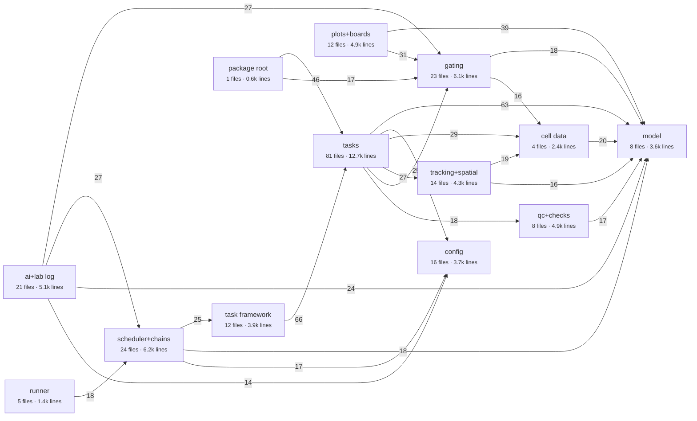
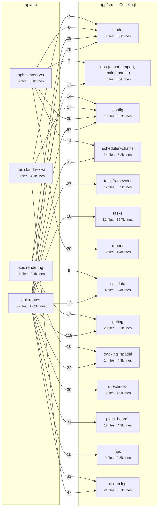

# Julia — areas and who calls whom

> **Generated** by `scripts/architecture/julia_extract.jl` — do not edit; run `pixi run arch-diagrams`.

The backend is **one module** (`Cecelia`, every file `include`d), so there is no module graph. These
areas are a curated grouping of files (`scripts/architecture/julia_areas.toml`); the arrows are from
the code: `A → B (n)` means files in A call `n` distinct functions (or name `n` types) defined in B.
Static name matching — approximate, see the script header.

Diagram rule: the strongest 25 arrows per diagram (ties at the cut-off included); every
count is in the full matrix below.

## Inside the package (`app/src`)

## API server → package (`api/src` → `app/src`)

The API server's own files are grouped on the left; arrows into the package only.

## Two-way dependencies between package areas

Both directions present (any n). In one module these are legal, but each pair is two areas that cannot be understood apart.

| Areas | → | ← |
|---|---|---|
| model ↔ jobs (export, import, maintenance) | 1: `store_debris_summary` | 5: `_rm_tree`, `discard_later`, `load_project`, `move_aside`, … |
| model ↔ config | 7: `_path_bytes`, `derived_image_name`, `gen_uid`, `keep_previous_version`, … | 4: `img_project_dir`, `img_project_uid`, `json_native`, `read_state_json` |
| model ↔ scheduler+chains | 8: `_history_leaves`, `_rl_str`, `_update_run_log!`, `read_run_log`, … | 18: `CciaImage`, `CciaSet`, `_fire_chain_event!`, `_load_image`, … |
| model ↔ cell data | 2: `_label_name_taken`, `free_label_name` | 20: `channel_names`, `commit_state!`, `img_branch_labels_dir`, `img_branch_props_path`, … |
| model ↔ gating | 8: `_clustfeatures_entry`, `_clustfeatures_part_of`, `_clustfeatures_suffixes`, `gating_history_path`, … | 18: `CciaImage`, `_load_image`, `channel_names`, `images`, … |
| model ↔ tracking+spatial | 2: `load_roi_set`, `roi_suffixes_on` | 16: `channel_names`, `image_attr_groups`, `img_axes`, `img_branch_props_path`, … |
| jobs (export, import, maintenance) ↔ ai+lab log | 1: `active_profile_name` | 2: `_kill_proc_tree`, `write_stored_zip` |
| config ↔ tasks | 1: `ngff_version` | 36: `BoundedCache`, `_dir_bytes`, `bf2raw_chunk_flags`, `bf2raw_compression_flags`, … |
| config ↔ ai+lab log | 1: `active_profile_name` | 14: `_pid_alive`, `_pretty_json`, `api_token_path`, `cecelia_conf`, … |
| scheduler+chains ↔ task framework | 25: `CompositeTask`, `ParamValidationError`, `TaskApplicabilityError`, `_clamp_to_spec`, … | 3: `_fun_name_from_task`, `list_tasks`, `run_env_of` |
| scheduler+chains ↔ tasks | 4: `_str_list`, `live_outputs`, `manual_check`, `validate_params` | 9: `close_run_log!`, `drop_props_sidecar_keys!`, `open_run_log!`, `pool_status`, … |
| scheduler+chains ↔ runner | 2: `TaskRequest`, `execute_task` | 18: `_is_probe_code_bug`, `cancel_chain_run!`, `cancel_task!`, `chain_template_from_raw`, … |
| scheduler+chains ↔ python bridge | 3: `_python_dir`, `pixi_env_name`, `python_bin_for` | 2: `read_local_py_usage`, `record_run_usage!` |
| scheduler+chains ↔ cell data | 2: `_stale_reads_names`, `stale_outputs_for` | 11: `_history_leaves`, `_rl_get`, `_rl_str`, `_run_has_output`, … |
| scheduler+chains ↔ gating | 11: `_cluster_measure_family`, `_cluster_measure_prefix`, `_gate_canon`, `_is_cluster_pop_type`, … | 4: `drop_props_sidecar_keys!`, `props_sidecar_path`, `put_props_sidecar_entry!`, `read_props_sidecar` |
| scheduler+chains ↔ qc+checks | 2: `chain_cohort_qc!`, `write_defaulted_scale_qc!` | 7: `_history_leaves`, `_history_output`, `is_bookkeeping_param`, `read_run_env`, … |
| scheduler+chains ↔ hpc | 3: `_with_run_target`, `hpc_resources`, `task_runs_on_hpc` | 5: `_fun_name_from_task`, `_task_pool_name`, `is_cancelled`, `iso_utc`, … |
| scheduler+chains ↔ ai+lab log | 2: `_parse_tkey`, `active_profile_name` | 27: `_cache_dir`, `_chains_dir`, `_history_leaves`, `_history_param_defaults`, … |
| task framework ↔ tasks | 66: `AfCells`, `AfCorrect`, `AggregatesMeshes`, `BayesianTracking`, … | 6: `ParamValidationError`, `_picked_channels`, `_spec_output_value_name`, `preview_py_env`, … |
| task framework ↔ cell data | 6: `SegmentStalenessReport`, `TrackingStalenessReport`, `label_props`, `n_obs`, … | 1: `_task_spec` |
| task framework ↔ qc+checks | 1: `channel_signal_flags` | 4: `_composite_step_names`, `_stored_key`, `_task_from_fun_name`, `task_params_name` |
| tasks ↔ cell data | 29: `CategoricalObsColumn`, `add_obs`, `append_label_corrections!`, `as_df`, … | 1: `_run_task` |
| tasks ↔ gating | 25: `Population`, `_clustfeatures_entry`, `_clustfeatures_path`, `_group_pops_by_value_name`, … | 2: `Track`, `pops_value_name` |
| tasks ↔ tracking+spatial | 27: `_basis_name`, `_basis_segments`, `append_corrections!`, `apply_track_ops!`, … | 8: `Track`, `_comp_col`, `roi_review_labels`, `store_written_at`, … |
| tasks ↔ qc+checks | 18: `_cal_num`, `_cluster_run_env`, `_saturation_channels`, `acquisition_technology`, … | 6: `Denoise`, `Track`, `import_source_fingerprint`, `ngff_multiscales`, … |
| tasks ↔ plots+boards | 3: `_obs_suffixes`, `_rm_if`, `prune_stale_hmmfit!` | 10: `Branching`, `Track`, `TrackMeasures`, `_motiffeatures_path`, … |
| tasks ↔ hpc | 1: `hpc_task_cpus` | 1: `zarr_group_meta_files` |
| python bridge ↔ hpc | 1: `_run_py_hpc` | 3: `_app_dir`, `_py_task_env`, `pixi_env_name` |
| cell data ↔ gating | 2: `gating_path`, `is_track_grained` | 16: `_split_channel_column`, `as_df`, `axis_of`, `canonical_channel_columns`, … |
| cell data ↔ tracking+spatial | 2: `corrections_dir`, `roi_suffixes_on` | 19: `_channel_label`, `_op_get`, `as_df`, `branch_paths`, … |
| cell data ↔ qc+checks | 2: `qc_finding`, `write_qc` | 2: `centroid_columns`, `label_props` |
| gating ↔ tracking+spatial | 5: `is_tracked`, `track_aggregate_base`, `track_aggregate_measures`, `track_name_sets`, … | 6: `_clustfeatures_entry`, `_clustfeatures_features`, `_clustfeatures_part_of`, `_split_pop_ref`, … |
| gating ↔ qc+checks | 6: `_cohort_outliers`, `cohort_value_names`, `qc_finding`, `qc_path`, … | 13: `Population`, `_gate_canon`, `_split_pop_ref`, `gate_shape_spec`, … |
| tracking+spatial ↔ plots+boards | 3: `_catkey`, `_finite`, `_ordered_cats` | 6: `_is_categorical_col`, `approach_cell_col`, `approach_track_col`, `contact_col_regex`, … |
| qc+checks ↔ ai+lab log | 1: `append_lab_log!` | 8: `_read_qc_file`, `all_qc_docs`, `cohort_qc_summary_lines`, `qc_fun_dir`, … |
| plots+boards ↔ ai+lab log | 5: `_collect_contact_stats`, `_collect_pattern_stats`, `_collect_proximity_stats`, `_parse_tkey`, … | 4: `boards_doc_path`, `plot_spec_index`, `plot_summary_data`, `read_boards_doc` |
| hpc ↔ ai+lab log | 1: `_last_line` | 1: `_sh_quote` |

## Full matrix (rows call columns)

| | model | jobs (export, import, maintenance) | config | scheduler+chains | task framework | tasks | runner | python bridge | cell data | gating | tracking+spatial | qc+checks | plots+boards | hpc | ai+lab log | logging | package root |
|---|---|---|---|---|---|---|---|---|---|---|---|---|---|---|---|---|---|
| **model** | · | 1 | 7 | 8 |  |  |  |  | 2 | 8 | 2 |  |  |  |  |  |  |
| **jobs (export, import, maintenance)** | 5 | · | 5 |  |  |  |  | 2 |  |  |  |  |  |  | 1 |  |  |
| **config** | 4 |  | · |  |  | 1 |  |  |  |  |  |  |  |  | 1 |  |  |
| **scheduler+chains** | 18 | 1 | 17 | · | 25 | 4 | 2 | 3 | 2 | 11 |  | 2 |  | 3 | 2 | 1 |  |
| **task framework** | 13 | 3 | 8 | 3 | · | 66 |  |  | 6 |  |  | 1 |  |  |  |  |  |
| **tasks** | 63 | 1 | 36 | 9 | 6 | · |  | 2 | 29 | 25 | 27 | 18 | 3 | 1 |  |  |  |
| **runner** | 4 | 1 | 13 | 18 | 2 |  | · |  |  |  |  |  |  |  | 1 | 6 |  |
| **python bridge** |  |  | 7 | 2 | 1 |  |  | · |  |  |  |  |  | 1 |  |  |  |
| **cell data** | 20 |  | 7 | 11 | 1 | 1 |  | 2 | · | 2 | 2 | 2 |  |  |  |  |  |
| **gating** | 18 |  | 12 | 4 |  | 2 |  |  | 16 | · | 5 | 6 |  |  |  |  |  |
| **tracking+spatial** | 16 |  | 1 |  |  | 8 |  |  | 19 | 6 | · | 1 | 3 |  |  |  |  |
| **qc+checks** | 17 |  | 5 | 7 | 4 | 6 |  |  | 2 | 13 |  | · |  |  | 1 |  |  |
| **plots+boards** | 39 |  | 7 | 6 | 4 | 10 |  | 2 | 9 | 31 | 6 | 7 | · |  | 5 |  |  |
| **hpc** | 2 | 1 | 12 | 5 | 1 | 1 |  | 3 |  |  |  |  |  | · | 1 |  |  |
| **ai+lab log** | 24 | 2 | 14 | 27 | 6 | 2 |  |  | 6 | 27 | 1 | 8 | 4 | 1 | · |  |  |
| **logging** |  |  | 1 |  |  |  |  |  |  |  |  |  |  |  |  | · |  |
| **package root** | 4 | 1 | 4 | 11 | 3 | 46 | 3 |  | 3 | 17 | 6 | 2 | 3 | 10 | 2 | 1 | · |
| **api: server+ws** | 8 | 7 | 25 | 14 | 2 |  | 20 |  |  |  |  |  |  |  | 3 | 6 |  |
| **api: rendering** | 29 | 4 | 14 | 3 |  | 6 |  | 1 | 9 | 17 | 10 |  |  |  |  |  |  |
| **api: claude+kiwi** | 7 | 5 | 17 | 5 | 3 | 1 |  |  | 4 | 5 | 1 |  | 5 |  | 47 |  |  |
| **api: routes** | 79 | 12 | 57 | 33 | 27 | 10 | 5 | 3 | 12 | 119 | 22 | 30 | 31 | 15 | 31 | 1 |  |

