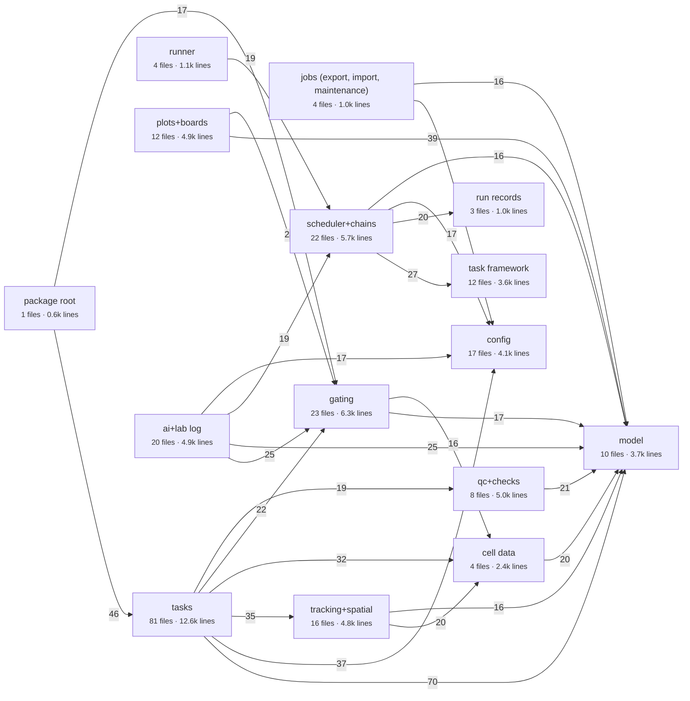
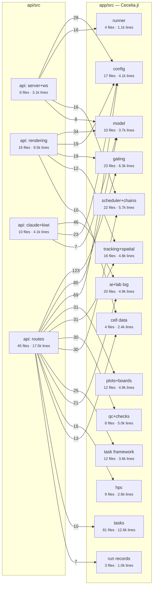

# Julia — areas and who calls whom

> **Generated** by `scripts/architecture/julia_extract.jl` — do not edit; run `pixi run arch-diagrams`.

The backend is **one module** (`Cecelia`, every file `include`d), so there is no module graph. These
areas are a curated grouping of files (`scripts/architecture/julia_areas.toml`); the arrows are from
the code: `A → B (n)` means files in A call `n` distinct functions (or name `n` types) defined in B.
Static name matching — approximate, see the script header.

**Read it as a size map.** Big areas call more, so the thickest arrows mostly show where the code
is, not where it is wrong. What to act on is the calls up the declared layer order (below, and
listed by name in [`gaps.md`](../gaps.md#julia-upward)). Diagram rule: the strongest 25 arrows per diagram
(ties at the cut-off included); every count is in the full matrix at the bottom.

## Inside the package (`app/src`)

## API server → package (`api/src` → `app/src`)

The API server's own files are grouped on the left; arrows into the package only.

## Two-way dependencies between package areas

Both directions present (any n). In one module these are legal, but each pair is two areas that cannot be understood apart.

| Areas | → | ← |
|---|---|---|
| model ↔ run records | 2: `_clustfeatures_suffixes`, `run_log_params_for_output` | 5: `_load_image`, `img_has_value_name`, `resolve_value_name`, `resolve_version`, … |
| run records ↔ scheduler+chains | 6: `_history_leaves`, `_history_output`, `_keyed_strings`, `_preflight_fields`, … | 20: `RunUsage`, `_rl_get`, `_rl_str`, `_run_has_output`, … |
| run records ↔ task framework | 5: `_composite_step_names`, `_task_from_fun_name`, `task_params_name`, `task_source_stamp`, … | 4: `close_run_log!`, `open_run_log!`, `run_env_of`, `run_provenance` |
| run records ↔ gating | 4: `is_gating_pop_type`, `load_pop_tree`, `pop_gate_hashes`, `resolve_pop_type` | 9: `_clustfeatures_entry`, `_clustfeatures_key`, `_clustfeatures_part_of`, `_clustfeatures_path`, … |
| scheduler+chains ↔ cell data | 2: `_stale_reads_names`, `stale_outputs_for` | 1: `_history_leaves` |
| scheduler+chains ↔ qc+checks | 2: `chain_cohort_qc!`, `write_defaulted_scale_qc!` | 3: `_history_leaves`, `_history_output`, `is_bookkeeping_param` |
| scheduler+chains ↔ hpc | 3: `_with_run_target`, `hpc_resources`, `task_runs_on_hpc` | 3: `_task_pool_name`, `is_cancelled`, `iso_utc` |
| task framework ↔ cell data | 4: `label_props`, `n_obs`, `select_cols`, `view_centroid_cols` | 1: `_task_spec` |
| task framework ↔ qc+checks | 1: `channel_signal_flags` | 4: `_composite_step_names`, `_stored_key`, `_task_from_fun_name`, `task_params_name` |
| cell data ↔ gating | 2: `gating_path`, `is_track_grained` | 16: `_split_channel_column`, `as_df`, `axis_of`, `canonical_channel_columns`, … |
| cell data ↔ tracking+spatial | 2: `corrections_dir`, `roi_suffixes_on` | 20: `_agg_suffix`, `_channel_label`, `_var_measure_set`, `as_df`, … |
| cell data ↔ qc+checks | 2: `qc_finding`, `write_qc` | 2: `centroid_columns`, `label_props` |
| gating ↔ tracking+spatial | 8: `_track_class_mask`, `add_pop_fraction_cols!`, `is_tracked`, `track_aggregate_base`, … | 14: `_catkey`, `_clustfeatures_features`, `_coerce_filter_fun`, `_missing_col_mask`, … |
| gating ↔ qc+checks | 6: `_cohort_outliers`, `cohort_value_names`, `qc_finding`, `qc_path`, … | 12: `_gate_canon`, `_split_pop_ref`, `gate_shape_spec`, `gating_qc!`, … |
| tracking+spatial ↔ plots+boards | 1: `_finite` | 8: `_is_categorical_col`, `_is_var_measure`, `add_pop_fraction_cols!`, `approach_cell_col`, … |
| plots+boards ↔ ai+lab log | 4: `_collect_contact_stats`, `_collect_pattern_stats`, `_collect_proximity_stats`, `contact_matrix` | 4: `boards_doc_path`, `plot_spec_index`, `plot_summary_data`, `read_boards_doc` |

## Layers — calls up the declared order

The declared order, bottom first (`[layers]` in `julia_areas.toml`). An area may call its own tier and the ones below; a call up the order is a gap, listed by name in [`gaps.md`](../gaps.md#julia-upward).

| Tier | Areas |
|---|---|
| 1 | config, logging |
| 2 | model, run records |
| 3 | python bridge, cell data |
| 4 | gating, tracking+spatial, qc+checks |
| 5 | task framework |
| 6 | tasks |
| 7 | scheduler+chains, hpc, jobs (export, import, maintenance) |
| 8 | runner, plots+boards, ai+lab log |
| 9 | package root |

Full matrix (rows call columns)

| | model | jobs (export, import, maintenance) | config | run records | scheduler+chains | task framework | tasks | runner | python bridge | cell data | gating | tracking+spatial | qc+checks | plots+boards | hpc | ai+lab log | logging | package root |
|---|---|---|---|---|---|---|---|---|---|---|---|---|---|---|---|---|---|---|
| **model** | · |  | 11 | 2 |  |  |  |  |  |  |  |  |  |  |  |  |  |  |
| **jobs (export, import, maintenance)** | 16 | · | 17 | 8 | 2 |  |  |  | 2 | 2 | 5 | 2 |  |  |  |  |  |  |
| **config** |  |  | · |  |  |  |  |  |  |  |  |  |  |  |  |  |  |  |
| **run records** | 5 |  | 6 | · | 6 | 5 |  |  |  |  | 4 |  |  |  |  |  |  |  |
| **scheduler+chains** | 16 |  | 17 | 20 | · | 27 | 2 |  | 3 | 2 | 8 |  | 2 |  | 3 |  | 1 |  |
| **task framework** | 15 |  | 15 | 4 |  | · |  |  |  | 4 |  |  | 1 |  |  |  |  |  |
| **tasks** | 70 |  | 37 | 8 |  | 7 | · |  | 2 | 32 | 22 | 35 | 19 |  |  |  |  |  |
| **runner** | 1 |  | 14 |  | 19 |  |  | · |  |  |  |  |  |  |  |  | 6 |  |
| **python bridge** |  |  | 8 | 2 |  |  |  |  | · |  |  |  |  |  |  |  |  |  |
| **cell data** | 20 |  | 7 | 10 | 1 | 1 |  |  | 2 | · | 2 | 2 | 2 |  |  |  |  |  |
| **gating** | 17 |  | 13 | 9 |  |  |  |  |  | 16 | · | 8 | 6 |  |  |  |  |  |
| **tracking+spatial** | 16 |  | 2 | 2 |  |  |  |  |  | 20 | 14 | · | 1 | 1 |  |  |  |  |
| **qc+checks** | 21 |  | 6 | 4 | 3 | 4 |  |  |  | 2 | 12 |  | · |  |  |  |  |  |
| **plots+boards** | 39 |  | 7 | 10 | 3 | 5 | 9 |  | 2 | 11 | 28 | 8 | 7 | · |  | 4 |  |  |
| **hpc** | 1 |  | 14 | 1 | 3 | 2 | 1 |  | 3 |  |  |  |  |  | · |  |  |  |
| **ai+lab log** | 25 | 1 | 17 | 12 | 19 | 6 | 1 |  |  | 6 | 25 | 1 | 8 | 4 | 1 | · |  |  |
| **logging** |  |  | 1 |  |  |  |  |  |  |  |  |  |  |  |  |  | · |  |
| **package root** | 4 | 1 | 4 | 1 | 12 | 3 | 46 | 1 |  | 3 | 17 | 6 | 2 | 3 | 10 | 2 | 1 | · |
| **api: server+ws** | 8 | 5 | 28 | 2 | 16 | 2 |  | 16 |  |  |  |  |  |  |  | 2 | 6 |  |
| **api: rendering** | 34 |  | 19 |  | 3 |  |  |  | 1 | 10 | 19 | 12 |  |  |  |  |  |  |
| **api: claude+kiwi** | 7 |  | 23 | 5 |  | 3 |  |  |  | 4 | 5 | 1 |  | 5 |  | 46 |  |  |
| **api: routes** | 85 | 5 | 69 | 7 | 30 | 25 | 10 | 5 | 3 | 13 | 123 | 31 | 30 | 31 | 15 | 21 | 1 |  |

