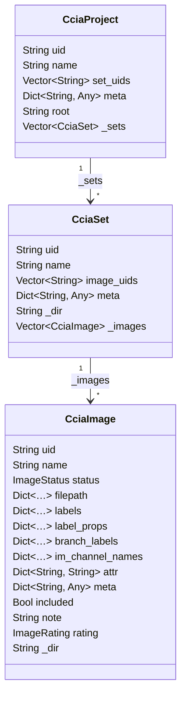

# Julia — the data model

> **Generated** by `scripts/architecture/julia_extract.jl` — do not edit; run `pixi run arch-diagrams`.

The three persisted objects, from their struct definitions. Fields starting with `_` (and `root`)
are runtime-only, not written to `ccid.json` / `project.json`. On-disk shape and the versioned-field
convention: [`docs/OBJECTMODEL.md`](../../OBJECTMODEL.md).

Functions taking each object as their first argument, by area — where the code that works on it lives:

| Area | `CciaProject` | `CciaSet` | `CciaImage` |
|---|---|---|---|
| model | 21 | 10 | 79 |
| ai+lab log | 50 |  | 22 |
| qc+checks | 4 | 32 | 18 |
| gating |  | 2 | 47 |
| plots+boards | 11 |  | 28 |
| scheduler+chains | 18 |  | 4 |
| tracking+spatial |  |  | 21 |
| run records |  |  | 19 |
| tasks |  |  | 15 |
| cell data |  |  | 9 |
| task framework |  |  | 3 |
| jobs (export, import, maintenance) | 1 |  |  |

