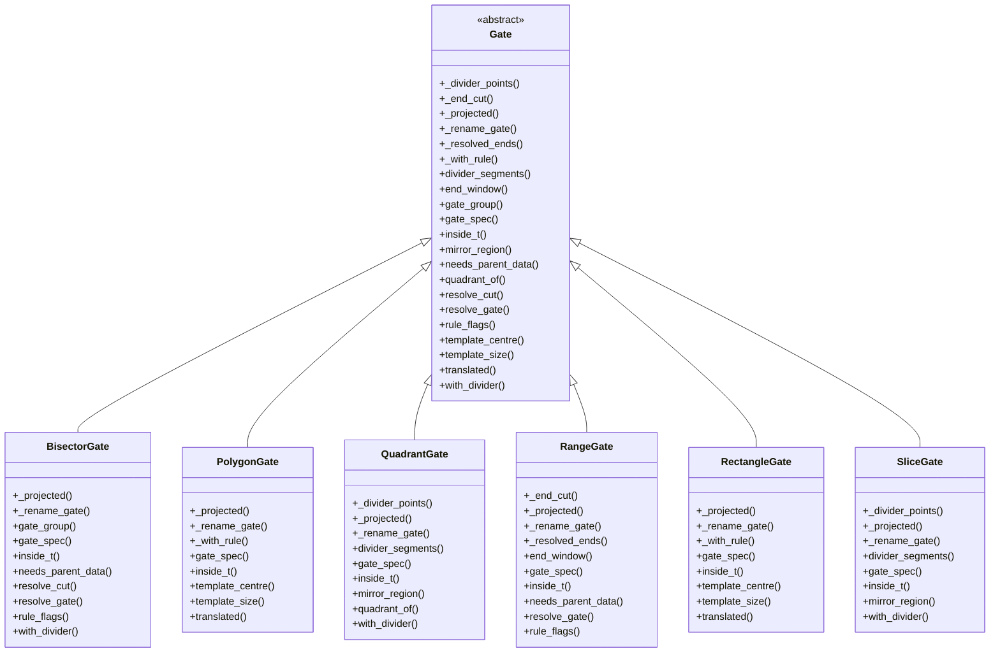
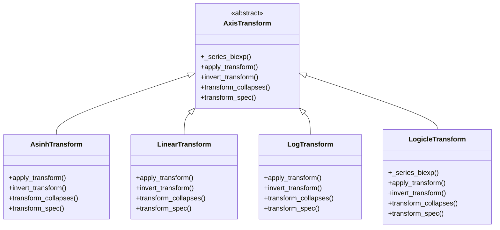
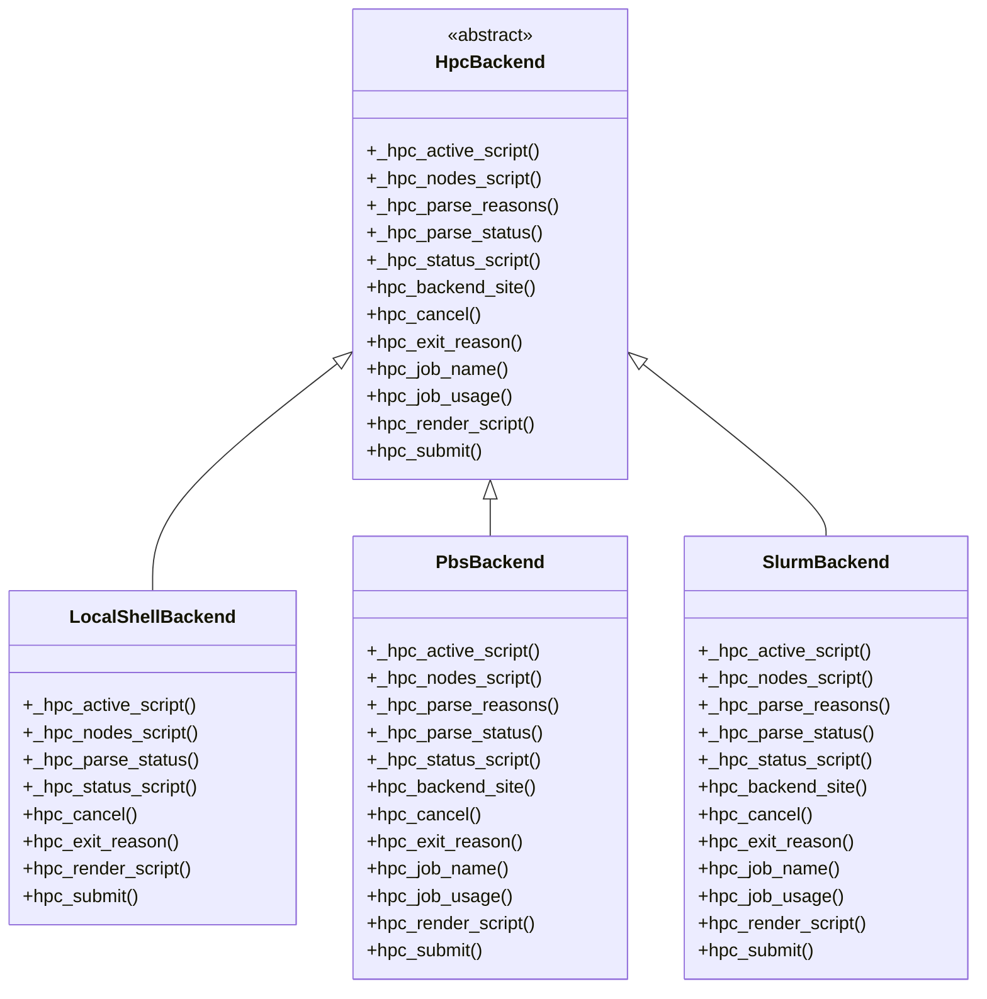
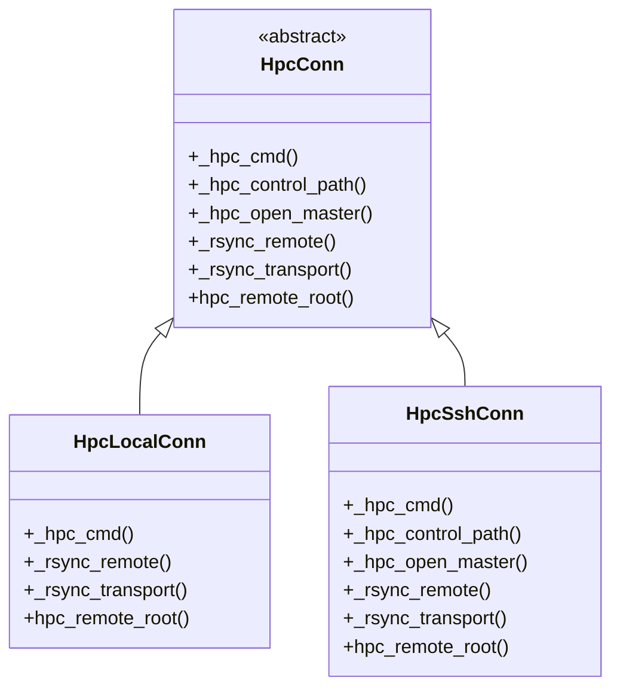
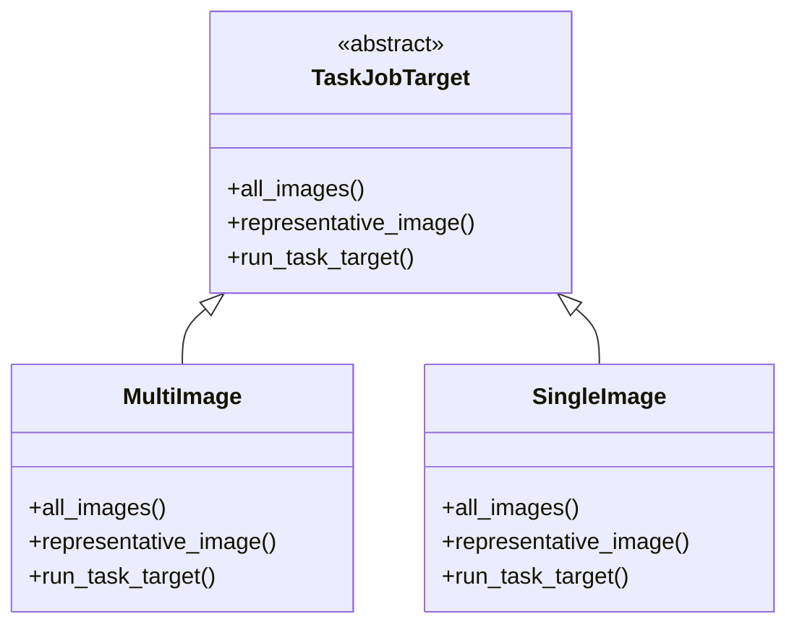
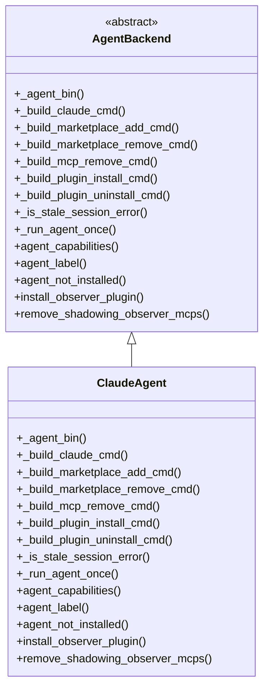

# Julia — abstract types and their contracts

> **Generated** by `scripts/architecture/julia_extract.jl` — do not edit; run `pixi run arch-diagrams`.

A Julia "interface" is an abstract type plus the functions its subtypes are expected to implement
(multiple dispatch — there are no classes). For each abstract type in `Cecelia`:

- **contract** — functions with a method specialised on a concrete subtype. *Kind*: **required** (no
  default, every subtype implements it), *optional* (a default on the abstract type, some subtypes
  override — note a default can itself raise, as `_run_task`'s does), or *partial* (no default and only
  some subtypes: a subtype-specific function, not a contract).
- **operations** — functions that take the abstract type but that no subtype overrides: the shared
  API every subtype gets for free.

Diagram rule: each subtype appears with the contract functions it overrides. More than 10 subtypes
are grouped by the directory they are defined in.

## `CciaTask`

Defined in `app/src/tasks/task.jl:9` · 60 concrete subtypes · 18 contract functions · 36 shared operations

```mermaid
classDiagram
  class CciaTask {
    <<abstract>>
    +_clamp_to_spec()
    +_run_task()
    +_spec_path()
    +_staleness_changed()
    +_staleness_fun_name()
    +_task_spec()
    +live_outputs()
    +manual_check()
    +preview_params()
    +preview_py_env()
    +task_output_effect()
    +task_output_name()
    +task_params_name()
    +task_previewable()
    +task_requires_axes()
    +task_requires_scale()
    +task_writes_into_key()
    +validate_params()
  }
  class app_src["app/src (2)"] {
    SegmentStalenessReport
    TrackingStalenessReport
  }
  CciaTask <|-- app_src
  class tasks_behaviour["tasks/behaviour (3)"] {
    HmmStates
    HmmTransitions
    MotifDiscovery
  }
  CciaTask <|-- tasks_behaviour
  class tasks_cleanupImages["tasks/cleanupImages (6)"] {
    AfCorrect
    Denoise
    DriftCorrect
    FlowRegister
    Smooth
    StackAlign
  }
  CciaTask <|-- tasks_cleanupImages
  class tasks_clustPops["tasks/clustPops (1)"] {
    ClustPops
  }
  CciaTask <|-- tasks_clustPops
  class tasks_clustRegions["tasks/clustRegions (2)"] {
    ClustRegions
    LensQuery
  }
  CciaTask <|-- tasks_clustRegions
  class tasks_clustTracks["tasks/clustTracks (1)"] {
    ClustTracks
  }
  CciaTask <|-- tasks_clustTracks
  class tasks_editImages["tasks/editImages (10)"] {
    BinImage
    CopyImage
    CropImage
    DtypeConvert
    Flip
    Register
    ResampleZ
    SplitTissues
    TProject
    ZProject
  }
  CciaTask <|-- tasks_editImages
  class tasks_exportImages["tasks/exportImages (1)"] {
    ExportOmeTiff
  }
  CciaTask <|-- tasks_exportImages
  class tasks_gate["tasks/gate (1)"] {
    ManualGate
  }
  CciaTask <|-- tasks_gate
  class tasks_importImages["tasks/importImages (5)"] {
    ImmunemapFetch
    ImportOmezarr
    MeasureSignal
    MigrateLegacy
    RemoveImage
  }
  CciaTask <|-- tasks_importImages
  class tasks_opticalFlow["tasks/opticalFlow (2)"] {
    TrainFlowModel
    TrainSupportDenoise
  }
  CciaTask <|-- tasks_opticalFlow
  class tasks_segment["tasks/segment (10)"] {
    AfCells
    Branching
    CellposeSegment
    CoastalSegment
    ImportLabels
    MeasureLabels
    Ridges
    SegmentCorrect
    SegmentCorrectCarryOverRestore
    SegmentCorrectCarryOverSnapshot
  }
  CciaTask <|-- tasks_segment
  class tasks_spatialAnalysis["tasks/spatialAnalysis (9)"] {
    AggregatesMeshes
    CellContacts
    CellNeighbours
    ContactsMeshes
    DetectAggregates
    NeighbourStats
    ProximityProfile
    RoiDiscovery
    SpatialPattern
  }
  CciaTask <|-- tasks_spatialAnalysis
  class tasks_task["tasks/task (1)"] {
    CompositeTask
  }
  CciaTask <|-- tasks_task
  class tasks_testTasks["tasks/testTasks (3)"] {
    IncrementalPlotTask
    TestImageTask
    TestSetTask
  }
  CciaTask <|-- tasks_testTasks
  class tasks_tracking["tasks/tracking (3)"] {
    BayesianTracking
    TrackCorrect
    TrackMeasures
  }
  CciaTask <|-- tasks_tracking
```

| Contract function | Kind | Implemented by |
|---|---|---|
| `_clamp_to_spec` | optional — default on `CciaTask` | CompositeTask (1 of 60) |
| `_run_task` | optional — default on `CciaTask` | AfCells, AfCorrect, AggregatesMeshes, BayesianTracking, BinImage, Branching, CellContacts, CellNeighbours, … (58 of 60) |
| `_spec_path` | optional — default on `CciaTask` | AfCells, AfCorrect, AggregatesMeshes, BayesianTracking, BinImage, Branching, CellContacts, CellNeighbours, … (60 of 60) |
| `_staleness_changed` | partial — no default, only these subtypes (others: MethodError) | SegmentStalenessReport, TrackingStalenessReport (2 of 60) |
| `_staleness_fun_name` | partial — no default, only these subtypes (others: MethodError) | SegmentStalenessReport, TrackingStalenessReport (2 of 60) |
| `_task_spec` | optional — default on `CciaTask` | CompositeTask (1 of 60) |
| `live_outputs` | optional — default on `CciaTask` | CellposeSegment, CoastalSegment, CompositeTask (3 of 60) |
| `manual_check` | optional — default on `CciaTask` | ManualGate (1 of 60) |
| `preview_params` | optional — default on `CciaTask` | AfCorrect, CellposeSegment, CoastalSegment, CompositeTask, Ridges, Smooth, SplitTissues (7 of 60) |
| `preview_py_env` | optional — default on `CciaTask` | CellposeSegment, CompositeTask (2 of 60) |
| `task_output_effect` | optional — default on `CciaTask` | AfCorrect, BinImage, CompositeTask, CopyImage, CropImage, Denoise, DriftCorrect, DtypeConvert, … (17 of 60) |
| `task_output_name` | optional — default on `CciaTask` | CompositeTask (1 of 60) |
| `task_params_name` | optional — default on `CciaTask` | CompositeTask (1 of 60) |
| `task_previewable` | optional — default on `CciaTask` | AfCorrect, CellposeSegment, CoastalSegment, CompositeTask, Ridges, Smooth, SplitTissues (7 of 60) |
| `task_requires_axes` | optional — default on `CciaTask` | CompositeTask (1 of 60) |
| `task_requires_scale` | optional — default on `CciaTask` | CompositeTask (1 of 60) |
| `task_writes_into_key` | optional — default on `CciaTask` | CompositeTask (1 of 60) |
| `validate_params` | optional — default on `CciaTask` | CompositeTask, SegmentCorrect, TrackCorrect, TrainFlowModel (4 of 60) |

Shared operations: `_apply_group_order`, `_apply_param_requires`, `_apply_param_requires_by_axes`, `_apply_spec_defaults`, `_composite_step_names`, `_composite_steps`, `_flatten_sections`, `_fun_name_from_task`, `_inject_dynamic_options!`, `_live_outputs_for`, `_needs_dynamic_options`, `_repeatable_group_keys`, `_section_keys`, `_spec_output_value_name`, `_task_pool_name`, `_with_run_target`, `effective_pool_name`, `hpc_dispatch_for`, `hpc_resources`, `hpc_task_class`, `output_registry`, `preview_env`, `preview_params_for_run`, `preview_steps_not_previewed`, `register_task!`, `resolve_params_unscoped`, `resolve_run_params`, `run_task`, `run_tasks`, `task_applicability_reason`, `task_applies`, `task_citations`, `task_manual`, `task_missing_scale`, `task_runs_on_hpc`, `task_scope`

## `Gate`

Defined in `app/src/gating/gates.jl:8` · 6 concrete subtypes · 21 contract functions · 8 shared operations

| Contract function | Kind | Implemented by |
|---|---|---|
| `_divider_points` | partial — no default, only these subtypes (others: MethodError) | QuadrantGate, SliceGate |
| `_end_cut` | partial — no default, only these subtypes (others: MethodError) | RangeGate |
| `_projected` | **required** — no default, every subtype has one | BisectorGate, PolygonGate, QuadrantGate, RangeGate, RectangleGate, SliceGate |
| `_rename_gate` | **required** — no default, every subtype has one | BisectorGate, PolygonGate, QuadrantGate, RangeGate, RectangleGate, SliceGate |
| `_resolved_ends` | partial — no default, only these subtypes (others: MethodError) | RangeGate |
| `_with_rule` | partial — no default, only these subtypes (others: MethodError) | PolygonGate, RectangleGate |
| `divider_segments` | partial — no default, only these subtypes (others: MethodError) | QuadrantGate, SliceGate |
| `end_window` | partial — no default, only these subtypes (others: MethodError) | RangeGate |
| `gate_group` | optional — default on `Gate` | BisectorGate |
| `gate_spec` | **required** — no default, every subtype has one | BisectorGate, PolygonGate, QuadrantGate, RangeGate, RectangleGate, SliceGate |
| `inside_t` | **required** — no default, every subtype has one | BisectorGate, PolygonGate, QuadrantGate, RangeGate, RectangleGate, SliceGate |
| `mirror_region` | partial — no default, only these subtypes (others: MethodError) | QuadrantGate, SliceGate |
| `needs_parent_data` | optional — default on `Gate` | BisectorGate, RangeGate |
| `quadrant_of` | partial — no default, only these subtypes (others: MethodError) | QuadrantGate |
| `resolve_cut` | optional — default on `Gate` | BisectorGate |
| `resolve_gate` | optional — default on `Gate` | BisectorGate, RangeGate |
| `rule_flags` | optional — default on `Gate` | BisectorGate, RangeGate |
| `template_centre` | partial — no default, only these subtypes (others: MethodError) | PolygonGate, RectangleGate |
| `template_size` | partial — no default, only these subtypes (others: MethodError) | PolygonGate, RectangleGate |
| `translated` | partial — no default, only these subtypes (others: MethodError) | PolygonGate, RectangleGate |
| `with_divider` | optional — default on `Gate` | BisectorGate, QuadrantGate, SliceGate |

Shared operations: `_gate_mask`, `anchor_rule`, `gate_channels`, `gate_shape_spec`, `inside`, `needs_anchor`, `project_gate`, `set_gate!`

## `AxisTransform`

Defined in `app/src/gating/transforms.jl:27` · 4 concrete subtypes · 5 contract functions · 6 shared operations

| Contract function | Kind | Implemented by |
|---|---|---|
| `_series_biexp` | partial — no default, only these subtypes (others: MethodError) | LogicleTransform |
| `apply_transform` | optional — default on `AxisTransform` | AsinhTransform, LinearTransform, LogTransform, LogicleTransform |
| `invert_transform` | optional — default on `AxisTransform` | AsinhTransform, LinearTransform, LogTransform, LogicleTransform |
| `transform_collapses` | **required** — no default, every subtype has one | AsinhTransform, LinearTransform, LogTransform, LogicleTransform |
| `transform_spec` | **required** — no default, every subtype has one | AsinhTransform, LinearTransform, LogTransform, LogicleTransform |

Shared operations: `effective_transform`, `invert_column`, `project_gate`, `transform_column`, `transform_key`, `transform_kind`

## `HpcBackend`

Defined in `app/src/hpc/backend.jl:44` · 3 concrete subtypes · 12 contract functions · 11 shared operations

| Contract function | Kind | Implemented by |
|---|---|---|
| `_hpc_active_script` | **required** — no default, every subtype has one | LocalShellBackend, PbsBackend, SlurmBackend |
| `_hpc_nodes_script` | **required** — no default, every subtype has one | LocalShellBackend, PbsBackend, SlurmBackend |
| `_hpc_parse_reasons` | optional — default on `HpcBackend` | PbsBackend, SlurmBackend |
| `_hpc_parse_status` | **required** — no default, every subtype has one | LocalShellBackend, PbsBackend, SlurmBackend |
| `_hpc_status_script` | **required** — no default, every subtype has one | LocalShellBackend, PbsBackend, SlurmBackend |
| `hpc_backend_site` | optional — default on `HpcBackend` | PbsBackend, SlurmBackend |
| `hpc_cancel` | **required** — no default, every subtype has one | LocalShellBackend, PbsBackend, SlurmBackend |
| `hpc_exit_reason` | **required** — no default, every subtype has one | LocalShellBackend, PbsBackend, SlurmBackend |
| `hpc_job_name` | optional — default on `HpcBackend` | PbsBackend, SlurmBackend |
| `hpc_job_usage` | optional — default on `HpcBackend` | PbsBackend, SlurmBackend |
| `hpc_render_script` | **required** — no default, every subtype has one | LocalShellBackend, PbsBackend, SlurmBackend |
| `hpc_submit` | **required** — no default, every subtype has one | LocalShellBackend, PbsBackend, SlurmBackend |

Shared operations: `_try_exit_reason`, `hpc_active_jobs`, `hpc_cleanup!`, `hpc_cleanup_refusal`, `hpc_env_status`, `hpc_install_env!`, `hpc_node_shapes`, `hpc_poll`, `hpc_queue_cancel!`, `hpc_require_env`, `hpc_watch_job`

## `HpcConn`

Defined in `app/src/hpc/transport.jl:251` · 2 concrete subtypes · 6 contract functions · 22 shared operations

| Contract function | Kind | Implemented by |
|---|---|---|
| `_hpc_cmd` | **required** — no default, every subtype has one | HpcLocalConn, HpcSshConn |
| `_hpc_control_path` | partial — no default, only these subtypes (others: MethodError) | HpcSshConn |
| `_hpc_open_master` | partial — no default, only these subtypes (others: MethodError) | HpcSshConn |
| `_rsync_remote` | **required** — no default, every subtype has one | HpcLocalConn, HpcSshConn |
| `_rsync_transport` | **required** — no default, every subtype has one | HpcLocalConn, HpcSshConn |
| `hpc_remote_root` | **required** — no default, every subtype has one | HpcLocalConn, HpcSshConn |

Shared operations: `_hpc_rsync_run`, `_hpc_sched_log_tail`, `_try_exit_reason`, `hpc_active_jobs`, `hpc_cancel`, `hpc_cleanup!`, `hpc_cleanup_refusal`, `hpc_env_status`, `hpc_exec`, `hpc_exec!`, `hpc_exit_reason`, `hpc_install_env!`, `hpc_job_usage`, `hpc_node_shapes`, `hpc_poll`, `hpc_queue_cancel!`, `hpc_require_env`, `hpc_rsync`, `hpc_rsync_itemize`, `hpc_submit`, `hpc_sync_code!`, `hpc_watch_job`

## `TaskJobTarget`

Defined in `app/src/tasks/scheduler/jobs.jl:23` · 2 concrete subtypes · 3 contract functions · 0 shared operations

| Contract function | Kind | Implemented by |
|---|---|---|
| `all_images` | **required** — no default, every subtype has one | MultiImage, SingleImage |
| `representative_image` | **required** — no default, every subtype has one | MultiImage, SingleImage |
| `run_task_target` | **required** — no default, every subtype has one | MultiImage, SingleImage |

## `AgentBackend`

Defined in `app/src/ai/agent_runner.jl:30` · 1 concrete subtypes · 14 contract functions · 2 shared operations

| Contract function | Kind | Implemented by |
|---|---|---|
| `_agent_bin` | optional — default on `AgentBackend` | ClaudeAgent |
| `_build_claude_cmd` | **required** — no default, every subtype has one | ClaudeAgent |
| `_build_marketplace_add_cmd` | **required** — no default, every subtype has one | ClaudeAgent |
| `_build_marketplace_remove_cmd` | **required** — no default, every subtype has one | ClaudeAgent |
| `_build_mcp_remove_cmd` | **required** — no default, every subtype has one | ClaudeAgent |
| `_build_plugin_install_cmd` | **required** — no default, every subtype has one | ClaudeAgent |
| `_build_plugin_uninstall_cmd` | **required** — no default, every subtype has one | ClaudeAgent |
| `_is_stale_session_error` | optional — default on `AgentBackend` | ClaudeAgent |
| `_run_agent_once` | optional — default on `AgentBackend` | ClaudeAgent |
| `agent_capabilities` | optional — default on `AgentBackend` | ClaudeAgent |
| `agent_label` | optional — default on `AgentBackend` | ClaudeAgent |
| `agent_not_installed` | optional — default on `AgentBackend` | ClaudeAgent |
| `install_observer_plugin` | **required** — no default, every subtype has one | ClaudeAgent |
| `remove_shadowing_observer_mcps` | **required** — no default, every subtype has one | ClaudeAgent |

Shared operations: `agent_available`, `run_agent_turn`

