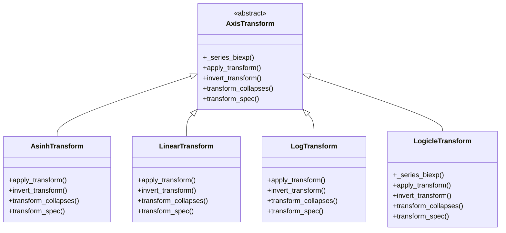
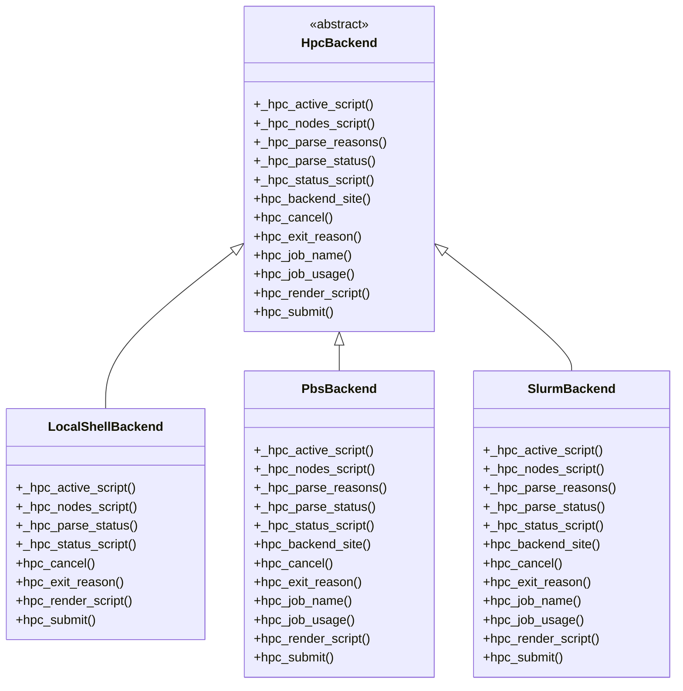
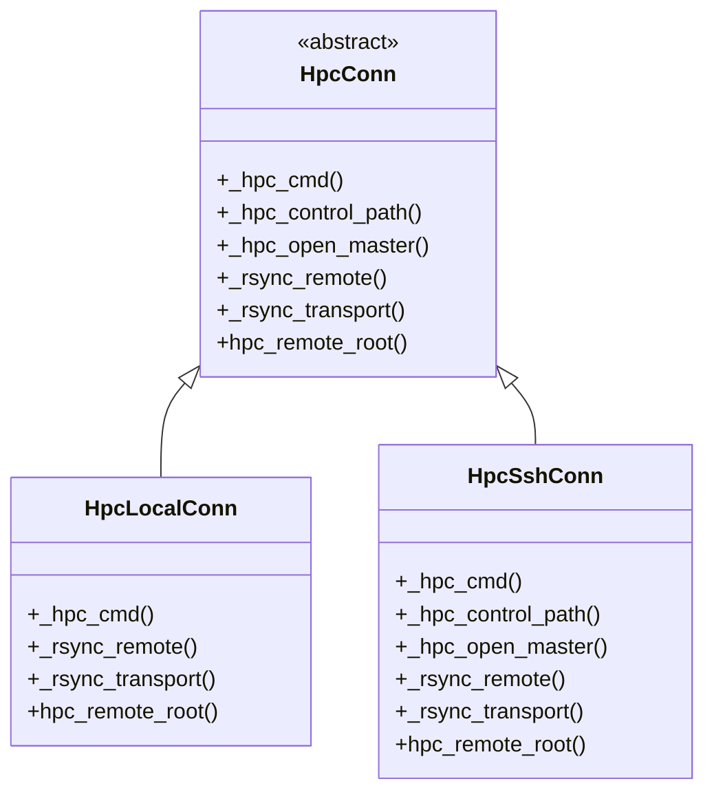
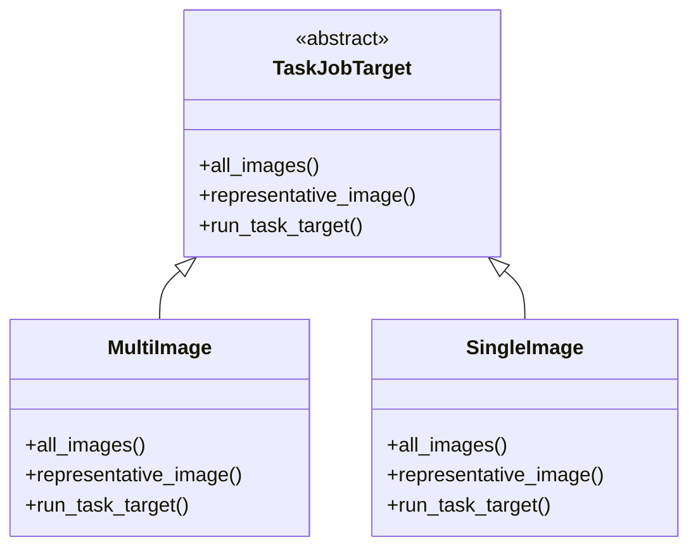
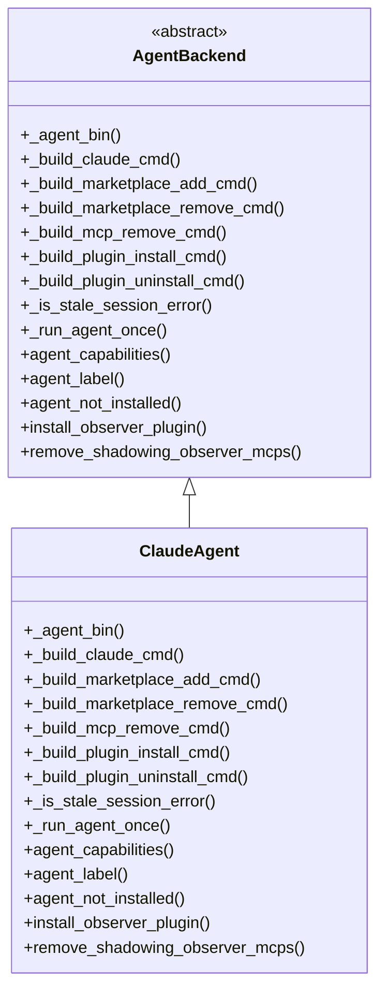

# Julia — abstract types and their contracts

> **Generated** by `scripts/architecture/julia_extract.jl` — do not edit; run `pixi run arch-diagrams`.

A Julia "interface" is an abstract type plus the functions its subtypes are expected to implement
(multiple dispatch — there are no classes). For each abstract type in `Cecelia`:

- **contract** — functions with a method specialised on a concrete subtype. **Required**: no
  default, every subtype implements it. *Optional*: a default on the abstract type that some subtypes
  override (a default can itself raise, as `_run_task`'s does). A function with no default that only
  some subtypes have is listed apart as *subtype-specific* — it belongs to those subtypes, not the type.
- **operations** — functions that take the abstract type but that no subtype overrides: the shared
  API every subtype gets for free.

Each type opens with the checklist for adding a subtype. Up to 10 subtypes: a class diagram, each
subtype with the functions it overrides. More: a table of subtypes by directory (a diagram of 60
names shows nothing). How to add a task end to end: [`docs/MODULES.md`](../../MODULES.md).

## `CciaTask`

Defined in `app/src/tasks/task.jl:9` · 60 subtypes · 0 required, 16 with a default, 2 subtype-specific

**To add a subtype** — implement the required and expected functions; override an optional one only to change its default.

| Function | Kind | Implemented by |
|---|---|---|
| `_run_task` | **expected** — has a default, but nearly every subtype overrides it | AfCells, AfCorrect, AggregatesMeshes, BayesianTracking, BinImage, Branching, CellContacts, CellNeighbours, … (58 of 60) |
| `_spec_path` | **expected** — has a default, but nearly every subtype overrides it | AfCells, AfCorrect, AggregatesMeshes, BayesianTracking, BinImage, Branching, CellContacts, CellNeighbours, … (60 of 60) |
| `_clamp_to_spec` | optional | CompositeTask (1 of 60) |
| `_task_spec` | optional | CompositeTask (1 of 60) |
| `live_outputs` | optional | CellposeSegment, CoastalSegment, CompositeTask (3 of 60) |
| `manual_check` | optional | ManualGate (1 of 60) |
| `preview_params` | optional | AfCorrect, CellposeSegment, CoastalSegment, CompositeTask, Ridges, Smooth, SplitTissues (7 of 60) |
| `preview_py_env` | optional | CellposeSegment, CompositeTask (2 of 60) |
| `task_output_effect` | optional | AfCorrect, BinImage, CompositeTask, CopyImage, CropImage, Denoise, DriftCorrect, DtypeConvert, … (17 of 60) |
| `task_output_name` | optional | CompositeTask (1 of 60) |
| `task_params_name` | optional | CompositeTask (1 of 60) |
| `task_previewable` | optional | AfCorrect, CellposeSegment, CoastalSegment, CompositeTask, Ridges, Smooth, SplitTissues (7 of 60) |
| `task_requires_axes` | optional | CompositeTask (1 of 60) |
| `task_requires_scale` | optional | CompositeTask (1 of 60) |
| `task_writes_into_key` | optional | CompositeTask (1 of 60) |
| `validate_params` | optional | CompositeTask, SegmentCorrect, TrackCorrect, TrainFlowModel (4 of 60) |

Subtype-specific (no default; only these subtypes have one, so not part of the contract): `_staleness_changed` (SegmentStalenessReport, TrackingStalenessReport); `_staleness_fun_name` (SegmentStalenessReport, TrackingStalenessReport)

Subtypes by where they are defined:

| Directory | Subtypes |
|---|---|
| `app/src` | SegmentStalenessReport, TrackingStalenessReport |
| `tasks/behaviour` | HmmStates, HmmTransitions, MotifDiscovery |
| `tasks/cleanupImages` | AfCorrect, Denoise, DriftCorrect, FlowRegister, Smooth, StackAlign |
| `tasks/clustPops` | ClustPops |
| `tasks/clustRegions` | ClustRegions, LensQuery |
| `tasks/clustTracks` | ClustTracks |
| `tasks/editImages` | BinImage, CopyImage, CropImage, DtypeConvert, Flip, Register, ResampleZ, SplitTissues, TProject, ZProject |
| `tasks/exportImages` | ExportOmeTiff |
| `tasks/gate` | ManualGate |
| `tasks/importImages` | ImmunemapFetch, ImportOmezarr, MeasureSignal, MigrateLegacy, RemoveImage |
| `tasks/opticalFlow` | TrainFlowModel, TrainSupportDenoise |
| `tasks/segment` | AfCells, Branching, CellposeSegment, CoastalSegment, ImportLabels, MeasureLabels, Ridges, SegmentCorrect, SegmentCorrectCarryOverRestore, SegmentCorrectCarryOverSnapshot |
| `tasks/spatialAnalysis` | AggregatesMeshes, CellContacts, CellNeighbours, ContactsMeshes, DetectAggregates, NeighbourStats, ProximityProfile, RoiDiscovery, SpatialPattern |
| `tasks/task` | CompositeTask |
| `tasks/testTasks` | IncrementalPlotTask, TestImageTask, TestSetTask |
| `tasks/tracking` | BayesianTracking, TrackCorrect, TrackMeasures |

36 shared operations — take any `CciaTask`, no subtype overrides them

`_apply_group_order`, `_apply_param_requires`, `_apply_param_requires_by_axes`, `_apply_spec_defaults`, `_composite_step_names`, `_composite_steps`, `_flatten_sections`, `_fun_name_from_task`, `_inject_dynamic_options!`, `_live_outputs_for`, `_needs_dynamic_options`, `_repeatable_group_keys`, `_section_keys`, `_spec_output_value_name`, `_task_pool_name`, `_with_run_target`, `effective_pool_name`, `hpc_dispatch_for`, `hpc_resources`, `hpc_task_class`, `output_registry`, `preview_env`, `preview_params_for_run`, `preview_steps_not_previewed`, `register_task!`, `resolve_params_unscoped`, `resolve_run_params`, `run_task`, `run_tasks`, `task_applicability_reason`, `task_applies`, `task_citations`, `task_manual`, `task_missing_scale`, `task_runs_on_hpc`, `task_scope`

## `Gate`

Defined in `app/src/gating/gates.jl:8` · 6 subtypes · 4 required, 6 with a default, 11 subtype-specific

**To add a subtype** — implement the required and expected functions; override an optional one only to change its default.

| Function | Kind | Implemented by |
|---|---|---|
| `_projected` | **required** | BisectorGate, PolygonGate, QuadrantGate, RangeGate, RectangleGate, SliceGate |
| `_rename_gate` | **required** | BisectorGate, PolygonGate, QuadrantGate, RangeGate, RectangleGate, SliceGate |
| `gate_spec` | **required** | BisectorGate, PolygonGate, QuadrantGate, RangeGate, RectangleGate, SliceGate |
| `inside_t` | **required** | BisectorGate, PolygonGate, QuadrantGate, RangeGate, RectangleGate, SliceGate |
| `gate_group` | optional | BisectorGate |
| `needs_parent_data` | optional | BisectorGate, RangeGate |
| `resolve_cut` | optional | BisectorGate |
| `resolve_gate` | optional | BisectorGate, RangeGate |
| `rule_flags` | optional | BisectorGate, RangeGate |
| `with_divider` | optional | BisectorGate, QuadrantGate, SliceGate |

Subtype-specific (no default; only these subtypes have one, so not part of the contract): `_divider_points` (QuadrantGate, SliceGate); `_end_cut` (RangeGate); `_resolved_ends` (RangeGate); `_with_rule` (PolygonGate, RectangleGate); `divider_segments` (QuadrantGate, SliceGate); `end_window` (RangeGate); `mirror_region` (QuadrantGate, SliceGate); `quadrant_of` (QuadrantGate); `template_centre` (PolygonGate, RectangleGate); `template_size` (PolygonGate, RectangleGate); `translated` (PolygonGate, RectangleGate)

8 shared operations — take any `Gate`, no subtype overrides them

`_gate_mask`, `anchor_rule`, `gate_channels`, `gate_shape_spec`, `inside`, `needs_anchor`, `project_gate`, `set_gate!`

## `AxisTransform`

Defined in `app/src/gating/transforms.jl:27` · 4 subtypes · 2 required, 2 with a default, 1 subtype-specific

**To add a subtype** — implement the required and expected functions; override an optional one only to change its default.

| Function | Kind | Implemented by |
|---|---|---|
| `transform_collapses` | **required** | AsinhTransform, LinearTransform, LogTransform, LogicleTransform |
| `transform_spec` | **required** | AsinhTransform, LinearTransform, LogTransform, LogicleTransform |
| `apply_transform` | **expected** — has a default, but nearly every subtype overrides it | AsinhTransform, LinearTransform, LogTransform, LogicleTransform |
| `invert_transform` | **expected** — has a default, but nearly every subtype overrides it | AsinhTransform, LinearTransform, LogTransform, LogicleTransform |

Subtype-specific (no default; only these subtypes have one, so not part of the contract): `_series_biexp` (LogicleTransform)

6 shared operations — take any `AxisTransform`, no subtype overrides them

`effective_transform`, `invert_column`, `project_gate`, `transform_column`, `transform_key`, `transform_kind`

## `HpcBackend`

Defined in `app/src/hpc/backend.jl:44` · 3 subtypes · 8 required, 4 with a default

**To add a subtype** — implement the required and expected functions; override an optional one only to change its default.

| Function | Kind | Implemented by |
|---|---|---|
| `_hpc_active_script` | **required** | LocalShellBackend, PbsBackend, SlurmBackend |
| `_hpc_nodes_script` | **required** | LocalShellBackend, PbsBackend, SlurmBackend |
| `_hpc_parse_status` | **required** | LocalShellBackend, PbsBackend, SlurmBackend |
| `_hpc_status_script` | **required** | LocalShellBackend, PbsBackend, SlurmBackend |
| `hpc_cancel` | **required** | LocalShellBackend, PbsBackend, SlurmBackend |
| `hpc_exit_reason` | **required** | LocalShellBackend, PbsBackend, SlurmBackend |
| `hpc_render_script` | **required** | LocalShellBackend, PbsBackend, SlurmBackend |
| `hpc_submit` | **required** | LocalShellBackend, PbsBackend, SlurmBackend |
| `_hpc_parse_reasons` | optional | PbsBackend, SlurmBackend |
| `hpc_backend_site` | optional | PbsBackend, SlurmBackend |
| `hpc_job_name` | optional | PbsBackend, SlurmBackend |
| `hpc_job_usage` | optional | PbsBackend, SlurmBackend |

11 shared operations — take any `HpcBackend`, no subtype overrides them

`_try_exit_reason`, `hpc_active_jobs`, `hpc_cleanup!`, `hpc_cleanup_refusal`, `hpc_env_status`, `hpc_install_env!`, `hpc_node_shapes`, `hpc_poll`, `hpc_queue_cancel!`, `hpc_require_env`, `hpc_watch_job`

## `HpcConn`

Defined in `app/src/hpc/transport.jl:251` · 2 subtypes · 4 required, 0 with a default, 2 subtype-specific

**To add a subtype** — implement the required and expected functions; override an optional one only to change its default.

| Function | Kind | Implemented by |
|---|---|---|
| `_hpc_cmd` | **required** | HpcLocalConn, HpcSshConn |
| `_rsync_remote` | **required** | HpcLocalConn, HpcSshConn |
| `_rsync_transport` | **required** | HpcLocalConn, HpcSshConn |
| `hpc_remote_root` | **required** | HpcLocalConn, HpcSshConn |

Subtype-specific (no default; only these subtypes have one, so not part of the contract): `_hpc_control_path` (HpcSshConn); `_hpc_open_master` (HpcSshConn)

22 shared operations — take any `HpcConn`, no subtype overrides them

`_hpc_rsync_run`, `_hpc_sched_log_tail`, `_try_exit_reason`, `hpc_active_jobs`, `hpc_cancel`, `hpc_cleanup!`, `hpc_cleanup_refusal`, `hpc_env_status`, `hpc_exec`, `hpc_exec!`, `hpc_exit_reason`, `hpc_install_env!`, `hpc_job_usage`, `hpc_node_shapes`, `hpc_poll`, `hpc_queue_cancel!`, `hpc_require_env`, `hpc_rsync`, `hpc_rsync_itemize`, `hpc_submit`, `hpc_sync_code!`, `hpc_watch_job`

## `TaskJobTarget`

Defined in `app/src/tasks/scheduler/jobs.jl:23` · 2 subtypes · 3 required, 0 with a default

**To add a subtype** — implement the required and expected functions; override an optional one only to change its default.

| Function | Kind | Implemented by |
|---|---|---|
| `all_images` | **required** | MultiImage, SingleImage |
| `representative_image` | **required** | MultiImage, SingleImage |
| `run_task_target` | **required** | MultiImage, SingleImage |

## `AgentBackend`

Defined in `app/src/ai/agent_runner.jl:30` · 1 subtypes · 8 required, 6 with a default

**To add a subtype** — implement the required and expected functions; override an optional one only to change its default.

| Function | Kind | Implemented by |
|---|---|---|
| `_build_claude_cmd` | **required** | ClaudeAgent |
| `_build_marketplace_add_cmd` | **required** | ClaudeAgent |
| `_build_marketplace_remove_cmd` | **required** | ClaudeAgent |
| `_build_mcp_remove_cmd` | **required** | ClaudeAgent |
| `_build_plugin_install_cmd` | **required** | ClaudeAgent |
| `_build_plugin_uninstall_cmd` | **required** | ClaudeAgent |
| `install_observer_plugin` | **required** | ClaudeAgent |
| `remove_shadowing_observer_mcps` | **required** | ClaudeAgent |
| `_agent_bin` | optional | ClaudeAgent |
| `_is_stale_session_error` | optional | ClaudeAgent |
| `_run_agent_once` | optional | ClaudeAgent |
| `agent_capabilities` | optional | ClaudeAgent |
| `agent_label` | optional | ClaudeAgent |
| `agent_not_installed` | optional | ClaudeAgent |

2 shared operations — take any `AgentBackend`, no subtype overrides them

`agent_available`, `run_agent_turn`

