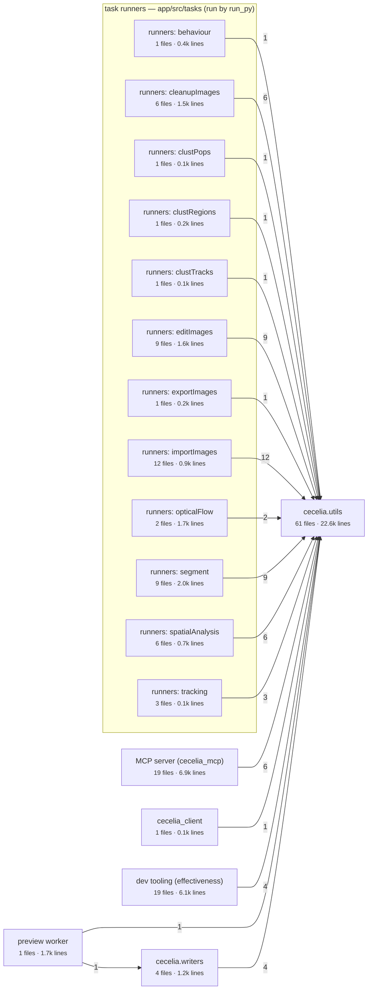

# Python — the parts and who imports whom

> **Generated** by `scripts/architecture/python_extract.py` — do not edit; run `pixi run arch-diagrams`.

Python has three jobs here: **task runners** (`app/src/tasks/<category>/*_run.py`, run by path through
`run_py`, never imported), the **`cecelia` IO library** they import (`python/cecelia/utils` +
`writers`), and side processes (the MCP server Claude talks to, the preview worker). Dev tooling
(recital, judge) lives in `cecelia.effectiveness` and is not part of the app.

`A → B (n)`: n files in A import something from B. Runners are grouped by task category.

Runners and side processes never import each other; everything shared goes through `cecelia.utils`. An arrow between two runner groups or into a runner would be a violation.

Arrows into a runner group today: **0**
