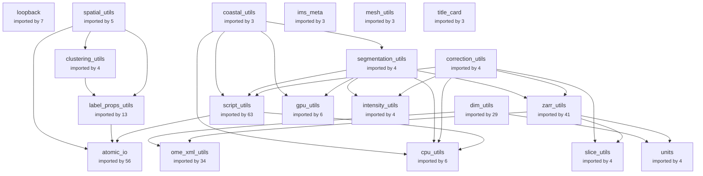
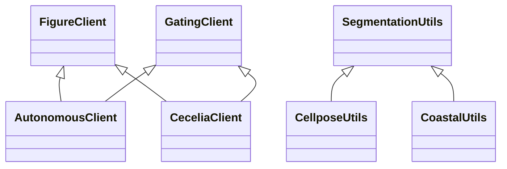

# Python — inside `cecelia.utils`

> **Generated** by `scripts/architecture/python_extract.py` — do not edit; run `pixi run arch-diagrams`.

`cecelia.utils` is 61 modules, 22.4k lines. Which ones carry the weight, and how they lean on each other.

## The 20 most-imported modules

Box: module and how many repo files import it. Arrow `a → b`: a imports b. Only edges among these 20.

## Import cycles

None.

## The de-facto API — most-imported functions and classes

`from cecelia.utils.x import y` counted per importing file, or `zarr_utils.open_as_zarr(…)` after a module import, counted per using file; dev tooling included. These are the interfaces a change ripples through.

| Name | Module | Imported by |
|---|---|---|
| `script_params` | `cecelia.utils.script_utils` | 58 |
| `get_logfile_utils` | `cecelia.utils.script_utils` | 55 |
| `write_json_atomic` | `cecelia.utils.atomic_io` | 48 |
| `read_axes` | `cecelia.utils.zarr_utils` | 33 |
| `open_as_zarr` | `cecelia.utils.zarr_utils` | 32 |
| `DimUtils` | `cecelia.utils.dim_utils` | 29 |
| `parse_meta` | `cecelia.utils.ome_xml_utils` | 28 |
| `staged_store` | `cecelia.utils.zarr_utils` | 21 |
| `open_multiscales_for_writing` | `cecelia.utils.zarr_utils` | 20 |
| `get_param` | `cecelia.utils.script_utils` | 17 |
| `save_meta_in_zarr` | `cecelia.utils.ome_xml_utils` | 15 |
| `write_calibration` | `cecelia.utils.zarr_utils` | 15 |
| `write_multiscale_pyramid` | `cecelia.utils.zarr_utils` | 15 |
| `read_timepoint` | `cecelia.utils.zarr_utils` | 12 |
| `LabelPropsView` | `cecelia.utils.label_props_utils` | 10 |
| `channel_indices` | `cecelia.utils.script_utils` | 9 |
| `carry_valid_box` | `cecelia.utils.zarr_utils` | 9 |
| `write_h5ad_atomic` | `cecelia.utils.atomic_io` | 6 |
| `torch_device` | `cecelia.utils.gpu_utils` | 5 |
| `write_label_pyramid` | `cecelia.utils.zarr_utils` | 5 |
| `atomic_path` | `cecelia.utils.atomic_io` | 4 |
| `default_base_url` | `cecelia.utils.loopback` | 4 |
| `channel_index` | `cecelia.utils.script_utils` | 4 |
| `fortify` | `cecelia.utils.zarr_utils` | 4 |
| `native_dtype` | `cecelia.utils.zarr_utils` | 4 |
| `store_axes` | `cecelia.utils.zarr_utils` | 4 |
| `split_back_and_write` | `cecelia.utils.clustering_utils` | 3 |
| `task_workers` | `cecelia.utils.cpu_utils` | 3 |
| `skimage_centroid_axis_names` | `cecelia.utils.label_props_utils` | 3 |
| `api_token` | `cecelia.utils.loopback` | 3 |

## Class hierarchies

Classes with a base class defined in the repo (exceptions and NamedTuples left out).

- `AutonomousClient` ← `FigureClient` — `mcp/cecelia_mcp/autonomous.py`
- `AutonomousClient` ← `GatingClient` — `mcp/cecelia_mcp/autonomous.py`
- `CeceliaClient` ← `FigureClient` — `mcp/cecelia_mcp/client.py`
- `CeceliaClient` ← `GatingClient` — `mcp/cecelia_mcp/client.py`
- `CellposeUtils` ← `SegmentationUtils` — `python/cecelia/utils/cellpose_utils.py`
- `CoastalUtils` ← `SegmentationUtils` — `python/cecelia/utils/coastal_utils.py`
