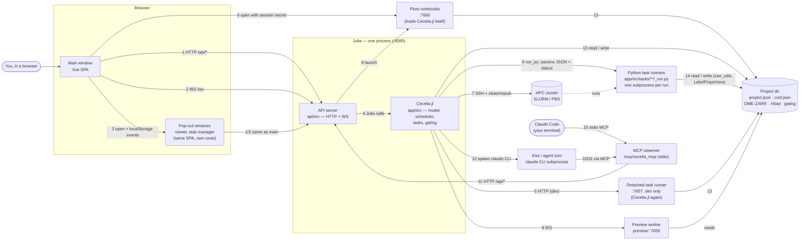

# System — the runtimes and how they talk

> **Hand-traced** — no tool sees these arrows. Every arrow is pinned to a file and a function in the
> *Pins* table; `python/cecelia/tests/test_architecture_docs.py` fails when a pinned file or symbol no
> longer exists. A dead arrow is caught; a new one nobody drew is not — redraw when you add a process,
> a port or a protocol.

Ports are slot 0 (`service_port`, `app/src/ports.jl`). Every port is gated by the API token
(`docs/ARCHITECTURE.md` → *API token*).

## Containers

## The arrows

| # | Arrow | What crosses | Contract lives in |
|---|---|---|---|
| 1 | browser → API, HTTP | `/api/*` JSON + binary (tiles, slabs) | `docs/API.md` → *Route index* |
| 2 | browser ↔ API, WebSocket | commands in (`task:run`, `chain:run`, cancel, export…); task status / progress / log and change broadcasts out — every type: [`boundaries_reference.md`](boundaries_reference.md) §3 | `docs/ARCHITECTURE.md` → *WS message type reference* |
| 3 | main ↔ pop-outs | window handles; cross-window events via `localStorage` + `storage` event | `frontend/src/lib/*Channel.ts` |
| 4 | API → package | plain Julia calls; the API owns no data model | `docs/ARCHITECTURE.md` → *Layer ownership* |
| 5 | package → runner | task / chain requests over HTTP; runner relays frames back | `docs/RUNNER.md` |
| 6 | package → Python runner | params JSON in the run's task dir, `[PROGRESS] n/total` on stdout, exit code | `app/CLAUDE.md` → *Spawning Python* |
| 7 | package → HPC | same `run_py` call, dispatched over SSH | `docs/HPC.md` |
| 8 | package → preview worker | one region's compute, mask block back | `docs/ARCHITECTURE.md` → *Repository layout* (`preview/`) |
| 9 | API → Pluto, browser → Pluto | the API launches it lazily and hands the page its URL + secret; the browser then talks to Pluto directly. Pluto loads `Cecelia.jl` in its own env (`pluto/Project.toml`), so it reads the project dir itself | `docs/NOTEBOOKS.md` |
| 10 | Claude → MCP | MCP tools over stdio | `mcp/cecelia_mcp/tools.json` |
| 11 | MCP → API | `/api/*` with the API token (file path in env) | `docs/ARCHITECTURE.md` → *API token* |
| 12 | package → Kiwi | `claude` CLI subprocess with an MCP config pointing at 10 | `docs/ai-assist/` |
| 13 | Julia → disk | `ccid.json` / `project.json` via `save!`, or `commit_state!` (transactional read-modify-write) when a task registers its outputs; cell data via `label_props` | `docs/OBJECTMODEL.md`, `docs/DATAMODEL.md` |
| 14 | Python → disk | OME-ZARR via `zarr_utils` (staged writes), `.h5ad` via `LabelPropsView` / `write_h5ad_atomic` | root `CLAUDE.md` → *Image / OME-ZARR access*, *H5AD* |

## Pins

One row per arrow end. `Symbol` must appear in `File` (as a definition or a call).

| # | File | Symbol |
|---|---|---|
| 1 | `api/src/server.jl` | `handle_stream` |
| 2 | `api/src/server.jl` | `handle_ws` |
| 2 | `api/src/server.jl` | `broadcast_ws` |
| 2 | `api/src/sockets.jl` | `ws_status` |
| 2 | `frontend/src/stores/ws.ts` | `new WebSocket` |
| 3 | `frontend/src/lib/popout.ts` | `openPopoutWindow` |
| 3 | `frontend/src/lib/openProjectChannel.ts` | `localStorage` |
| 4 | `api/src/server.jl` | `using Cecelia` |
| 5 | `app/src/runner/client.jl` | `_runner_post` |
| 5 | `app/src/tasks/scheduler/execute.jl` | `execute_task` |
| 6 | `app/src/py_runner.jl` | `function run_py` |
| 6 | `python/cecelia/utils/script_utils.py` | `def script_params` |
| 7 | `app/src/py_runner.jl` | `_run_py_remote` |
| 7 | `app/src/hpc/dispatch.jl` | `function _run_py_hpc` |
| 7 | `app/src/hpc/backends/slurm.jl` | `hpc_submit` |
| 8 | `app/src/preview.jl` | `HTTP.WebSockets.open` |
| 8 | `preview/preview_worker.py` | `websockets.serve` |
| 9 | `api/src/notebooks_api.jl` | `_pluto_launch_cmd` |
| 9 | `frontend/src/modules/NotebooksModule.vue` | `secret` |
| 9 | `pluto/Project.toml` | `Cecelia = {path = "../app"}` |
| 10 | `mcp/cecelia_mcp/server.py` | `transport="stdio"` |
| 11 | `mcp/cecelia_mcp/client.py` | `urllib.request` |
| 11 | `mcp/cecelia_mcp/auth.py` | `def auth_headers` |
| 12 | `app/src/ai/agent_runner.jl` | `function run_agent_turn` |
| 12 | `app/src/ai/agent_runner.jl` | `function _agent_spawn_cmd` |
| 13 | `app/src/model/image.jl` | `function save!(img::CciaImage)` |
| 13 | `app/src/model/project.jl` | `function commit_state!(` |
| 13 | `app/src/label_props.jl` | `function label_props(img::CciaImage` |
| 14 | `python/cecelia/utils/zarr_utils.py` | `def staged_store` |
| 14 | `python/cecelia/utils/atomic_io.py` | `def write_h5ad_atomic` |
| 14 | `python/cecelia/utils/label_props_utils.py` | `class LabelPropsView` |
