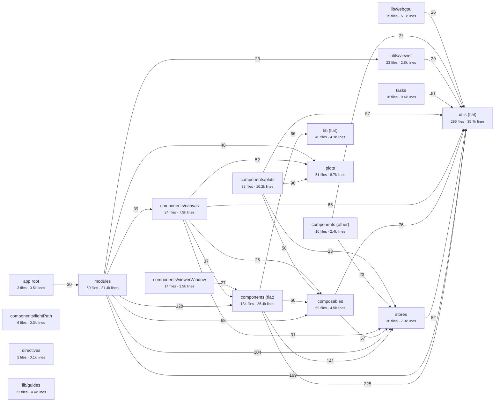

# Vue — layers and who imports whom

> **Generated** by `scripts/architecture/vue_extract.py` — do not edit; run `pixi run arch-diagrams`.

Groups are the directories under `frontend/src/` (rule in the script header). `A → B (n)`: n import
statements from files in A to files in B. **A size map:** big directories import more, so the thick
arrows show where the code is. The strongest 30 arrows are drawn; the full matrix is below.

Full matrix (rows import columns)

| | app root | components (flat) | components (other) | components/canvas | components/lightPath | components/plots | components/viewerWindow | composables | directives | lib (flat) | lib/guides | lib/webgpu | modules | plots | stores | tasks | utils (flat) | utils/viewer |
|---|---|---|---|---|---|---|---|---|---|---|---|---|---|---|---|---|---|---|
| **app root** | · | 17 | 2 |  |  |  |  | 4 | 2 | 13 |  |  | 30 |  | 16 |  | 2 | 1 |
| **components (flat)** |  | · | 2 |  | 5 |  |  | 60 |  | 66 | 11 |  |  | 11 | 141 | 2 | 225 | 2 |
| **components (other)** |  | 17 | · |  |  |  |  | 12 |  | 8 |  |  |  |  | 23 |  | 27 | 3 |
| **components/canvas** |  | 37 | 1 | · |  | 16 |  | 26 |  | 3 |  |  | 2 | 52 | 31 |  | 66 | 1 |
| **components/lightPath** |  |  |  |  | · |  |  |  |  |  |  |  |  |  |  |  |  |  |
| **components/plots** |  | 21 |  | 1 |  | · |  | 50 |  | 4 |  |  |  | 98 | 23 |  | 57 | 3 |
| **components/viewerWindow** |  | 27 | 2 |  |  |  | · | 6 |  | 2 |  |  |  | 3 | 11 |  | 17 | 7 |
| **composables** |  |  |  |  |  |  |  | · |  | 3 |  |  |  | 7 | 57 |  | 76 | 7 |
| **directives** |  |  |  |  |  |  |  |  | · |  |  |  |  |  |  |  | 3 |  |
| **lib (flat)** |  |  |  |  |  |  |  |  |  | · |  |  |  |  | 5 |  | 8 |  |
| **lib/guides** |  |  |  | 1 |  |  |  |  |  | 4 | · |  | 1 |  |  |  | 4 |  |
| **lib/webgpu** |  |  |  |  |  |  |  |  |  |  |  | · |  |  |  |  | 26 |  |
| **modules** |  | 128 | 1 | 39 |  | 11 | 14 | 68 |  | 15 |  | 3 | · | 48 | 104 | 19 | 169 | 23 |
| **plots** |  |  |  |  |  |  |  |  |  | 1 |  |  |  | · |  |  | 14 | 1 |
| **stores** | 1 |  |  |  |  |  |  | 4 |  | 11 | 4 |  |  | 2 | · |  | 82 | 5 |
| **tasks** |  | 20 | 1 |  |  |  |  | 6 |  | 7 |  |  |  |  | 20 | · | 51 | 1 |
| **utils (flat)** |  |  |  |  |  |  |  | 1 |  | 18 | 13 | 1 |  | 18 | 14 | 8 | · | 1 |
| **utils/viewer** |  |  |  |  |  |  |  |  |  | 1 |  |  |  | 1 | 5 |  | 29 | · |

## Where the backend is called

Files that call the backend (a bare `fetch(` or a `utils/api.ts` shape), open a `WebSocket` or an `EventSource`: **108** of 837. HTTP calls go through `utils/api.ts` (status checked, failures logged); a bare `fetch(` is a call not moved onto it yet.

| Group | Files |
|---|---|
| utils (flat) | 25 |
| components (flat) | 20 |
| modules | 15 |
| stores | 12 |
| components/plots | 11 |
| composables | 10 |
| components/canvas | 4 |
| tasks | 4 |
| utils/viewer | 3 |
| components (other) | 1 |
| components/viewerWindow | 1 |
| lib (flat) | 1 |
| plots | 1 |
