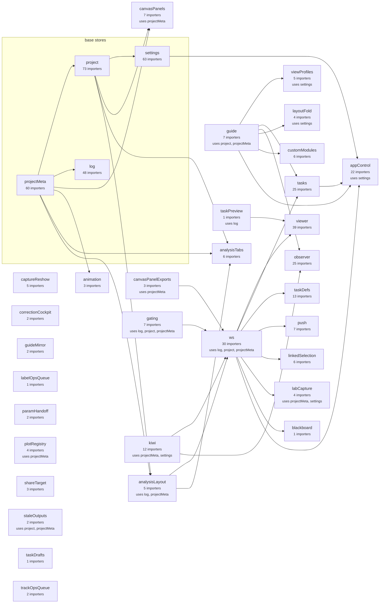

# Vue — stores

> **Generated** by `scripts/architecture/vue_extract.py` — do not edit; run `pixi run arch-diagrams`.

The 36 Pinia stores in `frontend/src/stores/`. Arrow `a → b`: store a imports store b.

**Base stores** — imported by 5 or more other stores: `log`, `project`, `projectMeta`, `settings`.
Arrows into them are not drawn (they would hide everything else); each box says which base stores it
uses instead. Box also shows how many files import the store.

## Who imports each store

| Store | Importers | By group |
|---|---|---|
| `project` | 73 | components (flat) 22, modules 16, components/plots 9, composables 8, stores 5, components/canvas 4, utils (flat) 3, components (other) 2, tasks 2, app root 1, lib (flat) 1 |
| `settings` | 63 | components (flat) 15, modules 10, components/viewerWindow 9, composables 8, stores 6, components/canvas 5, components (other) 3, tasks 3, app root 2, components/plots 1, utils (flat) 1 |
| `projectMeta` | 60 | modules 19, components (flat) 17, stores 10, composables 4, components/canvas 3, tasks 3, components (other) 2, app root 1, utils (flat) 1 |
| `log` | 48 | modules 16, components (flat) 13, stores 5, app root 2, components/canvas 2, composables 2, tasks 2, utils (flat) 2, utils/viewer 2, components/plots 1, lib (flat) 1 |
| `viewer` | 39 | modules 11, components/plots 9, composables 5, components (flat) 4, utils/viewer 3, stores 2, app root 1, components (other) 1, components/canvas 1, components/viewerWindow 1, tasks 1 |
| `ws` | 30 | components (flat) 8, composables 6, modules 6, stores 4, tasks 2, utils (flat) 2, app root 1, lib (flat) 1 |
| `observer` | 25 | components (flat) 13, components (other) 4, components/canvas 2, composables 2, stores 2, app root 1, components/viewerWindow 1 |
| `tasks` | 25 | components (flat) 8, modules 5, tasks 3, utils (flat) 3, composables 2, stores 2, app root 1, lib (flat) 1 |
| `appControl` | 22 | components (flat) 9, stores 4, modules 3, app root 2, composables 2, components (other) 1, lib (flat) 1 |
| `taskDefs` | 13 | components (flat) 6, composables 2, modules 2, components (other) 1, stores 1, tasks 1 |
| `kiwi` | 12 | components (flat) 3, components (other) 3, composables 3, components/canvas 2, modules 1 |
| `canvasPanels` | 7 | components/canvas 2, composables 2, stores 2, modules 1 |
| `gating` | 7 | modules 4, components/canvas 2, components (flat) 1 |
| `guide` | 7 | components (flat) 6, app root 1 |
| `push` | 7 | composables 3, components (other) 1, components/plots 1, modules 1, stores 1 |
| `analysisTabs` | 6 | stores 3, components/canvas 1, modules 1, utils (flat) 1 |
| `customModules` | 6 | components (flat) 4, modules 1, stores 1 |
| `linkedSelection` | 6 | app root 1, components/canvas 1, composables 1, modules 1, stores 1, utils (flat) 1 |
| `analysisLayout` | 5 | components/canvas 2, stores 2, modules 1 |
| `captureReshow` | 5 | components/canvas 2, modules 2, composables 1 |
| `viewProfiles` | 5 | components (flat) 4, stores 1 |
| `labCapture` | 4 | components (flat) 2, app root 1, stores 1 |
| `layoutFold` | 4 | components (flat) 3, stores 1 |
| `plotRegistry` | 4 | composables 2, components (other) 1, components/canvas 1 |
| `animation` | 3 | modules 2, stores 1 |
| `canvasPanelExports` | 3 | composables 2, components/canvas 1 |
| `shareTarget` | 3 | composables 2, components (other) 1 |
| `correctionCockpit` | 2 | components (other) 1, components/plots 1 |
| `guideMirror` | 2 | app root 1, components (flat) 1 |
| `paramHandoff` | 2 | modules 1, tasks 1 |
| `staleOutputs` | 2 | components (flat) 1, tasks 1 |
| `trackOpsQueue` | 2 | components (other) 1, components/plots 1 |
| `blackboard` | 1 | stores 1 |
| `labelOpsQueue` | 1 | components (other) 1 |
| `taskDrafts` | 1 | tasks 1 |
| `taskPreview` | 1 | components (flat) 1 |
