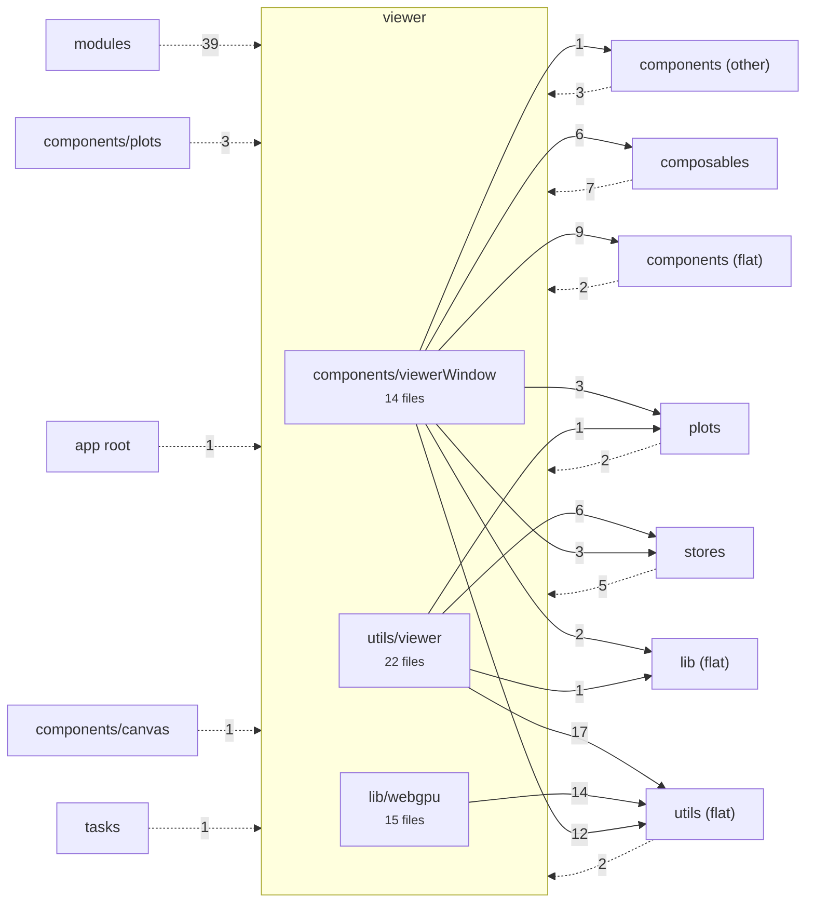

# Vue — the viewer boundary

> **Generated** by `scripts/architecture/vue_extract.py` — do not edit; run `pixi run arch-diagrams`.

The viewer is `lib/webgpu`, `utils/viewer`, `components/viewerWindow`. Below: what it imports from the rest of the app
(the less, the more the viewer is a self-contained engine), and who imports it.

Solid: the viewer imports from outside (n files). Dotted: outside imports the viewer (n imports).

## Viewer → app stores

Each store the viewer reaches into — the coupling a self-contained viewer would replace with inputs.

| Viewer group | Stores imported |
|---|---|
| components/viewerWindow | `observer`, `settings`, `viewer` |
| lib/webgpu | — |
| utils/viewer | `linkedSelection`, `log`, `project`, `projectMeta`, `settings`, `viewer` |
