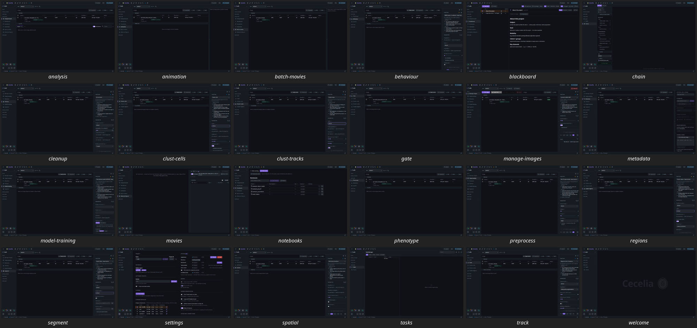

# GUI clarity audit (P0 of GUI_CLARITY_PLAN)

**Status:** **draft** (2026-11-10). Unreviewed. Code read at `origin/main` 71509170. Screenshots and
control counts were measured on an isolated instance. No code was changed.
**Plan:** [`GUI_CLARITY_PLAN.md`](GUI_CLARITY_PLAN.md). **Brief:**
[`../archive/GUI_CLARITY_AUDIT_PROMPT.md`](../archive/GUI_CLARITY_AUDIT_PROMPT.md); read its banner.
**Evidence:** [`gui-audit/`](gui-audit/) holds one report per phase, with file:line for every claim.
This page is the summary.

## How this was measured, and what it can't say

- **Measured:** first-paint screenshots and visible-control counts for all 24 routed pages. Each page
  was captured three ways: no project, RFtn9f ("T cells") and 4kS67f ("unimelb 3P spleen"), at
  1440×900. They were taken by `scripts/gui_capture.mjs` against an isolated instance (own config
  dir, port slot 5, project copies with the image stores symlinked). Results:
  [`gui-audit/p1_census_measured.md`](gui-audit/p1_census_measured.md), screenshots alongside.
- **From code only:** the journey verdicts, modal and drawer counts, depth, entry points, the
  buried-check table and the CSS numbers. Each claim is marked "from code" in its report.
- **Not done:**
  - Expanded states (an open accordion, a picked image, the viewer).
  - The light/dark comparison: dark only, by Decision 1.
  - Contrast ratios. They need the new tokens first.
  - Any observation of real users. Usage of every control is **unknown**, because there is no UI
    telemetry.
  - [`gui-audit/p2_journeys.md`](gui-audit/p2_journeys.md) → *What to observe* lists 16 things to
    check by eye.

## 1. Top 10 findings, ranked by user impact

| # | Finding | Evidence | Do | Effort |
|---|---|---|---|---|
| 1 | **Nothing says what comes next.** 31 of 55 journey steps are WEAK, mostly because, once a task finishes, no page points to the next step. Only the guides do. Welcome has 0 controls (a watermark), projects open in a pop-up, and creating a project leaves you on the blank page. | p2 *Totals*. `WelcomeModule.vue:17-26`, `ProjectPanel.vue:44-45`. [Welcome shot](gui-audit/RFtn9f_welcome.jpg) | **surface**: a `#next` slot on `ModuleLayout` and `ModulePage`. A real Welcome with recent projects plus one "Open / New" action on the page skeleton. | M |
| 2 | **Pages open on the wrong function.** Segment preselects "Import labels · Experimental", Model training preselects "Train denoise model (SUPPORT) · Experimental", and Cleanup preselects AF correction, while the recipes start with drift correction. | `utils/taskGroups.ts:17` ranks 'Import' first. `TaskRunner.vue:623` falls back to the top row. [Segment shot](gui-audit/RFtn9f_segment.jpg) | **move**: a per-module default function, with plain labels. | S |
| 3 | **Every module page shows about 60–100 controls at once.** The header and sidebar take 26–32 on every page. Module pages add 28–68 more for one set (RFtn9f vs 4kS67f), 30–74 of them before scrolling. The rest comes from always-visible extras: 6 icon-only help buttons, 3 "report a problem" buttons on TaskRunner pages, Pool chips beside the "Run on" switch, and a per-row "add a note…" line that makes every image row 3 lines tall. | p1 measured. p4 rows 1, 2, 4, 8. `ImageTable.vue:668`, `AppHeader.vue:76-133`, `TaskRunner.vue:845` | **disclose / merge / cut**: see §5. | S–M |
| 4 | **Some pages feel like a different app.** Chains has three fixed panes, its own image picker and a green Run button at the bottom left. Settings uses its own padding and grid and opens with all 16 sections (56 controls). Notebooks has its own status colours. Animation and Batch movies box their sections. Run appears in 3 places with 3 looks. | p5 §1–2. [Chain shot](gui-audit/RFtn9f_chain.jpg), [Settings shot](gui-audit/RFtn9f_settings.jpg) | **move** onto the shared shells (p5 §6 table). | M each |
| 5 | **No spacing or chrome tokens, which is where the heavy feel comes from.** 89% of padding, margin and gap values are literals (80 distinct values). There are about 300 border declarations, about 100 card-like rules, 42 shadows in 38 different values, 24 raw font sizes, 286 hex literals that match no token, and 33 bespoke `*-empty` classes. | p5 §5 | **central**: a spacing ladder plus chrome tokens (p5 §6). 88% of the literals already sit within 1px of the ladder. | M (mostly mechanical) |
| 6 | **Three must-interrupt checks never show where the action happens.** The "each cell counted as a replicate / n too small" stats finding appears only inside plot options, not on the plot or the export. Outputs made stale by re-running an upstream step are visible only to Claude, through MCP lineage. Missing calibration is not mentioned at Run. | p3 #1–3. `PlotOptions.vue:176` (verified). `stale_outputs_for` reaches the API through `GET /api/analysis/lineage` (per-image `stale`), which no frontend code calls (verified) | **surface**: a `PlotNotice` on the plot and in export. A pre-run checkpoint in TaskRunner. A stale `qc_finding`. | M |
| 7 | **Checks have no shared look.** There are 8 different icons, 3 different ambers and 2 different "ok" colours, and the cohort button renders brighter than its neighbours. Acquisition's `pi-sliders-h` breaks the icon legend. The cohort warning is held only in the page (`CohortCheckButton.vue:22`), so it is lost on reload. | p3 *Notes*, p4 row 6 | **merge**: one `CheckButton` and one check accent. A fixed "Checks" cluster in the action bar. Cohort state from the server. | S–M |
| 8 | **Cross-page prerequisites are never named.** HMM states must run before Cluster tracks, but they live on Behaviour, under Explore, listed lower down. Fixing labels after segmentation is only reachable through the unlabelled wrench icon, and the cockpit then says "Open an image in the viewer to begin". | p2 J4 and J6 FAILs. `navGroups.ts:47` vs `:56`. `PanelLaunchers.vue:38-49` (verified). `CorrectionCockpit.vue:610` | **surface / rename**: name the page in the "When to use" line. Add a "Correct labels" action on Segment and Track. | S |
| 9 | **Words change between screens, and internal names leak into the UI.** "Cleanup" and "Correct" each cover both image correction and label fixing. "flow" has 3 meanings. Visible labels include "(SUPPORT)", "(Phase B)", "(labelProps)" and "CLEANUPIMAGES". Gate's channel columns are headed "1 2 3 4". Adding images is called "Add", "Import" and "Convert to OME-ZARR". | p2 *Terminology drift*. [Chain shot](gui-audit/RFtn9f_chain.jpg), [Gate shot](gui-audit/4kS67f_gate.jpg) | **rename**: one word per thing. `pixi run ui-copy` already finds the drift. | S |
| 10 | **AI copy still shows with AI off (the default).** The first-run tour's Kiwi step, the empty Blackboard's "Claude can create them via MCP", Settings → Other MCP connections and the Claude-login rows, and the empty Claude column in the Find ROIs table. | p4 row 7. `tour.ts:111-118`, `BlackboardModule.vue:681` | **hide** under the AI toggle (registry in `AI_TOGGLE_PLAN.md`). | S |

**Depth is not the problem.** Every sidebar page is at most 2 clicks away. What's buried is per-image
work behind the image table's ⋯ menu: image metadata is 3 clicks, the acquisition card 5.

## 2. Census (Phase 1)

Measured page controls at first paint. Chrome (header, sidebar, rails) adds 26–32 on every page.
Full table: [`gui-audit/p1_census_measured.md`](gui-audit/p1_census_measured.md). Modals (33),
floating panels and drawers (11), entry points and the AI cross-check:
[`gui-audit/p1_census_code.md`](gui-audit/p1_census_code.md).

| Page | No project | RFtn9f | 4kS67f | Shell |
|---|---:|---:|---:|---|
| Model training | 29 | 42 | 68 | ModuleLayout + TaskRunner |
| Track | 28 | 41 | 67 | ModuleLayout + TaskRunner |
| Segment | 25 | 38 | 64 | ModuleLayout + TaskRunner |
| Cluster tracks / cells / regions | 21–24 | 34–37 | 60–64 | ModuleLayout + TaskRunner |
| Manage images | 23 | 37 | 62 | ModuleLayout + TaskRunner |
| Behaviour / Spatial / Cleanup / Preprocess | 19–22 | 31–35 | 57–61 | ModuleLayout + TaskRunner |
| Metadata | 19 | 28 | 53 | ModuleLayout, own panel |
| Settings | 51 | 56 | 56 | bespoke |
| Analysis board | 2 | 18 | 49 | ModuleLayout, no panel |
| Gate / Phenotype | 2 | 14 | 40 | ModuleLayout, no panel |
| Animation / Batch movies | 3 | 13–14 | 39–40 | ModuleLayout, own panel |
| Notebooks / Movies | 0 | 12–14 | 25–29 | ModulePage |
| Blackboard | 0 | 21 | 23 | bespoke split |
| Chains | 11 | 15 | 16 | bespoke, three panes |
| Tasks | 10 | 10 | 10 | bespoke split |
| Welcome | 0 | 0 | 0 | watermark |

Page counts grow with the number of images in the set: each image-table row adds its checkbox, star,
eye and ⋯ menu.

**Entry points are lopsided.** Metadata, Notebooks, Movies and Chains are reachable two ways each
(sidebar and guide map). The Analysis board has 6 ways in and the viewer window 7.

## 3. Journeys (Phase 2)

From code, not observed. Per-step tables: [`gui-audit/p2_journeys.md`](gui-audit/p2_journeys.md).

| Journey | PASS | WEAK | FAIL | Worst step |
|---|---:|---:|---:|---|
| 1 Import a set | 2 | 4 | 0 | after "Add images", only a console line. Nothing says the images still need converting |
| 2 Acquisition / quality | 2 | 5 | 0 | nothing prompts a check after import |
| 3 Correct (drift, denoise, versions) | 1 | 5 | 0 | Cleanup opens on AF correction |
| 4 Segment, then cleanup | 1 | 2 | 2 | opens on "Import labels"; label fixing only via the wrench |
| 5 Populations / gate | 3 | 3 | 0 | three different "select an image" empty states |
| 6 Track, then behaviour clusters | 2 | 3 | 1 | HMM states live on another page, never named |
| 7 Figure / board / report | 4 | 1 | 0 | three write-up homes (lab log, Blackboard, Notebooks) |
| 8 Chain on a batch | 3 | 3 | 0 | an empty canvas with no "New chain" action |
| 9 Ask Claude / Kiwi | 3 | 5 | 0 | with AI off, the tour still advertises Kiwi |
| **Total** | **21** | **31** | **3** | |

**What works:** pages say why a control is disabled, and the task picker's "When to use" lines are good.

## 4. Buried critical features (Phase 3)

24 checks: [`gui-audit/p3_buried.md`](gui-audit/p3_buried.md).

| Class | Checks | Surface it as |
|---|---|---|
| **Must interrupt** | the stats replicate / small-n finding · outputs stale after an upstream re-run · missing or unusual calibration at Run | a `PlotNotice` on the plot and in export · a stale `qc_finding` on the QC dot · a pre-run checkpoint (`InlineNote` lines under "When to use", each with a Fix action, advisory only, never blocking) |
| **Should be visible** | acquisition check (image and set) · cohort QC · per-task QC findings · import saturation / photon flags · board tab with changed parameters | one "Checks" cluster in the action bar (Acquisition, Cohort, "n QC-flagged" with a row filter) · a "Check acquisition" prompt after import · a warn dot on the board tab |
| **Fine where it is** | maturity dots (D2) · claim review (on the plot by design; signpost only) · axis gating · disabled-control tooltips · "When to use" · the excluded count · plot notices · the lab-log bell | — |

## 5. Cut / merge list (Phase 4)

There is no telemetry, so usage is unknown for every row. Full list of 31:
[`gui-audit/p4_cuts.md`](gui-audit/p4_cuts.md).

| Element | Do | Who would miss it | Replacement | Effort |
|---|---|---|---|---|
| 6 icon-only help buttons in the header | merge into one Help menu | people who know the icons | a worded menu with the same entries | M (Decision D1) |
| 3 "report a problem" buttons on TaskRunner pages | keep the header one | nobody: the same target | header button pre-fills the picked function | S–M |
| Per-row "add a note…" line | show only when a note exists | people who note often | "Add note" in the row's ⋯ menu. About 25% more rows fit per screen | S |
| Preferences → Layout duplicates (4 launcher toggles, 2 collapse toggles, "Track main" twice) | cut | unknown | the controls they duplicate | S |
| Pool chips on every TaskRunner page | move into the throttle popover | people who tune pools per run | the same chips, one click away | S |
| Settings troubleshooting sections | collapse under one section | people troubleshooting | the same sections, collapsed | S |
| Correction cockpit hammer badge | replace with the maturity badge | nobody | standard tier badge | S |
| Speech-bubble glyph used for both Kiwi and Zulip | give Zulip its own icon | nobody | icon from the legend | S |

## 6. Consistency issues (Phase 5 and Decision 2)

Page families, outliers and numbers: [`gui-audit/p5_consistency.md`](gui-audit/p5_consistency.md).
Twelve pages already share one frame (ModuleLayout + TaskRunner). The fix is to bring the rest onto it
and give the frame calmer defaults.

**Fix once, centrally:**
- **Spacing ladder** `--cc-space-3xs…2xl` (2/4/6/8/12/16/24/32 px), plus chrome roles: `--cc-bar-pad`,
  `--cc-section-pad`, `--cc-page-pad`, `--cc-divider`, two shadows, `--cc-ring`, and four font
  weights. Applied first to the 7 shared shells (SetBar, ModuleLayout action bar, CollapsibleSection,
  CollapsiblePanel, FloatingPanel, CanvasPanel, ModulePage).
- **One rule for PRIMITIVES:** inside a panel, sections are separated by dividers, never boxed.
- **One panel-section primitive** for every right panel (TaskRunner, Metadata, Animation, Batch movies).
- **One Run button** (`.cc-btn-primary` + full width) and one `#next` slot.
- **One empty state owned by `ModuleLayout`:** `.cc-empty` with one next action, replacing
  `.gp-empty`, `.sc-empty`, `.cp-empty` and the other 30 bespoke ones.
- **One `CheckButton`** with the check accent (finding 7).
- **The hex sweep:** the top 10 files hold about 40% of the 286.

**Per screen:**
- **Chains:** CollapsiblePanel panes, the image table or `SelectionTable` as picker, the shared Run
  button, a "New chain" empty state, and plain category labels.
- **Settings:** `ModulePage` scroll layout, sections collapsed by default.
- **Notebooks:** status colours on tokens, headings on the section primitive.
- **Movies:** panel sections instead of cards.
- **Tasks, Blackboard and Chain's Live tab:** a shared `SplitPage.vue`. This is the only new
  component proposed. The layout is already described in `docs/UI.md` but has no component yet.
- **Welcome:** a real page (finding 1).

**Colour (brief + Decision 4):** not proposed in detail yet. The token roles (journey stage, check
status, maturity tier, selection/focus, empty states, welcome) land with P1, after the palette mock
(open question 4 in the plan). The contrast check runs on those tokens.

## 7. Navigation proposal (Phase 6)

| Option | Verdict | Cost in the current architecture |
|---|---|---|
| **"You are here / next step" spine** | **Yes, per page, not a global bar.** A `#next` slot in `ModuleLayout`/`ModulePage` names one next action. It comes from the picked recipe's next step when a recipe is picked, otherwise from what the selected images have already run. This keeps the map's "no default path" decision. | M. The recipe steps (`recipes.ts`) and task history exist. The join that reads "what's done for these images" is new. |
| **Progressive disclosure tied to view profiles** | **Partly.** Profiles already curate the sidebar. Use the same profile to set the default open/closed state of advanced panels (Pool, troubleshooting, "When to use"), not to hide features. | S–M. *Inferred:* check whether task specs mark params as advanced before relying on per-param disclosure. |
| **Checks dock** | **Yes, as a cluster in the existing action bar,** not a new dock. `ModuleLayout` already owns the image selection the checks are about. | S–M. A `CheckButton` and server-side cohort state. |
| **Sidebar order = journey order** | **Already close.** The one break: HMM states (Behaviour, under Explore) is needed before Cluster tracks. Fix with a cross-link in the "When to use" text, not a reorder. | S |
| **One empty-state pattern, one next action** | **Yes.** `.cc-empty` exists and `PRIMITIVES.md` already forbids new `*-empty` classes. 33 sites don't use it yet. | S per batch |

## 8. Proposed slicing

Small PRs that can be reviewed by eye, in this order. 👁 = needs the maintainer's eyes on real pages
before merge. `pixi run gui-capture` produces the before/after shots for each.

1. **Default functions + internal labels** (findings 2, 9): per-module default, drop "(SUPPORT)",
   "(Phase B)", "(labelProps)" and "CLEANUPIMAGES" from visible text. S.
2. **AI copy behind the toggle** (finding 10). S.
3. **Cross-page prerequisites** (finding 8): name the page in "When to use"; "Correct labels" action on
   Segment and Track. S. 👁
4. **Tokens on the 7 shared shells** (finding 5): spacing ladder and chrome roles, no colour yet. M. 👁
5. **Panel-section primitive + one Run button + `#next` slot + ModuleLayout empty state.** M. 👁
6. **Density cuts** (§5): note line, duplicates, Pool chips, report buttons. S each. 👁
7. **Checks:** `CheckButton`, action-bar cluster, server cohort state, stats `PlotNotice`, pre-run
   checkpoint. M, likely two PRs. 👁
8. **Welcome page** and next-step content. M. 👁
9. **Chains onto the shared shells.** M. 👁
10. **Settings, Notebooks, Movies;** then `SplitPage` for Tasks and Blackboard. M. 👁
11. **Palette mock → colour tokens → hex sweep.** M. 👁
12. **Stale outputs in the GUI** (finding 6, part 2): reuse `GET /api/analysis/lineage?projectUid&imageUid`, which already returns `stale` / `staleUnknown` per image. No new route; check that a per-image call is light enough for the Run panel. M.

## 9. Decisions needed

| # | Question | Recommended |
|---|---|---|
| D1 | Merge the 6 header help icons into one worded Help menu? This reverses the rationale in `AppHeader.vue`'s comments (a compass, deliberately not a `?`). | **Yes.** Six unlabelled icons on every page cost more than one menu click. |
| D2 | ~~Worded "Experimental" badge in the header and task heading?~~ | **Decided (maintainer, 2026-11-10): dots stay.** The word took too much space in the layout, which is why FEATURE_MATURITY_PLAN Decision 10 settled on dots. The maturity tier stays in "fine where it is". |
| D3 | Hide the Kiwi launcher while AI is off? This revisits AI_TOGGLE_PLAN call 5. | **Keep it.** It is the way in to turning AI on. Hide the other AI copy (finding 10). |
| D4 | One home for a human write-up (lab log, Blackboard, Notebooks)? | **No merge.** Add a role line to each empty state: lab log = automatic record, Blackboard = authored notes, Notebooks = code. |
| D5 | The 10 px spacing bucket (137 uses): round to 8 or 12 per site, or add a token? | **Round per site,** in the shells first. |
| D6 | The default function per module: who sets it? | **The recipes' first step:** drift correction on Cleanup, Cellpose on Segment. Import moves down. |
