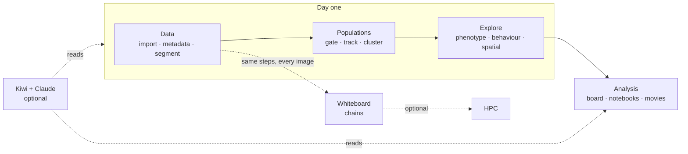

# Start here: what's in Cecelia

This page names every part of Cecelia once: what it is for, what it needs, and whether you need
it on day one. The buttons themselves are taught in the app: open **Guides** (compass icon, top
right) and pick the guide named in the last column.

## Day one

1. **Find your way around:** the tour runs by itself the first time you close the welcome dialog.
2. **Import images** → **fix pixel size and channel names** → **segment** → **gate** → **phenotype**.
   For timelapses, add **track** → **behaviour**.
3. If you work with intravital timelapses, follow the recipe **Intravital timelapse** at the top
   of Guides. It chains those guides in order and says why each step is there.

Everything below "Scaling up" can wait.

## How your data is organised

| Term | Meaning |
|---|---|
| **Project** | One study. Everything below lives inside it. |
| **Set** | A group of images processed together (e.g. one mouse, one condition). |
| **Image** | One acquisition. Belongs to exactly one set. |
| **Image version** | Corrections (drift, autofluorescence, denoise) make a new version; the raw import stays. Pick which one you see in the viewer. |
| **Segmentation** | Each segmentation has a name and its own cell table, so you can keep several side by side. |
| **Population** | A named group of cells or tracks, from a gate or a cluster. Most plots are drawn per population. |

## The sidebar

The groups follow the analysis: **Populations** pages *define* who the cells are; **Explore** pages
*summarise* those populations across images. Every page except Tasks needs an open project.

### Data: get images in and ready

| Page | What it's for | Day one | Guide |
|---|---|---|---|
| Manage images | Add, organise, copy, move and export images | Yes | Import images |
| Metadata | Pixel size, channel names, colours. Fix before segmenting | Yes | Fix pixel size and channel names |
| Preprocessing | Crop, project or resample into a new image | Optional | Preprocess an image |
| Cleanup | Drift correction, bleedthrough/autofluorescence, denoise | Optional | Drift correct · Correct bleedthrough |
| Model training | Train your own denoise or flow models | No | Train a denoise / flow model |
| Segment | Find cells (Cellpose and others), with segmentation QC | Yes | Segment an image · Segment a movie by motion |

### Populations: define who the cells are

| Page | What it's for | Needs | Guide |
|---|---|---|---|
| Gate | Draw gates on cell measures, like flow cytometry | Segmentation | Create and gate populations |
| Track | Link cells over time; gate tracks | Timelapse + segmentation | Track cells |
| Cluster cells | Group cells by phenotype across a set | Segmentation | Cluster cells into phenotypes |
| Cluster tracks | Group tracks by behaviour | Tracks | Cluster tracks into behaviours |
| Cluster regions | Find tissue neighbourhoods | Spatial's neighbour graph | Cluster spatial regions |

### Explore: summarise populations

| Page | Summarises | Paired with |
|---|---|---|
| Phenotype | Counts and proportions per population, across images | Gate, Cluster cells |
| Behaviour | Speed, HMM states and other track measures | Track, Cluster tracks |
| Spatial | Neighbours, interactions, contacts. Build the graph first | Cluster regions |

### Analysis: your own figures and notes

| Page | What it's for | Day one |
|---|---|---|
| Analysis board | Combine any plots across pages, images and segmentations; export PDF/CSV | Later |
| Blackboard | Notes and diagrams for an open question, versioned, marked open/resolved | Optional |
| Notebooks | Pluto (Julia) notebooks for analysis the board can't do | No |
| Animation | Keyframe a fly-through of one image into a movie | No |
| Batch movies | One movie setup → one timelapse movie per image | No |
| Movies | Play the movies this project has rendered | — |

A quick timelapse movie of the image you're viewing is the **record** button in the viewer.
Guides: Build plots · Record a movie · Build an animation · Create a notebook · Use the blackboard.

### Pipeline: run many images

| Page | What it's for |
|---|---|
| Tasks | Everything running or finished; **History** shows past runs; pop-out window |
| Whiteboard | Draw your pipeline as a chain of tasks and run it on a whole set |

Guide: Run a pipeline over a whole set.

## Panels beside the pages

Opened from the icon row in the sidebar; they stay open while you change pages.

| Panel | What it's for |
|---|---|
| Viewer | Your image in 2D/3D with cells, tracks and populations. Opens in its own window; its controls panel stays in the main one |
| Correction cockpit | Fix masks and tracks by hand: merge, split, remove. *In progress* |
| Lab log | A dated diary per project, written by you, Claude and Cecelia's activity summary |
| Kiwi | Ask Claude about your project; connect your own Claude session |
| Console | Docked at the bottom: the app's messages. Look here when something fails |

## Working with Claude (optional)

Everything above works without Claude. With a Claude account you get two ways in:

| | Kiwi **Ask** (in the app) | Claude in a terminal |
|---|---|---|
| What it is | Type a question in the Kiwi panel | Your own Claude Code session, connected to Cecelia |
| Can change things | No: reads only; you **Save to Blackboard** if a reply is worth keeping | Adds lab-log lines, Blackboard entries, notebooks, analysis boards and chains for you to review and run. Never runs tasks or edits your data |
| Needs | Claude Code installed, log in from Kiwi | Same, plus the Cecelia plugin: Kiwi → Assistant → **Set up** |

In both, **Share** in the viewer or on a plot sends Claude a snapshot with whatever you drew on it
(a *capture*), and Claude can point back: highlight cells, circle a region, or show which button
to press. Guide: Assist with Kiwi.

## Where to write things down

| You want to record… | Use |
|---|---|
| Something about one image ("fold in this section") | The image's note, in the image table |
| What you did and why, dated | Lab log |
| An open question you are working through | Blackboard entry |
| What ran, with which parameters | Nothing: Cecelia records it. See task history |

## Scaling up

| Feature | What it's for | Needs |
|---|---|---|
| Whiteboard (chains) | Run the steps you settled on over every image in a set | Steps that worked on one image first |
| HPC | Send the heavy part of a task to a SLURM/PBS cluster | Cluster account + SSH key; your admin sets it up in **Settings → HPC**, you add your login in **Preferences → HPC**. Not yet run on a real cluster |
| Task limits | How many tasks run at once, per CPU/GPU/disk | The sliders on the Tasks page |

## Extending Cecelia

| Feature | What it's for |
|---|---|
| Custom module | Your own analysis step, as a task with its own parameters |
| Plugin | One or more custom modules packaged to share, optionally with its own page |

Both run with full access to your machine. Install only code you trust.

## Settings, profiles and moving projects

| | What it's for |
|---|---|
| **Settings** (sidebar footer) | The machine: storage, updates, HPC, connected tools. Shared by everyone on this computer |
| **Preferences** (your profile chip) | You: your own settings, your HPC login, your Claude login |
| **User profile** | Who is using the app, when several people share a computer |
| **View profile** | Hide sidebar pages you don't use. Tidies the menu; doesn't restrict anything |
| **Export / import** | Move a whole project as one folder (`.ccbundle`), from the project panel |
