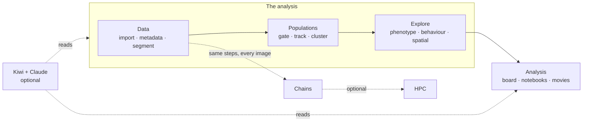

# Start here: what's in Cecelia

This page names every part of Cecelia once: what it is for and what it needs. The same map is the
front page of **Guides** in the app (compass icon, top right), where each page is one click away and
each guide shows you the buttons.

## Where to start

1. **Find your way around:** the tour runs by itself the first time you close the welcome dialog.
2. **Open Guides and pick your recipe.** Where you start depends on your data: whether it moves, how
   many markers it has, and what you want to know. The recipe lights its pages on the map and lists
   its steps, each with why it is there. The recipes are listed [below](#recipes).
3. **No recipe fits?** Click **Ask for a recipe** under the recipes: tell us what you image and what
   you want to know.

Everything below "Scaling up" can wait.

## How your data is organised

| Term | Meaning |
|---|---|
| **Project** | One study. Everything below lives inside it. |
| **Set** | A group of images processed together (e.g. one mouse, one condition). |
| **Image** | One acquisition. Belongs to exactly one set. |
| **Image version** | Corrections (drift, autofluorescence, denoise) make a new version; the raw import stays. Pick which one you see in the viewer. |
| **Segmentation** | Each segmentation has a name and its own cell table, so you can keep several side by side. |
| **Population** | A named group of cells or tracks, from a gate or a cluster. Most plots are drawn per population. |

## Recipes

Pick the one that matches your data at the top of **Guides**: its pages light up on the map and its
steps are listed in order, each with why it is there. Steps marked optional depend on your images.
Every recipe ends the same way: once the settings work on a few images, run them over the whole set
as a chain.

| Recipe | When this is you | Steps |
|---|---|---|
| **Few-marker tissue** | A fixed section with a handful of markers, e.g. a confocal stack of spleen. | 9 (2 optional) |
| **Multiplex tissue** | Many markers on one section, e.g. IBEX or CODEX of a lymph node or spleen. | 9 (1 optional) |
| **Intravital timelapse** | A time-lapse of cells moving in tissue, e.g. T cells in a lymph node. | 12 (5 optional) |
| **Live cells and structures** | A time-lapse where cells move along a structure, e.g. T cells and lymphatics in skin. | 9 (1 optional) |
| **In vitro migration** | Cells migrating in a dish or chamber, e.g. a cancer cell line under two treatments. | 8 |

## The sidebar

The groups follow the analysis: **Populations** pages *define* who the cells are; **Explore** pages
*summarise* those populations across images. Every page except Tasks needs an open project. Each
page that defines a population names the page that summarises it.

### Data: get images in and ready

| Page | What it's for | Summarised on | Guide | Claude |
|---|---|---|---|---|
| Manage images | Add, organise, copy, move and export images |  | Import images |  |
| Preprocessing | Crop, project or resample into a new image |  | Preprocess an image |  |
| Metadata | Pixel size, channel names, colours — fix before segmenting |  | Fix pixel size and channel names |  |
| Cleanup | Drift correction, bleedthrough and autofluorescence, denoise |  | Drift correct a time series |  |
| Model training | Train your own denoise or flow models |  | Train a flow model |  |
| Segment | Find cells, with segmentation QC |  | Segment an image |  |

### Populations: define who the cells are

| Page | What it's for | Summarised on | Guide | Claude |
|---|---|---|---|---|
| Gate | Draw gates on cell measures, like flow cytometry | Phenotype | Create and gate populations |  |
| Track | Link cells over time; gate tracks | Behaviour | Track cells |  |
| Cluster cells | Group cells by phenotype across a set | Phenotype | Cluster cells into phenotypes |  |
| Cluster tracks | Group tracks by behaviour | Behaviour | Cluster tracks into behaviours |  |
| Cluster regions | Find tissue neighbourhoods | Spatial | Cluster spatial regions |  |

### Explore: summarise those populations across images

| Page | What it's for | Summarised on | Guide | Claude |
|---|---|---|---|---|
| Phenotype | Counts and proportions per population, across images |  |  |  |
| Behaviour | Speed, HMM states and other track measures |  | Classify behaviour states |  |
| Spatial | Neighbours, interactions, contacts — build the graph first |  | Score spatial interactions |  |

### Analysis: your own figures and notes

| Page | What it's for | Summarised on | Guide | Claude |
|---|---|---|---|---|
| Analysis board | Combine any plots across pages and images; export PDF or CSV |  | Build plots | A terminal session builds a board of plots for you |
| Blackboard | Notes for an open question, versioned, tagged good or bad |  | Use the blackboard | Kiwi replies you save land here; a terminal session writes entries |
| Notebooks | Pluto (Julia) notebooks for what the board can’t do |  | Create a notebook | A terminal session writes a notebook for you |
| Animation | Keyframe a fly-through of one image into a movie |  | Build an animation |  |
| Batch movies | One movie setup, one timelapse movie per image |  | Record a movie |  |
| Movies | Play the movies this project has rendered |  |  |  |

### Pipeline: run many images

| Page | What it's for | Summarised on | Guide | Claude |
|---|---|---|---|---|
| Tasks | Everything running or finished; history of past runs |  |  |  |
| Chains | Wire the steps you settled on into a chain; run it over a set |  | Run a pipeline over a whole set | A terminal session designs the chain; you run it |

## Panels beside the pages

Opened from the icon row in the sidebar; they stay open while you change pages.

| Panel | What it's for |
|---|---|
| Viewer | Your image in 2D/3D with cells, tracks and populations. Opens in its own window; its controls panel stays in the main one |
| Correction cockpit | Fix masks and tracks by hand: merge, split, remove. *In progress* |
| Lab log | A dated diary per project, written by you, Claude and Cecelia's activity summary |
| Kiwi | Ask Claude about your project; connect your own Claude session |
| Console | Docked at the bottom: the app's messages. Look here when something fails |

## Working with Claude (optional)

Everything above works without Claude. Claude doesn't add steps to your analysis. It helps you
**check** one: a segmentation that looks off, a gate, a cluster you can't name, a result you want to
state carefully. One loop, the same one Kiwi's **?** and the guide *Assist with Kiwi* show:

1. **Point at it.** Press **@ Add to Kiwi** on what puzzles you: an image row, a population, a plot,
   the viewer or a Blackboard entry. If it is a spot *in* the picture, **Share** a frame and draw on
   it; that's a *capture*.
2. **Ask Kiwi.** Kiwi is a rubber duck: it points and counts, it doesn't judge. Every claim in its
   reply has a reference; click it to see what the claim rests on.
3. **Keep it.** **Save** the reply, then tag it good or bad on the Blackboard, with a why. Replies
   expire after 50 turns; the Blackboard keeps them, and bad tags are how Claude warns you when the
   same failure comes back.
4. **Go further.** **Continue in terminal** on a reply when one question isn't enough. It saves the
   reply and copies a command that starts Claude in a terminal, picking up from that entry. The
   Blackboard is the bridge: a terminal session can't see Kiwi replies you didn't save.

| | Kiwi | Terminal | `pixi run chat` (no GUI, experimental) |
|---|:-:|:-:|:-:|
| Reads your project, captures, Blackboard and lab log | ✓ | ✓ | ✓ except captures (no viewer to share from) |
| Warns when a bad-tagged failure keeps coming back | ✓ | ✓ | ✓ |
| Marks cells and tracks on the viewer | – | ✓ | – (no viewer) |
| Adds a chain, board, notebook or lab-log line for you to review | – | ✓ | ✓ |
| Writes a custom module for a step Cecelia lacks (you reload and run it) | – | ✓ | ✓ |
| Reads your LabArchives notebook, once linked | – | ✓ | – |
| Brings in data: new project, set, images | – | – | ✓ |
| Runs a task or chain; adds, changes or deletes a gate | – | – | ✓ you approve each call |
| Deletes images or projects, or edits cell data | – | – | – |

**`pixi run chat`** is Cecelia without the GUI: Claude in your terminal is the front end, and it can
run steps, so it asks before each one. It is new and experimental. See
[`docs/INSTALL.md`](../docs/INSTALL.md) → *Without the GUI*.

Replies are provisional: they aren't checked against the biology. What Claude reads is sent to
Anthropic, so check your institute's rules for unpublished or patient data.

**Setup:** install Claude Code and log in from Kiwi; that's all Kiwi needs. For a terminal session,
also click Kiwi → Assistant → **Set up** once (it installs the Cecelia plugin).

## Where to write things down

| You want to record… | Use |
|---|---|
| Something about one image ("fold in this section") | The image's note, in the image table |
| What you did and why, dated | Lab log |
| An open question you are working through | Blackboard entry |
| What ran, with which parameters | Nothing: Cecelia records it. See task history |

## Scaling up

| Feature | What it's for | Needs |
|---|---|---|
| Chains | Run the steps you settled on over every image in a set | Steps that worked on one image first |
| HPC (optional) | Run segmentation, the heavy step, on a SLURM/PBS cluster. More tasks may follow | Cluster account + SSH key; your admin sets it up in **Settings → HPC**, you add your login in **Preferences → HPC**. Built for one lab's cluster so far |
| Task limits | How many tasks run at once, per CPU/GPU/disk | The sliders on the Tasks page |

## Extending Cecelia

| Feature | What it's for |
|---|---|
| Custom module | Your own analysis step, as a task with its own parameters |
| Plugin | One or more custom modules packaged to share, optionally with its own page |

Both run with full access to your machine. Install only code you trust.

## Settings, profiles and moving projects

| | What it's for |
|---|---|
| **Settings** (sidebar footer) | The machine: storage, updates, HPC, connected tools. Shared by everyone on this computer |
| **Preferences** (your profile chip) | You: your own settings, your HPC login, your Claude login |
| **User profile** | Who is using the app, when several people share a computer |
| **Sidebar layout** | Hide sidebar pages you don't use. Tidies the menu; doesn't restrict anything |
| **Export / import** | Move a whole project as one folder (`.ccbundle`), from the project panel |
