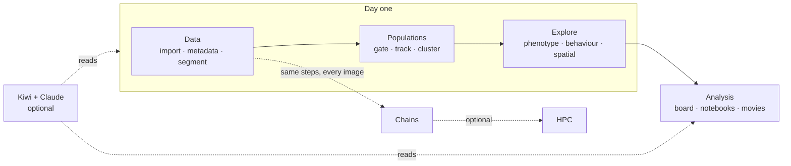

# Start here: what's in Cecelia

This page names every part of Cecelia once: what it is for, what it needs, and whether you need
it on day one. The same map is the front page of **Guides** in the app (compass icon, top right),
where each page is one click away and each guide shows you the buttons.

## Day one

1. **Find your way around:** the tour runs by itself the first time you close the welcome dialog.
2. **Open Guides and pick your recipe.** Where you start depends on your data: whether it moves, how
   many markers it has, and what you want to know. The recipe lights its pages on the map and lists
   its steps, each with why it is there. The recipes are listed [below](#recipes).
3. **No recipe fits?** The pages every image goes through are **Manage images** → **Metadata** →
   **Segment**, then **Gate** → **Phenotype** (add **Track** → **Behaviour** for a timelapse).

Everything below "Scaling up" can wait.

## How your data is organised

| Term | Meaning |
|---|---|
| **Project** | One study. Everything below lives inside it. |
| **Set** | A group of images processed together (e.g. one mouse, one condition). |
| **Image** | One acquisition. Belongs to exactly one set. |
| **Image version** | Corrections (drift, autofluorescence, denoise) make a new version; the raw import stays. Pick which one you see in the viewer. |
| **Segmentation** | Each segmentation has a name and its own cell table, so you can keep several side by side. |
| **Population** | A named group of cells or tracks, from a gate or a cluster. Most plots are drawn per population. |

