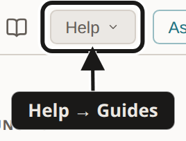
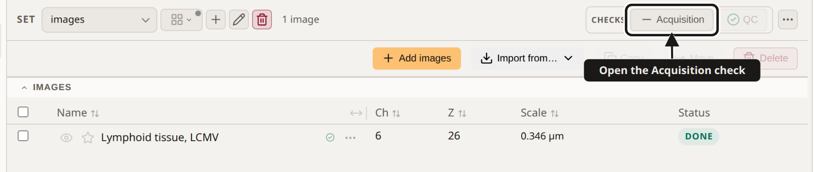
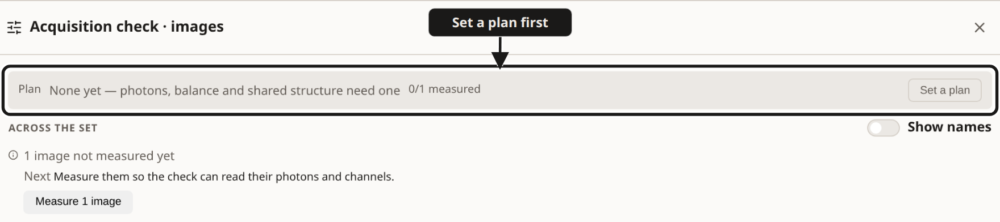
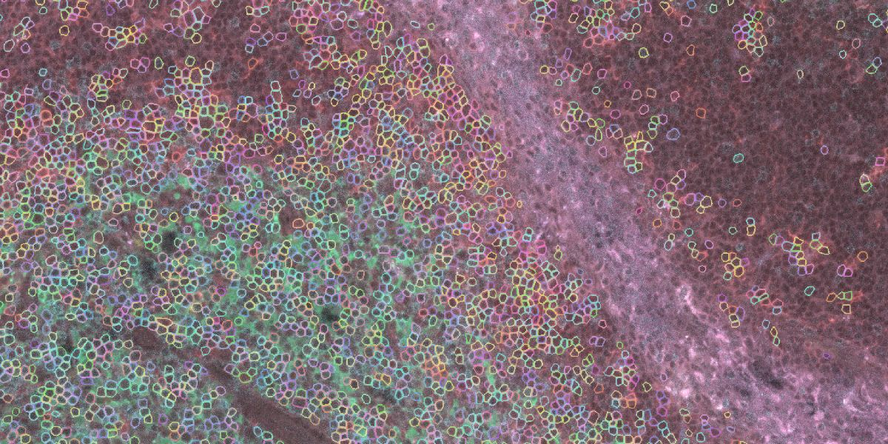
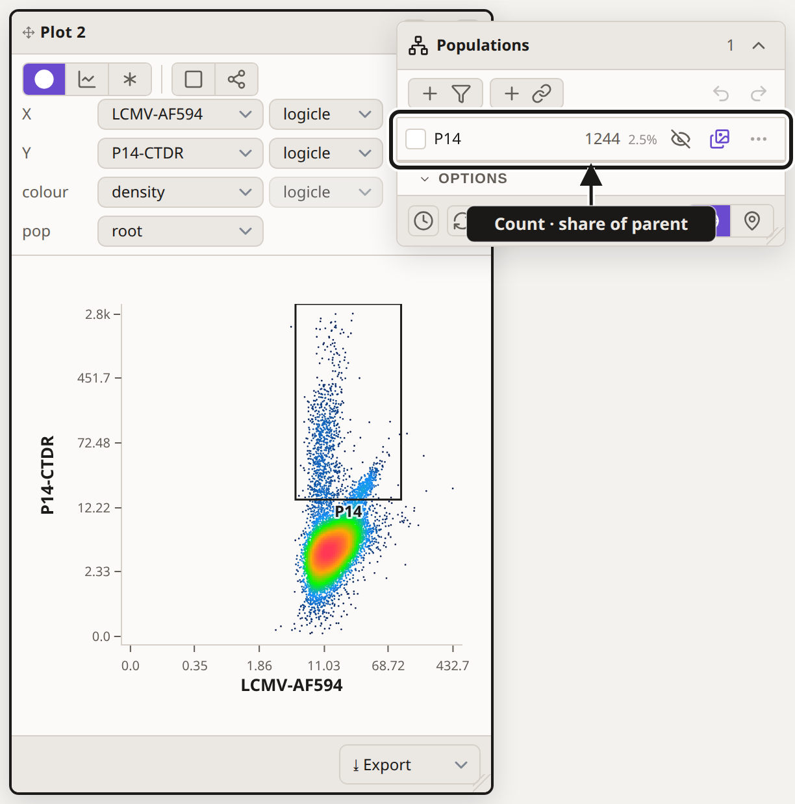

<!-- Generated by frontend/src/utils/trainingDoc.ts — edit there, then `npx vitest run -u src/utils/trainingDoc.test.ts`. -->

# Training with Cecelia: a trainer’s run-sheet

_Draft. The trainee follows the in-app guides; this sheet is what an expert would add in the room._

- **For:** microscopy staff who train facility users. No Cecelia experience needed.
- **You get:** a path for sessions 2 and 3: what to open, what to check on the trainee’s own images, and when to stop.
- **You need:** a Cecelia workstation, and the trainee’s session-2 images imported the day before session 3.
- **Ends at:** the trainee imports, checks, segments, gates and plots a measure on their own, with the guides, and knows how to check a claim once they have a set.

## Before you start

Every step below names an in-app guide. Guides are under **Help → Guides**, top right. Each one puts a bubble beside the real button, on the trainee’s own data. This sheet names the guide; it does not repeat its clicks.

**Maturity badges.** Most of Cecelia is labelled Experimental or Beta. Don’t hide this from trainees; say what it means:

| Badge | What it means |
|---|---|
| Experimental | Not checked on realistic data — check every result by hand. |
| Beta | Checked by hand on real data — spot-check results. |
| Tested | A test fails when the result is wrong. |

**AI is off by default** and nothing here needs it. What Claude reads is sent to Anthropic, so turning it on is the trainee’s and their lab’s decision.

**When to stop.** A result looks wrong and the step’s “If it goes wrong” doesn’t fix it: stop, don’t work around it. Note the image, the step and what you saw, and send it to _[contact: to be filled in by the facility]_.

## Session 2: at the scope

Cecelia is not on the scope PC, so the loop is: acquire a test, check it at a Cecelia workstation, go back and change what the check names.

| Step | Trainee does | You check |
|---|---|---|
| 1. Acquire a test | One or two images of a typical sample, with the settings they plan to use. | Saved in the scope’s own format (`.oir`, `.czi`), not exported TIFFs: the settings live in the file. |
| 2. Import | guide **Import images**. | The image opens in the viewer with the right number of channels. |
| 3. Fix metadata | guide **Fix pixel size and channel names**. | Pixel size and Z step match the scope software; channels have real names. |
| 4. Check it | guide **Check an acquisition**, with **Test acquisition** picked. | The trainee can say what the verdict under **Before acquiring the rest** asks them to change, and why. |
| 5. Back to the scope | Change what the check named, then acquire the rest. | — |

One or two images are enough for this session and for session 3. Comparing conditions and checking a claim (session 3, step 6) needs more: a set with a few images per condition, acquired with the same settings.

**Settings to take back.** Click the image’s name in the Acquisition check to open its metadata, then **Acquisition → Settings card**: a printable card of that image’s settings. It shows only when Cecelia can tell from the file which kind of microscope took it.

## Session 3: analysis

**The day before.** Import the trainee’s session-2 images into a project for them and open one in the viewer. If import fails, you find out now, not in front of the trainee. Keep a second project with images that worked, as a fallback.

### 1. Check the data · Beta

**Do:** Open **Manage images**. Compare each image’s **Ch**, **Z** and **Scale** with the scope software. Fix anything wrong with the guide **Fix pixel size and channel names**.

**You’ll see:** One row per image. Every image of the set has the same pixel size and the same channel names, matching the scope.

**If it goes wrong:** A flag on a row means a field looks implausible: hover it. Fix metadata _before_ segmenting: segmentation reads it when it runs.

### 2. Check the acquisition · Experimental

**Do:** Follow the guide **Check an acquisition**. Set the plan, with **Final data** picked.

**You’ll see:** The verdict under **Before analysing**. The trainee can say what it means for their analysis.

**If it goes wrong:** “Not measured yet”: press **Measure**. It runs in the background, about a minute per image.

### 3. Segment · Beta

**Do:** Follow the guide **Segment an image**. Preview on a small region first, then run it and open the image in the viewer with the mask on.

**You’ll see:** One outline per cell, on the cell’s edge, with clumps split into single cells.

**If it goes wrong:** An odd size distribution in the QC plots often means the cell diameter was off. Preview again with another diameter: seconds, not minutes.

> [!NOTE]
> Have the trainee look at the mask _on the image_, not just at the QC plots. A few wrong cells: note them in the log below. Correcting masks by hand is Experimental; leave it out of training.

### 4. Gate populations · Beta

**Do:** Follow the guide **Create and gate populations** on one image, then copy the gates to the rest of the set.

**You’ll see:** A named population per cell type, each with its cell count and its share of its parent.

**If it goes wrong:** Open the population in the viewer: do the gated cells sit where that cell type should be?

### 5. Plot a measure · Beta

**Do:** Follow the guide **Build plots**. Plot one measure of the gated populations, e.g. each population’s share of its parent.

**You’ll see:** One value per image and population. With a set, group it by the experimental attribute (treatment, mouse).

**If it goes wrong:** No groups to compare by: the attributes are set on the **Metadata** page (step 1).

### 6. Check the claim (needs a set)

**Do:** Show where it lives. With a set, a summary plot’s footer has a ✓ button: it takes the result as one sentence and the replicate (e.g. Mouse).

**You’ll see:** The checks, without AI: are the images there, was everything processed the same way, how many replicates, are the units calibrated. Each line is a fact, or a problem with what to do.

**If it goes wrong:** No ✓ button: the plot is not across a set. The check needs a set of processed images, a few per condition. ✓ greyed out: pick a measure and at least one population; a count or share of populations is not a claim.

> [!NOTE]
> Trainees usually bring one or two images, which is enough for steps 1–5 but not for a claim. Say so: this is how they check a result once they have a set with conditions, all processed the same way. Nothing is blocked: the checks inform, they don’t decide.

## What the trainee takes home

- Their project, and where it lives: _[data path: to be filled in by the facility]_.
- **Help → Guides**, which opens on their next step. To repeat the analysis on more images: guide **Run a pipeline over a whole set**.
- Who to ask: _[contact: to be filled in by the facility]_.

## After each session

Note where trainees got stuck. The “If it goes wrong” lines above come from that list; they are only as good as the cohorts behind them.

| Date | Session | Step | What happened | What fixed it |
|---|---|---|---|---|
| | | | | |
