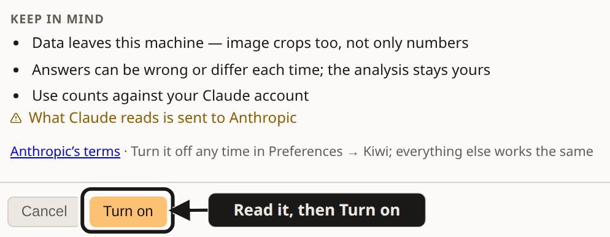
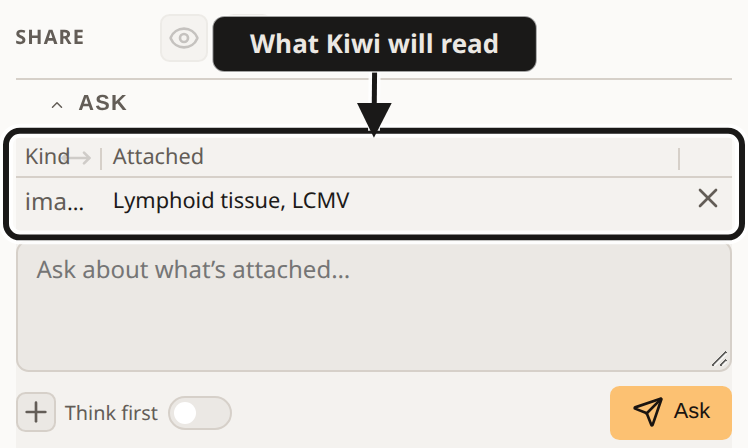
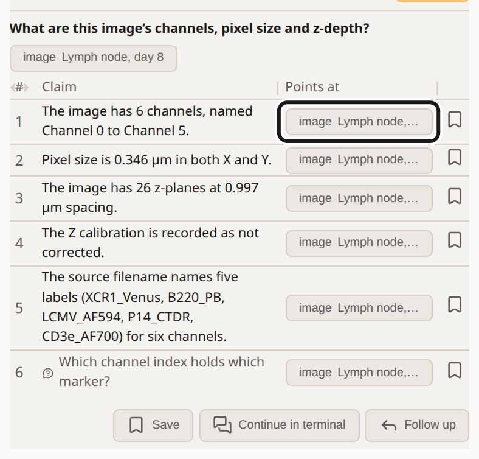
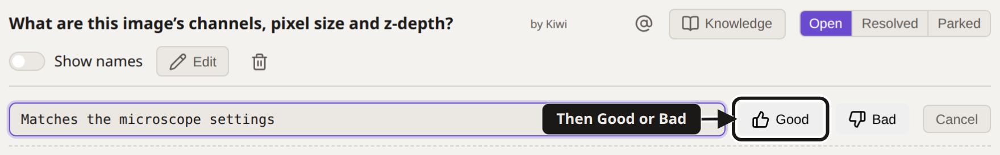

<!-- Generated by frontend/src/utils/usingAiDoc.ts — edit there, then `npx vitest run -u src/utils/usingAiDoc.test.ts`. -->

# Using AI in Cecelia

_Optional, off until you turn it on, and the analysis stays yours._

- **For:** anyone using Cecelia. No AI experience needed.
- **You get:** which of the two AI tools to open, how to turn AI on, and what leaves your computer when you do.
- **You need:** a Claude account; each Cecelia profile logs in once.
- **Ends at:** AI turned on, or deliberately left off, and your first Kiwi answer with its refs checked.

> [!WARNING]
> Everything in Cecelia works with AI off. What Claude reads is sent to Anthropic, so turning AI on is up to you, your lab and your data policy. Check your institute's rules for unpublished or patient data.

## Two ways in

### Kiwi

_Answers you can check, in the app_

- Every claim links to data it read
- Can’t change anything — enforced
- No terminal — just log in
- Attach anything on screen with @

Ask Kiwi at top right, or Share a frame. It points at the evidence; you decide.

### Claude Code

_In a terminal — it builds for you_

- Marks cells and tracks on your viewer
- Builds chains, boards and notebooks
- Proposes gates — edits only its own
- Writes lab-log and Blackboard entries

Start in terminal on Kiwi’s Chat row. You run what it builds.

## Words used here

- **Claim:** one fact in a Kiwi reply, on its own row.
- **Ref:** the clickable link on a claim to what it is about: an image, a population, a plot, a cell.
- **Blackboard:** the project’s shared notes page. Saved Kiwi replies, notes and shared frames live there.
- **Chain:** steps you settled on, wired together to run over a whole set of images.

> [!NOTE]
> “Checked” means Cecelia made sure every claim’s ref exists and that Kiwi actually read it. A claim that fails shows its number in red. Whether the data supports the claim is yours to judge. Replies are provisional — not checked against the biology.

Either can come first — Continue in terminal hands a Kiwi reply over via the Blackboard.

## What is sent to Anthropic

| When you use | What is sent to Anthropic |
|---|---|
| Ask Kiwi | Your question, and what Kiwi reads to answer it: names, notes, settings and numbers from the project, plus image crops and the frames you share |
| Review a claim | The claim and the project record behind it, image crops included |
| Review a test acquisition | The set’s acquisition plan and the movies’ record: settings, photon numbers, QC |
| Claude in your terminal | Whatever your Claude session asks Cecelia’s tools for — the project, results and images |
| Send a shared frame to your Claude session | A shared frame’s id and your note, to your own paired Claude session |

## Step by step

### 1. Turn AI on

**Do:** Open your avatar menu → **Preferences** → **Kiwi**, then switch on **AI features**.

**You’ll see:** The dialog **Turn on AI features?** opens. Read its **Keep in mind** list, then press **Turn on**. Turn it off any time in Preferences → Kiwi; everything else works the same.

**If it goes wrong:** The switch is greyed out and says "Turned off for this workstation": whoever looks after this computer turned AI off for everyone. Ask them; it is their call, not a fault.

### 2. Log in to Claude

**Do:** Press **Ask Kiwi** at the top right. On the **Account** row, press **Log in**.

**You’ll see:** A Claude sign-in page opens. Once you sign in, the Account row shows your account instead of **Not logged in**.

**If it goes wrong:** If the page does not hand you back to Cecelia, copy the code it shows into **Paste the code from the sign-in page**.

### 3. Point at it

**Do:** Press **@** on what puzzles you: a population or a plot. For an image, pick **Add to Kiwi** in its row’s **⋯** menu.

**You’ll see:** Kiwi opens with it listed under **Attached**, above the box you type your question in.

**If it goes wrong:** No **@** buttons and no **Add to Kiwi** anywhere: AI is still off for this profile (step 1).

> [!NOTE]
> To ask about something in the viewer instead, use the **Share** row in Kiwi: draw on the pop-out viewer and share the frame.

### 4. Ask Kiwi

**Do:** Type your question in **Ask** and press Ctrl+Enter.

**You’ll see:** A table of claims, one fact per row, each with its refs under **Points at**. Click a ref and Cecelia shows you what it points at; compare it with the claim. A row marked ? is a question back to you.

**If it goes wrong:** Kiwi answers **Can’t say from what I looked at.**: attach what the question is about and ask again. A claim number in red cites something Kiwi didn’t read; hover it for why, and don’t rely on that claim.

### 5. Keep it (optional)

**Do:** Press **Save** under a reply. On the Blackboard, press **Tag outcome**, write why, then **Good** or **Bad**.

**You’ll see:** The entry with your tag and note. Entries say **by Kiwi** or **by Claude**; gates Claude proposed carry ✦ **Proposed by Claude**.

**Why:** Replies expire after 50; the Blackboard keeps them. Bad tags are how Claude warns you when a failure comes back.

**If it goes wrong:** **Good** and **Bad** stay greyed out until you write the note: the reason is required.

[← Start here: what’s in Cecelia](README.md)
